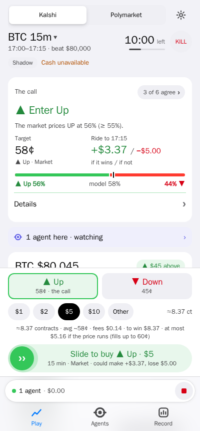
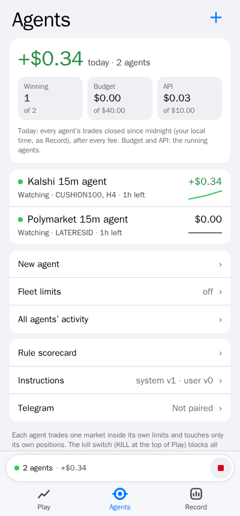
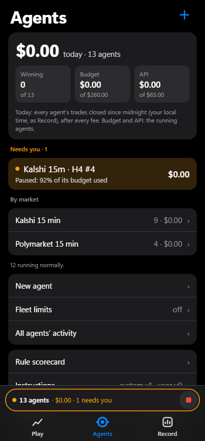
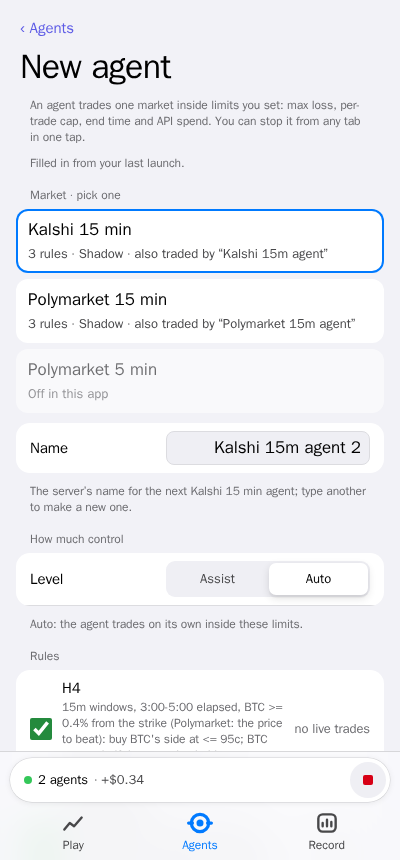
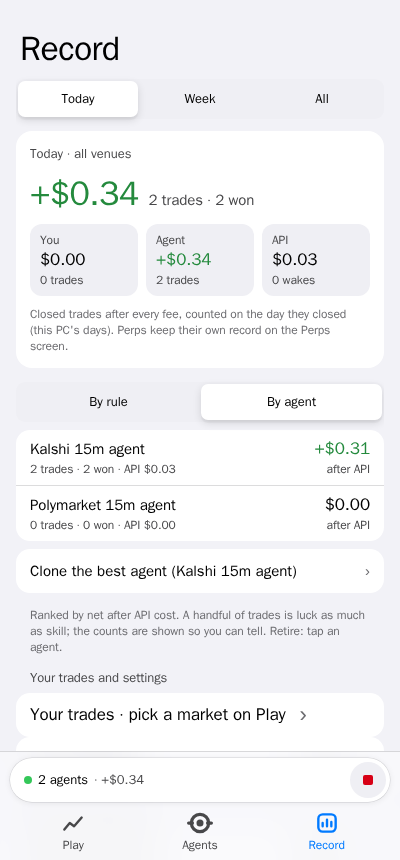
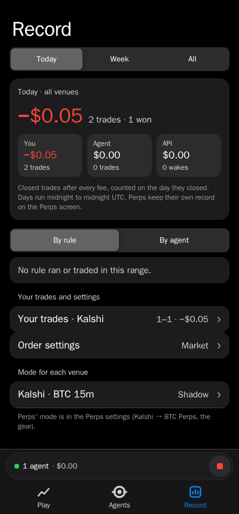

# Settleview

**See where the window is likely to settle, then make your own call.**

Settleview is a personal, local web app for short-window Bitcoin "Up or Down" prediction markets: the 15-minute
market on Kalshi and the 15- and 5-minute markets on Polymarket US. One screen (phone or desktop, light or dark)
shows you what the window is doing and what the market thinks. You make every decision and place every order
yourself.

> **Read this first.** Our own research found **no rule that beats the market price after fees** (see
> [`docs/research/LEARNINGS.md`](docs/research/LEARNINGS.md)). These markets are well calibrated. Settleview is a
> decision aid and a trading front end, not an edge. Expect to lose about the cost of trading over time.

## What it is

- A local app you run on your own computer: a FastAPI backend with a plain HTML/JS front end (Alpine.js and
  TradingView Lightweight Charts, vendored).
- One "Play" screen for Kalshi and Polymarket US, which works on a phone over your home network.
- A front end to **your own** venue accounts, using your own API keys and the venues' official Python SDKs.
- A research toolkit (`scripts/`, `docs/research/`) with pre-registered tests and honest write-ups, including the
  negative results.

## What it isn't

- **Not an unbounded trading bot.** On the Play screen a person makes every call and confirms every order with a
  deliberate slide. Agents (below) trade only inside limits you set when you start them, through the same order gate,
  and you can stop one or all in one tap.
- **Not a source of edge.** No tested rule survived the out-of-sample checks after fees.
- **Not a hosted service.** There is no internet-grade authentication. Never expose it to the internet; phones get
  HTTPS over your own tailnet (Tailscale), never the public internet.
- **Not financial advice.**

## Screenshots

Generated by the browser tests from the test app's own data (shadow mode: no real balances, accounts or orders).

| Play | Agents (a few) | Agents (many) |
|---|---|---|
|  |  |  |

| New agent | Record by agent | Record |
|---|---|---|
|  |  |  |

Desktop and dark versions of each are in [`docs/images/`](docs/images/). They are generated, not hand-made: the
browser tests write them in the Linux dev container from the test app's own data (`python scripts/dev.py test
tests/e2e/test_design_pass.py tests/e2e/test_fleet_ui.py`), and only images made there are committed.

## Features

Three tabs: **Play** (`/#play`), **Agents** (`/#agent`) and **Record** (`/#record`). Play is the main screen:

- **Venue and window**: Kalshi (15 min) or Polymarket US (15 min or 5 min), picked at the top and remembered.
- **The call**: a plain "enter / wait" verdict for the current window.
- **Price-to-beat chart**: live BTC against the window's strike, with the gap to the strike, signal chips, and odds
  and level overlays.
- **Market odds and trend**: the venue's live prices and how they moved over the last minute.
- **Model second opinion**: a random-walk estimate of the odds next to the market's. The research found it adds no
  information beyond the market price; it is shown for context.
- **Likely close range**: while you are in a trade, a 1σ / 2σ cone on the chart showing where BTC is likely to be
  when the window settles.
- **Hold vs. sell**: once you are in a trade, a HOLD / CONSIDER EXIT sentence and what each choice is worth in
  dollars.
- **Slide-to-confirm orders**: market orders (fill at the best offers, capped at 99c, worst case checked against
  your limits) or limit orders (a max price of the ask plus your tolerance). The server prepares the ticket; a slide
  approves it. Refusals are shown word for word.
- **Optional auto-sell / stop after entry**: off by default, set by you, and drawn on the chart.
- **Your limits**: per-trade and per-day limits that you set in the app (default: none). Raising or removing a limit
  needs a typed confirmation, and every change is audited.
- **Kill switch**: one button (top right) that stops all new entries in every mode and strategy.
- **Phone access**: sign in from your phone with a PIN that you set on the PC, over HTTPS on your tailnet
  (Tailscale, home or away) or on the home network.
- **Agents here**: one quiet line on Play when agents hold or watch the market you are looking at ("2 agents here ·
  one holds Up $1.00 (CUSHION100)"); tap it to see them.

The Agents tab (optional, `BTCFLOW_AGENT_ENABLED`): AI agents that trade inside bounded sessions you start. Every
agent order goes through the same prepare → order gate → approve path as your slide.

- **One agent, one market**: each agent trades a single market (Kalshi 15m, Polymarket 15m, Polymarket 5m) with its
  own name, rules, level (Assist proposes, Auto trades), budget, per-trade cap, end time, model and API cap. Run as
  many as you like; each touches only its own positions.
- **The fleet at a glance**: today's net, how many are winning, budget and API used; "Needs you" first in amber
  (a proposal waiting, a pause, a limit nearly used); one row per agent with its net and a tiny trend; many agents
  fold into markets and one "N running normally · best · worst" sentence.
- **One agent's screen**: its state in words, positions, latest trades, notes, settings and All activity across
  every run it has had (with a divider per run), plus a fleet-wide audit of every agent.
- **New agent**: pick one market first (its rules, mode and who else trades it), then the rest; a market without
  rules says the model judges alone. Type START, then slide to start. Presets per market.
- **Stop**: one agent stops in one tap from the bar above the tabs; several ask "Stop all?" on screen first.
- **Fleet limits** (off by default, set on the PC): a max loss and an API spend per day across all agents.

The Record tab: your results over today / the week / everything, split you / agents / API cost, **by rule** and
**by agent** (net after API cost, with Clone and Retire), your trades and each market's trading mode.

Running it: the same image and services on Windows, Linux and macOS (Docker, with Postgres 17 as the database and
nightly verified backups), or a portable supervisor without Docker (a SQLite file). The research recorders run as their own services, so a deploy or crash of the app never stops data
collection; the app tells you on Telegram when a recorder goes quiet for more than 2 minutes, and the daily summary
shows yesterday's coverage (5-minute windows recorded of 288, longest gap).

Observability: OpenTelemetry traces, metrics and logs from every service once you set an OTLP endpoint (off by
default), with each agent wake as a GenAI trace (model, tokens, cost, tool calls; never prompts or output) and tokens,
keys and headers scrubbed before anything leaves the process. An opt-in OpenObserve container is the local backend;
Azure Monitor, CloudWatch or any OTLP backend in the cloud ([docs/operations.md](docs/operations.md#observability-opentelemetry)).

The research-phase screens (Coach, strategy lab, rulesets, replay and others), their API routes and the unbounded
bots behind them have been removed from the app; their history stays in the database, and the offline research
toolkit stays in `scripts/` and `docs/research/`.

## Disclaimer

> **Settleview is not financial advice.** It can place **real-money** orders on your accounts when you switch it to
> production mode. Prediction markets are risky: you can lose the whole amount you put into a trade, and short
> windows move fast. Whether you are **eligible** to use Kalshi or Polymarket US where you live, and following their
> **terms of service** (including their API terms), is **your responsibility**. The software is provided "as is",
> **without warranty of any kind** (see [LICENSE](LICENSE)). The authors are not liable for any losses. Run it in
> shadow mode first and only risk money you can afford to lose.

## Requirements

- **Python 3.13** (the project pins `>=3.13,<3.14`).
- [uv](https://docs.astral.sh/uv/) for the environment and installs.
- A modern browser. A phone on the same network if you want phone access.
- Optional: API keys for Kalshi and/or Polymarket US (only needed for sandbox or production trading and the account
  view; shadow mode needs no keys).

**Tested platforms:**

| Platform | How it is tested |
| --- | --- |
| The dev container (Linux, the production base image; any host with Docker, amd64 or arm64) | development: the full test suite with the browser tests in Chromium, the Postgres tests, the quality gates, research scripts, evals and the README screenshots (`scripts/dev.py`) |
| Linux (ubuntu-latest, x64) | CI: the full test suite, import contracts, the Docker image and `docker compose config` |
| Linux, macOS, Windows (x64) | CI: the supervisor, `ops stop`, recorder and settings tests on all three |
| Docker (Linux containers) | CI builds the image and smoke-starts every compose service's entry point |
| Postgres 17 | CI: the full test suite again with the database on Postgres, empty-to-head migrations on both databases, the SQLite → Postgres copy tool, and a backup and restore drill of the compose stack |

Docker Desktop on Windows and macOS runs the same Linux containers; the dev container runs there too. A host install
without Docker needs `ta-lib` to install for that platform; if pip can't find a wheel, install the TA-Lib C library
first (see the [TA-Lib docs](https://ta-lib.github.io/ta-lib-python/install.html)).

## Quick start

**Docker Compose is the default, for local development and for production alike**: the same `compose.yaml` runs the
app, Postgres 17, both data recorders and the nightly backup on a laptop, a home server or a Swarm (and the same image
on Azure Container Apps or AWS with managed Postgres; see docs/operations.md, "Deploying to the cloud"). Any OS with
Docker (Docker Desktop on Windows and macOS).

```bash
git clone <this repo> settleview
cd settleview
cp .env.example .env                      # then edit it: keys, TZ=<your IANA zone>, BTCFLOW_ALLOWED_HOSTS=<this PC's LAN IP>
python deploy/postgres/make_secrets.py    # one random password per database role, in ./secrets (git-ignored)
docker build -t settleview:local .
docker compose up -d                      # app, postgres, rec-pm-quotes, rec-pm-settle, backup
docker compose ps                         # every service "healthy" after a minute
docker compose exec app python -m btc_signal_engine.ops pair-pc   # once: a one-time link that pairs this PC's browser
```

Open the link it prints (**http://localhost:8001/pair?code=...**) on this PC and press Pair: that browser is the PC
from then on (no PIN; a port alone never is). Phones use **http://<this PC's LAN IP>:8000** with the PIN (set it on
the PC's Phone access card; `BTCFLOW_PUBLIC_URL` in `.env` makes the card show that address). Kalshi key files are
mounted read-only from a git-ignored `compose.override.yaml` (docs/operations.md, "Docker: key files"). Moving an
existing SQLite install in: `ops migrate-sqlite-to-pg` (docs/operations.md).

**Without Docker** (a host that cannot run Docker; SQLite then): install the package into a Python 3.13 environment
of that host's choosing (`pip install .`, with `.[postgres]` for Postgres), then

```bash
cp .env.example .env        # Windows PowerShell: Copy-Item .env.example .env
```

Then edit `.env`. Every setting is optional, and the app starts with none of them set. `.env.example` lists the
general settings:

| Variable | What it does |
| --- | --- |
| `BTCFLOW_DB_PATH` | Where the SQLite database lives (all app state), when no Postgres URL is set; its folder also holds the logs. |
| `BTCFLOW_DATABASE_URL`, `BTCFLOW_DATABASE_PASSWORD_FILE` | Use Postgres instead (`postgresql://user@host:5432/database`; the password in a file). Needs the `postgres` extra (the image and the dev container have it; a host install: `pip install ".[postgres]"`). |
| `BTCFLOW_PREDICTION_HORIZONS` | The signal engine's horizons, as JSON name → seconds. |
| `BTCFLOW_TIE_POLICY` | How a close exactly at the strike scores (`kalshi` rule or `push`). |
| `BTCFLOW_BACKFILL_DAYS` | Days of history the `backfill` command downloads. |
| `BTCFLOW_KALSHI_BASE_URL` | Kalshi's public market-data API base URL. |
| `BTCFLOW_KALSHI_SERIES` | The Kalshi series to follow (15-minute BTC). |
| `BTCFLOW_KALSHI_FEE_RATE` | Kalshi's taker fee coefficient, used in every cost and P&L figure. |
| `BTCFLOW_MAX_ACTIVE_PER_HORIZON` | Signal engine: how many rulesets may decide per horizon (the leans behind Play's pressure chips). |
| `BTCFLOW_API_HOST` | Address the web server listens on. `127.0.0.1` (default) is this PC only; `0.0.0.0` enables phone access on the LAN. |
| `BTCFLOW_API_PORT` | Web server port (default 8000). |
| `BTCFLOW_WORKERS` | Must be 1 (one writer task and in-memory trading state). |
| `BTCFLOW_KALSHI_KEY_ID`, `BTCFLOW_KALSHI_PRIVATE_KEY_PATH` | Optional read-only Kalshi key: Play's Kalshi balance (cash and positions value). |

The trading settings are not in `.env.example` yet. They are read from the same `.env` (see
`btc_signal_engine/bootstrap/config.py`):

| Variable | What it does |
| --- | --- |
| `BTCFLOW_TRADING_ENABLED` | Master switch for **production** (real-money) trading. Off by default. |
| `BTCFLOW_TRADING_PROD_KEY_ID`, `BTCFLOW_TRADING_PROD_KEY_PATH` | Kalshi production trading key: the key id and the path to its private key file. |
| `BTCFLOW_TRADING_DEMO_KEY_ID`, `BTCFLOW_TRADING_DEMO_KEY_PATH` | Kalshi demo-exchange key for sandbox mode. |
| `BTCFLOW_POLYMARKET_KEY_ID`, `BTCFLOW_POLYMARKET_SECRET_KEY` | Polymarket US API key id and its secret. |
| `BTCFLOW_ACCESS_SESSION_HOURS` | How long a phone sign-in lasts (default 12 hours). |

**How keys are provided.** Kalshi keys are a key id plus a **path** to a private key file. Keep that file outside the
project folder; the app reads it into memory at start. The Polymarket US secret goes in `.env` itself. Keys are never
written to the database, logged, or sent to the browser. `.env` and `*.pem` are git-ignored: never commit them.

## Running

**With Docker** (any OS with Docker; nothing else to install):

```bash
python deploy/postgres/make_secrets.py   # once: random database passwords in ./secrets (never committed)
docker compose up -d --build     # Postgres, the backup job, the app and the two research recorders
docker compose ps                # each service healthy after a minute or two
docker compose logs -f app       # logs go to stderr; `docker compose logs` reads them
```

The database is Postgres 17 in its own container (not published to the network), with a nightly `pg_dump` kept 7
days plus 4 weeks. Settings come from a `.env` next to `compose.yaml` (optional) or from secret files
(`BTCFLOW_<NAME>_FILE`). On this PC open **http://localhost:8001** in a browser paired once with `docker compose exec
app python -m btc_signal_engine.ops pair-pc`; phones use `http://<this PC's LAN address>:8000` with the PIN; external
agents (MCP) call `http://localhost:8002` with their session token
([who counts as the PC](docs/operations.md#running-in-docker-who-counts-as-the-pc)). Docker Swarm:
`deploy/swarm/render_stack.py`, which never publishes the PC-only ports. Moving an existing SQLite database in
(`ops migrate-sqlite-to-pg`), backups and restores, cloud hosts with a managed Postgres:
[`docs/operations.md`](docs/operations.md#postgres). Telemetry (opt-in): `docker compose --profile observability up
-d` with `OTEL_EXPORTER_OTLP_ENDPOINT=http://openobserve:5080/api/default` in `.env`, then http://localhost:5080
([Observability](docs/operations.md#observability-opentelemetry)).

**Without Docker** (the host install above), the app alone:

```bash
python -m btc_signal_engine
```

or the app and the research recorders together, restarted when they exit (one log per process under `data/logs/`):

```bash
python -m btc_signal_engine.supervise
```

`deploy/` has thin examples to start it at boot (systemd, launchd, Windows Task Scheduler).

On first start the app downloads about 15 hours of Coinbase trades so the indicators have history (about a
minute), then collects live data. Run `python -m btc_signal_engine.ops pair-pc` once and open the link it prints
(**http://localhost:8000/pair?code=...**) to pair this PC's browser, then **http://127.0.0.1:8000/#play**.

Optional: `python -m btc_signal_engine backfill` downloads deeper history (`BTCFLOW_BACKFILL_DAYS`, 30 by default;
about 30 minutes) for the research tools.

## Phone access

1. In `.env`, set `BTCFLOW_API_HOST=0.0.0.0` and restart the app.
2. On the PC, open the settings sheet (the gear on the Play screen) and use the **Phone access** card to set a 4–8
   digit PIN. Until a PIN is set, every request from another device is refused. The card shows the phone URL
   (`http://<PC LAN address>:8000/#play`). It only works from the PC itself.
3. Allow the port through the firewall on your **private** network profile only. On Windows (PowerShell as
   administrator):

   ```powershell
   New-NetFirewallRule -DisplayName "Settleview 8000 (Private)" -Direction Inbound -Protocol TCP -LocalPort 8000 -Action Allow -Profile Private
   ```

4. On the phone, open the URL and sign in with the PIN. "Add to Home Screen" opens straight into Play.

The PIN is stored only as a salted PBKDF2 hash. Five wrong PINs from one phone lock it out for 15 minutes. Every
restart signs out all phones.

### Phones over HTTPS (Tailscale, recommended)

On the LAN port the PIN and session cookie cross your network in clear text. With Docker, phones can use HTTPS
instead, at home and away, with no port opened anywhere: the opt-in `tailscale` compose service joins your tailnet as
`settleview` and serves `https://settleview.<tailnet>.ts.net` to the app (Tailscale Serve; never Funnel, so never the
public internet).

1. Tailscale admin console: turn on MagicDNS and HTTPS Certificates; merge
   [`deploy/tailscale/policy.hujson`](deploy/tailscale/policy.hujson) into your access controls; generate a
   one-off auth key (not reusable, not ephemeral, tag `tag:settleview`, 1 day) and save it as `secrets/ts_authkey`.
2. In `.env`: `COMPOSE_PROFILES=tailscale`, `BTCFLOW_FORWARDED_ALLOW_IPS=10.89.250.2` and
   `BTCFLOW_PUBLIC_URL=https://settleview.<tailnet>.ts.net`; then `docker compose --profile tailscale up -d`.
3. On each phone: install Tailscale, sign in, open `https://settleview.<tailnet>.ts.net`, enter the PIN.
4. Once every phone uses it, close the LAN port: `BTCFLOW_PHONE_BIND=127.0.0.1` in `.env`.

Session cookies are then `Secure` and the app sends HSTS. Details, key rotation and the security notes:
[`docs/operations.md`](docs/operations.md), "Phones over HTTPS (Tailscale)".

**Without it there is no HTTPS.** Use the LAN port only on your home network. **Never port-forward the port to the
internet**, and don't put another reverse proxy in front on the same machine (without a PC listener it would make
every request look local).

## Trading modes and safety

Each venue has a mode, shown on screen at all times:

- **Shadow** (no keys, no money): the real order path against a simulated exchange that fills on the venue's real
  public order book. Start here.
- **Sandbox** (Kalshi only): Kalshi's demo exchange with demo money. It needs a demo key.
- **Production**: **real money**. It needs `BTCFLOW_TRADING_ENABLED=true`, a production key, and the typed
  confirmation "I understand this uses real money" when you switch.

Guards that apply in every mode:

- **A human approves every order.** The server prepares a ticket, and a fresh approval token bound to that exact
  ticket is needed to send it. An agent in Assist proposes and waits for your Approve; an agent in Auto approves its
  own tickets only inside the session you started (its budget, per-trade cap, end time and API cap), through the same
  gate.
- **The order gate** checks every entry: positions reconciled with the venue, market open with enough time left, the
  price within your limit (market orders: worst case at 99c plus fee), and your limits against logged exposure.
- **Your limits** (default none, set in the app) and, in production, your venue's available cash. Each gateway also
  has a hard notional ceiling per order (`BTCFLOW_TRADING_ORDER_HARD_CEILING`) that catches bugs; it is not a
  trading limit.
- **Kill switch**: blocks every new entry in every mode. Resuming asks for confirmation.
- **No silent fallbacks.** A missing or unreadable setting refuses entries with a message instead of guessing (for
  example, unreadable limits block entries until you save them again). The UI never fills gaps with sample data.
- **Venue guards.** Kalshi requests go through the official `kalshi_python_async` SDK behind our adapter, which
  enforces a series allow-list, a notional cap and a signing allow-list. The SDK's own retries are off, so our retry
  loop is the only one. Polymarket US calls use the official `polymarket_us` SDK for everything.

There is no auto-approve and no bot: every order is a slide you make.

## Architecture

A hexagonal layout, enforced by [import-linter](https://import-linter.readthedocs.io/) contracts in `.importlinter`:

- `btc_signal_engine/domain/`: pure, deterministic logic (features, the signal rules, the fair-odds model, settlement
  rules, the Play read model). No I/O.
- `btc_signal_engine/application/`: use cases (trading service and order gate, Play, limits, the Coach evaluation,
  the signal engine, settlement) that talk to the outside only through ports (`application/ports.py`).
- `btc_signal_engine/adapters/`: all I/O.
  - `adapters/kalshi/`: Kalshi REST (official SDK under our guarded backend), WebSocket, shadow exchange.
  - `adapters/polymarket_us/`: Polymarket US (official SDK), market data, streams, shadow exchange.
  - `adapters/coinbase/`: the BTC trade feed and backfill.
  - `adapters/sqlite/`: storage and migrations, one code path for SQLite and Postgres (the name is historical).
  - `adapters/http/`: the FastAPI routes and phone access.
- `btc_signal_engine/bootstrap/`: settings and wiring.
- `web/`: the front end (`web/views/play.js` is the Play screen and Record, `web/views/agent.js` the Agents tab).

The contracts are: layers only import downward (bootstrap > adapters > application > domain); domain and application
import no I/O libraries; only the adapters import Kalshi's SDK. The HTTP API is described in
[`docs/api.md`](docs/api.md), and design plans are in [`docs/plans/`](docs/plans/).

## Testing

Production runs in Linux containers, and so does all development: the tests, the quality gates, the research scripts
and the evals run in a Linux dev container on any host (`deploy/dev/`: the production base image, the project's
dependencies, Playwright's Chromium, and this checkout bind-mounted, so edits need no rebuild). No virtualenv: the
host needs Docker and any Python 3 to start it (`scripts/dev.py` is standard library only), or only uv
(`uv run --no-project python scripts/dev.py ...`). The first run builds the image (a few minutes), later runs reuse
it:

```bash
python scripts/dev.py test                   # the whole suite, browser tests and import contracts included
python scripts/dev.py test tests/kalshi -x   # any pytest arguments
python scripts/dev.py postgres-tests         # the Postgres-only tests on a throwaway Postgres 17 (--full: whole suite)
python scripts/dev.py quality                # quality gates: Ruff, import contracts, Hadolint, ShellCheck, Trivy
python scripts/dev.py evals test             # the agent evals' tests (evals run pipelines/pr.toml: the PR gate)
python scripts/dev.py shell                  # a shell in the container
```

The dev container is its own compose project (`settleview-dev`): it never touches the running app's containers,
volumes or ports, and publishes none. The quality gates run the same pinned tools as CI (Ruff in the dev container;
Trivy, Hadolint and ShellCheck from their official containers); `--only ruff` runs just the linter. Details:
[docs/operations.md, "Quality gates"](docs/operations.md#quality-gates-ruff-trivy-hadolint-shellcheck).

The tests build their own data (fixtures, fakes and in-memory exchanges). They need no network, keys or local
database. `postgres-tests` starts a Postgres with no published port, runs the tests against it (they make and use
their own `settleview_test` database) and removes it. Against a server of your own (from the container, the host is
`host.docker.internal` on Docker Desktop):

```bash
python scripts/dev.py test --db-url postgresql://postgres:<password>@host.docker.internal:5432/postgres
# without --db-url the tests marked `postgres` are skipped; `postgres-tests` refuses a skip
```

## Research

Every trading idea that was tested is in [`docs/research/LEARNINGS.md`](docs/research/LEARNINGS.md) (the hypothesis
register), with write-ups next to it in `docs/research/`. The harness is `scripts/experiments.py`. The honesty rules
are in [`AGENTS.md`](AGENTS.md): write the rule and the pass bar before looking, score at prices that really traded
with exact fees, judge on a holdout with a multiple-testing correction, and record negative results. The research
databases are local only (`data/` is git-ignored), so the scripts need data you collect yourself. They run in the dev
container with that data read-only: `python scripts/dev.py experiments report`, `python scripts/dev.py script
scripts/test_human_rules.py` (outputs go to new files under `data/research/` and to `docs/research/`).

## Project status

- Personal project, in active use by its author. Expect breaking changes.
- Venues: Kalshi BTC 15-minute; Polymarket US BTC 15- and 5-minute.
- Planned: renaming the repository and Python package (`btc_signal_engine`) to Settleview; adding the
  trading settings to `.env.example`; moving the database to Postgres in its own container.

## Contributing

See [CONTRIBUTING.md](CONTRIBUTING.md). Report security issues privately as described in [SECURITY.md](SECURITY.md).
Everyone taking part is expected to follow the [Code of Conduct](CODE_OF_CONDUCT.md).

## License

Settleview is **source-available, not OSI open source**. It is licensed under the
[PolyForm Noncommercial License 1.0.0](LICENSE) (Required Notice: Copyright (c) 2026 Jon Lange).

- **Free** for personal use, hobby projects, research, education, and charitable or other noncommercial
  organizations: use it, change it and share it under the license's terms (keep the license and the notice with it).
- **Commercial use needs a separate license** from the copyright holder.

Commercial licenses available — contact the copyright holder via GitHub ([github.com/jon-lange](https://github.com/jon-lange)).

## Credits

- [TradingView Lightweight Charts™](https://www.tradingview.com/lightweight-charts/) draws the charts (Apache-2.0,
  Copyright (c) 2025 TradingView, Inc., https://www.tradingview.com/). [Alpine.js](https://alpinejs.dev/) runs the
  web app (MIT; its CSP build, so the page's security policy allows no runtime code). Both are vendored unmodified in `web/vendor/` with their licenses; see [NOTICE](NOTICE).
- [OpenObserve](https://openobserve.ai/) is the optional local logs, metrics and traces backend (AGPL-3.0). It runs
  as its own unmodified upstream container (the opt-in `observability` profile) and is not part of this work; none of
  its code is in this repository.
- Python dependencies (see `pyproject.toml`) are installed from PyPI under their own licenses.
