<!-- Generated by Documenter Agent v0.1.0
     Timestamp: 2026-11-19T16:14:46.714399+00:00
     Source: 71fae626398ed5e7e10c4024e76a363d8da327ce
     Keywords: AdoptBody, ApproveBody, BandBody, ExitBody, FileValueSource, FilledShown, HeartbeatBody, IndexStopBody, LaunchBody, LightShown, LimitsBody, LineShown, ModeBody, MuteBody, NoteBody
-->

# Data Model

<!-- provenance -->
> **Extracted fact** from the code at commit `71fae62`, produced by static analysis with no AI model. Safe to rely on.

Deterministically extracted from schema sources (SQL, Pydantic, TypeScript, OpenAPI). No LLM was used to produce this map.

```mermaid
erDiagram
    PinBody {
        str pin "required"
        str pin_again "required"
    }
    LaunchBody {
        Any kind "required"
        Any agent_id "required"
        Any market "required"
        Any venues "required"
        Any name "required"
        Any budget "required"
        Any per_trade "required"
        Any ends_ts "required"
        Any minutes "required"
        Any spend_cap "required"
        Any model "required"
        Any sell_on_stop "required"
        Any rules "required"
        Any one_bet_per_window "required"
        Any level "required"
        Any proposal_ttl_s "required"
        str___None confirm
    }
    RuleStatusBody {
        str rule "required"
        str status "required"
        str___None reason
        str___None confirm
    }
    ResumeBody {
        str___None confirm
    }
    ProposalBody {
        str id "required"
    }
    RenameBody {
        Any name "required"
    }
    NoteBody {
        str text "required"
    }
    SaveBody {
        Literal__system____user layer "required"
        str text "required"
    }
    RestoreBody {
        Literal__system____user layer "required"
        int version "required"
    }
    ResetBody {
        Literal__system____user layer "required"
    }
    PauseBody {
        bool paused "required"
    }
    LightShown {
        str rule "required"
        Literal__grey____amber____green state "required"
    }
    LineShown {
        Literal__ready____setup____warning____context____hold kind "required"
        str text "required"
        str___None rule
    }
    WarningShown {
        list_str keys "required"
        str text "required"
    }
    FilledShown {
        str rule "required"
        Literal__UP____DOWN side "required"
        float max_price "required"
        float___None stop
    }
    Shown {
        Literal__quiet____full mode "required"
        Literal__UP____DOWN side "required"
        float___None ask
        list_LightShown lights "required"
        LineShown___None line
        WarningShown___None warning
        FilledShown___None filled
        float___None btc
        float___None strike
        float___None btc_gap
        int___None left_ms
    }
    ShownBody {
        str strategy "required"
        str bracket_id "required"
        Shown shown "required"
    }
    PrepareBody {
        Literal__entry____add action "required"
        Literal__long____short side "required"
        float collateral "required"
        float leverage "required"
        float___None stop_loss
        float___None take_profit
        Literal__market____all_or_nothing____limit fill "required"
        float___None limit_price
        float___None band
    }
    PrepareExitBody {
        Literal__reduce____close action "required"
        float___None count
    }
    PrepareTriggerBody {
        float___None stop_loss
        float___None take_profit
    }
    ApproveBody {
        str token "required"
        dict_str__Any shown "required"
    }
    AdoptBody {
        float size_shown "required"
    }
    ModeBody {
        Literal__perp_demo____perp_prod____off mode "required"
        str___None confirm
    }
    BandBody {
        int___None cents
    }
    LimitsBody {
        float___None per_trade
        float___None per_day
        str___None confirm
    }
    MuteBody {
        Any session_id "required"
        Any muted "required"
    }
    PresetBody {
        Any name "required"
        Any launch "required"
    }
    ExitBody {
        str bracket_id "required"
        str strategy "required"
    }
    TakeProfitBody {
        str bracket_id "required"
        float price "required"
        str strategy "required"
    }
    IndexStopBody {
        str bracket_id "required"
        float___None level
        str strategy "required"
    }
    HeartbeatBody {
        bool visible "required"
    }
    FileValueSource {
    }
    Settings {
        Path db_path "required"
        SecretStr___None database_url
        SecretStr___None database_password
        SecretStr___None research_database_url
        SecretStr___None research_database_password
        int db_statement_timeout_ms "required"
        int db_lock_timeout_ms "required"
        int db_idle_in_transaction_timeout_ms "required"
        int db_long_statement_timeout_ms "required"
        float db_pool_timeout_s "required"
        float db_migration_lock_wait_s "required"
        Literal__auto____check db_migrate "required"
        Path___None research_dir
        bool file_log "required"
        Literal__DEBUG____INFO____WARNING____ERROR http_client_log_level "required"
        dict_str__int prediction_horizons "required"
        Literal__kalshi____push tie_policy "required"
        int backfill_days "required"
        int trades_retention_days "required"
        int decision_lag_ms "required"
        str kalshi_base_url "required"
        str kalshi_series "required"
        float kalshi_fee_rate "required"
        str___None kalshi_key_id
        Path___None kalshi_private_key_path
        bool staging "required"
        bool trading_enabled "required"
        str___None trading_demo_key_id
        Path___None trading_demo_key_path
        str___None trading_prod_key_id
        Path___None trading_prod_key_path
        str___None polymarket_key_id
        SecretStr___None polymarket_secret_key
        int trading_max_open_positions "required"
        float trading_order_hard_ceiling "required"
        bool perps_enabled "required"
        bool agent_enabled "required"
        SecretStr___None anthropic_api_key
        Path___None agent_cli_path
        bool agent_allow_production "required"
        int agent_wake_concurrency "required"
        str agent_env_pass "required"
        SecretStr___None telegram_bot_token
        str___None telegram_bot_username
        int perps_subaccount "required"
        float perps_protective_band "required"
        float perps_warn_amber "required"
        float perps_warn_red "required"
        float perps_order_hard_ceiling "required"
        float trading_stop_slippage "required"
        int trading_approval_ttl_s "required"
        int trading_presence_timeout_s "required"
        bool trading_stream "required"
        int modes_shadow_place_latency_ms "required"
        int modes_shadow_cancel_latency_ms "required"
        int max_active_per_horizon "required"
        str api_host "required"
        int api_port "required"
        float access_session_hours "required"
        str allowed_hosts "required"
        str local_clients "required"
        int___None pc_port
        str___None pc_host
        int___None agent_port
        str___None agent_host
        str public_url "required"
        str forwarded_allow_ips "required"
        int workers "required"
    }
    Shown }o--o{ LineShown : "line"
    Shown }o--o{ WarningShown : "warning"
    Shown }o--o{ FilledShown : "filled"
    ShownBody }o--o{ Shown : "shown"
```

## Entities

### PinBody
_Source: pydantic (/tmp/documenter-718bdd8a-0prr0_74/repo/btc_signal_engine/adapters/http/access.py)_

| Field | Type | Nullable |
| --- | --- | --- |
| pin | `str` | no |
| pin_again | `str` | no |

### LaunchBody
_Source: pydantic (/tmp/documenter-718bdd8a-0prr0_74/repo/btc_signal_engine/adapters/http/agent_routes.py)_

| Field | Type | Nullable |
| --- | --- | --- |
| kind | `Any` | no |
| agent_id | `Any` | no |
| market | `Any` | no |
| venues | `Any` | no |
| name | `Any` | no |
| budget | `Any` | no |
| per_trade | `Any` | no |
| ends_ts | `Any` | no |
| minutes | `Any` | no |
| spend_cap | `Any` | no |
| model | `Any` | no |
| sell_on_stop | `Any` | no |
| rules | `Any` | no |
| one_bet_per_window | `Any` | no |
| level | `Any` | no |
| proposal_ttl_s | `Any` | no |
| confirm | `str | None` | yes |

### RuleStatusBody
_Source: pydantic (/tmp/documenter-718bdd8a-0prr0_74/repo/btc_signal_engine/adapters/http/agent_routes.py)_

| Field | Type | Nullable |
| --- | --- | --- |
| rule | `str` | no |
| status | `str` | no |
| reason | `str | None` | yes |
| confirm | `str | None` | yes |

### ResumeBody
_Source: pydantic (/tmp/documenter-718bdd8a-0prr0_74/repo/btc_signal_engine/adapters/http/agent_routes.py)_

| Field | Type | Nullable |
| --- | --- | --- |
| confirm | `str | None` | yes |

### ProposalBody
_Source: pydantic (/tmp/documenter-718bdd8a-0prr0_74/repo/btc_signal_engine/adapters/http/agent_routes.py)_

| Field | Type | Nullable |
| --- | --- | --- |
| id | `str` | no |

### RenameBody
_Source: pydantic (/tmp/documenter-718bdd8a-0prr0_74/repo/btc_signal_engine/adapters/http/agent_routes.py)_

| Field | Type | Nullable |
| --- | --- | --- |
| name | `Any` | no |

### NoteBody
_Source: pydantic (/tmp/documenter-718bdd8a-0prr0_74/repo/btc_signal_engine/adapters/http/agent_routes.py)_

| Field | Type | Nullable |
| --- | --- | --- |
| text | `str` | no |

### SaveBody
_Source: pydantic (/tmp/documenter-718bdd8a-0prr0_74/repo/btc_signal_engine/adapters/http/agent_routes.py)_

| Field | Type | Nullable |
| --- | --- | --- |
| layer | `Literal['system', 'user']` | no |
| text | `str` | no |

### RestoreBody
_Source: pydantic (/tmp/documenter-718bdd8a-0prr0_74/repo/btc_signal_engine/adapters/http/agent_routes.py)_

| Field | Type | Nullable |
| --- | --- | --- |
| layer | `Literal['system', 'user']` | no |
| version | `int` | no |

### ResetBody
_Source: pydantic (/tmp/documenter-718bdd8a-0prr0_74/repo/btc_signal_engine/adapters/http/agent_routes.py)_

| Field | Type | Nullable |
| --- | --- | --- |
| layer | `Literal['system', 'user']` | no |

### PauseBody
_Source: pydantic (/tmp/documenter-718bdd8a-0prr0_74/repo/btc_signal_engine/adapters/http/coach_routes.py)_

| Field | Type | Nullable |
| --- | --- | --- |
| paused | `bool` | no |

### LightShown
_Source: pydantic (/tmp/documenter-718bdd8a-0prr0_74/repo/btc_signal_engine/adapters/http/copilot_routes.py)_

| Field | Type | Nullable |
| --- | --- | --- |
| rule | `str` | no |
| state | `Literal['grey', 'amber', 'green']` | no |

### LineShown
_Source: pydantic (/tmp/documenter-718bdd8a-0prr0_74/repo/btc_signal_engine/adapters/http/copilot_routes.py)_

| Field | Type | Nullable |
| --- | --- | --- |
| kind | `Literal['ready', 'setup', 'warning', 'context', 'hold']` | no |
| text | `str` | no |
| rule | `str | None` | yes |

### WarningShown
_Source: pydantic (/tmp/documenter-718bdd8a-0prr0_74/repo/btc_signal_engine/adapters/http/copilot_routes.py)_

| Field | Type | Nullable |
| --- | --- | --- |
| keys | `list[str]` | no |
| text | `str` | no |

### FilledShown
_Source: pydantic (/tmp/documenter-718bdd8a-0prr0_74/repo/btc_signal_engine/adapters/http/copilot_routes.py)_

| Field | Type | Nullable |
| --- | --- | --- |
| rule | `str` | no |
| side | `Literal['UP', 'DOWN']` | no |
| max_price | `float` | no |
| stop | `float | None` | yes |

### Shown
_Source: pydantic (/tmp/documenter-718bdd8a-0prr0_74/repo/btc_signal_engine/adapters/http/copilot_routes.py)_

| Field | Type | Nullable |
| --- | --- | --- |
| mode | `Literal['quiet', 'full']` | no |
| side | `Literal['UP', 'DOWN']` | no |
| ask | `float | None` | yes |
| lights | `list[LightShown]` | no |
| line | `LineShown | None` | yes |
| warning | `WarningShown | None` | yes |
| filled | `FilledShown | None` | yes |
| btc | `float | None` | yes |
| strike | `float | None` | yes |
| btc_gap | `float | None` | yes |
| left_ms | `int | None` | yes |

### ShownBody
_Source: pydantic (/tmp/documenter-718bdd8a-0prr0_74/repo/btc_signal_engine/adapters/http/copilot_routes.py)_

| Field | Type | Nullable |
| --- | --- | --- |
| strategy | `str` | no |
| bracket_id | `str` | no |
| shown | `Shown` | no |

### PrepareBody
_Source: pydantic (/tmp/documenter-718bdd8a-0prr0_74/repo/btc_signal_engine/adapters/http/perp_routes.py)_

| Field | Type | Nullable |
| --- | --- | --- |
| action | `Literal['entry', 'add']` | no |
| side | `Literal['long', 'short']` | no |
| collateral | `float` | no |
| leverage | `float` | no |
| stop_loss | `float | None` | yes |
| take_profit | `float | None` | yes |
| fill | `Literal['market', 'all_or_nothing', 'limit']` | no |
| limit_price | `float | None` | yes |
| band | `float | None` | yes |

### PrepareExitBody
_Source: pydantic (/tmp/documenter-718bdd8a-0prr0_74/repo/btc_signal_engine/adapters/http/perp_routes.py)_

| Field | Type | Nullable |
| --- | --- | --- |
| action | `Literal['reduce', 'close']` | no |
| count | `float | None` | yes |

### PrepareTriggerBody
_Source: pydantic (/tmp/documenter-718bdd8a-0prr0_74/repo/btc_signal_engine/adapters/http/perp_routes.py)_

| Field | Type | Nullable |
| --- | --- | --- |
| stop_loss | `float | None` | yes |
| take_profit | `float | None` | yes |

### ApproveBody
_Source: pydantic (/tmp/documenter-718bdd8a-0prr0_74/repo/btc_signal_engine/adapters/http/perp_routes.py)_

| Field | Type | Nullable |
| --- | --- | --- |
| token | `str` | no |
| shown | `dict[str, Any]` | no |

### AdoptBody
_Source: pydantic (/tmp/documenter-718bdd8a-0prr0_74/repo/btc_signal_engine/adapters/http/perp_routes.py)_

| Field | Type | Nullable |
| --- | --- | --- |
| size_shown | `float` | no |

### ModeBody
_Source: pydantic (/tmp/documenter-718bdd8a-0prr0_74/repo/btc_signal_engine/adapters/http/perp_routes.py)_

| Field | Type | Nullable |
| --- | --- | --- |
| mode | `Literal['perp_demo', 'perp_prod', 'off']` | no |
| confirm | `str | None` | yes |

### BandBody
_Source: pydantic (/tmp/documenter-718bdd8a-0prr0_74/repo/btc_signal_engine/adapters/http/play_routes.py)_

| Field | Type | Nullable |
| --- | --- | --- |
| cents | `int | None` | yes |

### LimitsBody
_Source: pydantic (/tmp/documenter-718bdd8a-0prr0_74/repo/btc_signal_engine/adapters/http/play_routes.py)_

| Field | Type | Nullable |
| --- | --- | --- |
| per_trade | `float | None` | yes |
| per_day | `float | None` | yes |
| confirm | `str | None` | yes |

### MuteBody
_Source: pydantic (/tmp/documenter-718bdd8a-0prr0_74/repo/btc_signal_engine/adapters/http/telegram_routes.py)_

| Field | Type | Nullable |
| --- | --- | --- |
| session_id | `Any` | no |
| muted | `Any` | no |

### PresetBody
_Source: pydantic (/tmp/documenter-718bdd8a-0prr0_74/repo/btc_signal_engine/adapters/http/telegram_routes.py)_

| Field | Type | Nullable |
| --- | --- | --- |
| name | `Any` | no |
| launch | `Any` | no |

### ExitBody
_Source: pydantic (/tmp/documenter-718bdd8a-0prr0_74/repo/btc_signal_engine/adapters/http/trading_routes.py)_

| Field | Type | Nullable |
| --- | --- | --- |
| bracket_id | `str` | no |
| strategy | `str` | no |

### TakeProfitBody
_Source: pydantic (/tmp/documenter-718bdd8a-0prr0_74/repo/btc_signal_engine/adapters/http/trading_routes.py)_

| Field | Type | Nullable |
| --- | --- | --- |
| bracket_id | `str` | no |
| price | `float` | no |
| strategy | `str` | no |

### IndexStopBody
_Source: pydantic (/tmp/documenter-718bdd8a-0prr0_74/repo/btc_signal_engine/adapters/http/trading_routes.py)_

| Field | Type | Nullable |
| --- | --- | --- |
| bracket_id | `str` | no |
| level | `float | None` | yes |
| strategy | `str` | no |

### HeartbeatBody
_Source: pydantic (/tmp/documenter-718bdd8a-0prr0_74/repo/btc_signal_engine/adapters/http/trading_routes.py)_

| Field | Type | Nullable |
| --- | --- | --- |
| visible | `bool` | no |

### FileValueSource
_Source: pydantic (/tmp/documenter-718bdd8a-0prr0_74/repo/btc_signal_engine/bootstrap/config.py)_

_No fields extracted._

### Settings
_Source: pydantic (/tmp/documenter-718bdd8a-0prr0_74/repo/btc_signal_engine/bootstrap/config.py)_

| Field | Type | Nullable |
| --- | --- | --- |
| db_path | `Path` | no |
| database_url | `SecretStr | None` | yes |
| database_password | `SecretStr | None` | yes |
| research_database_url | `SecretStr | None` | yes |
| research_database_password | `SecretStr | None` | yes |
| db_statement_timeout_ms | `int` | no |
| db_lock_timeout_ms | `int` | no |
| db_idle_in_transaction_timeout_ms | `int` | no |
| db_long_statement_timeout_ms | `int` | no |
| db_pool_timeout_s | `float` | no |
| db_migration_lock_wait_s | `float` | no |
| db_migrate | `Literal['auto', 'check']` | no |
| research_dir | `Path | None` | yes |
| file_log | `bool` | no |
| http_client_log_level | `Literal['DEBUG', 'INFO', 'WARNING', 'ERROR']` | no |
| prediction_horizons | `dict[str, int]` | no |
| tie_policy | `Literal['kalshi', 'push']` | no |
| backfill_days | `int` | no |
| trades_retention_days | `int` | no |
| decision_lag_ms | `int` | no |
| kalshi_base_url | `str` | no |
| kalshi_series | `str` | no |
| kalshi_fee_rate | `float` | no |
| kalshi_key_id | `str | None` | yes |
| kalshi_private_key_path | `Path | None` | yes |
| staging | `bool` | no |
| trading_enabled | `bool` | no |
| trading_demo_key_id | `str | None` | yes |
| trading_demo_key_path | `Path | None` | yes |
| trading_prod_key_id | `str | None` | yes |
| trading_prod_key_path | `Path | None` | yes |
| polymarket_key_id | `str | None` | yes |
| polymarket_secret_key | `SecretStr | None` | yes |
| trading_max_open_positions | `int` | no |
| trading_order_hard_ceiling | `float` | no |
| perps_enabled | `bool` | no |
| agent_enabled | `bool` | no |
| anthropic_api_key | `SecretStr | None` | yes |
| agent_cli_path | `Path | None` | yes |
| agent_allow_production | `bool` | no |
| agent_wake_concurrency | `int` | no |
| agent_env_pass | `str` | no |
| telegram_bot_token | `SecretStr | None` | yes |
| telegram_bot_username | `str | None` | yes |
| perps_subaccount | `int` | no |
| perps_protective_band | `float` | no |
| perps_warn_amber | `float` | no |
| perps_warn_red | `float` | no |
| perps_order_hard_ceiling | `float` | no |
| trading_stop_slippage | `float` | no |
| trading_approval_ttl_s | `int` | no |
| trading_presence_timeout_s | `int` | no |
| trading_stream | `bool` | no |
| modes_shadow_place_latency_ms | `int` | no |
| modes_shadow_cancel_latency_ms | `int` | no |
| max_active_per_horizon | `int` | no |
| api_host | `str` | no |
| api_port | `int` | no |
| access_session_hours | `float` | no |
| allowed_hosts | `str` | no |
| local_clients | `str` | no |
| pc_port | `int | None` | yes |
| pc_host | `str | None` | yes |
| agent_port | `int | None` | yes |
| agent_host | `str | None` | yes |
| public_url | `str` | no |
| forwarded_allow_ips | `str` | no |
| workers | `int` | no |
