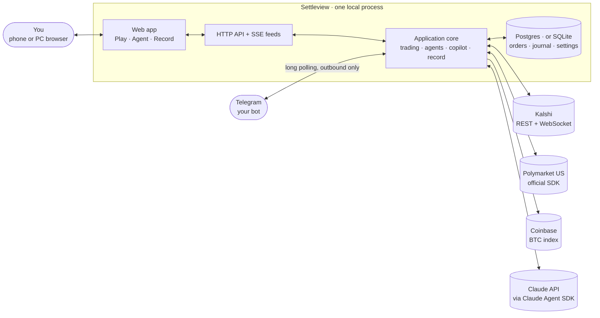
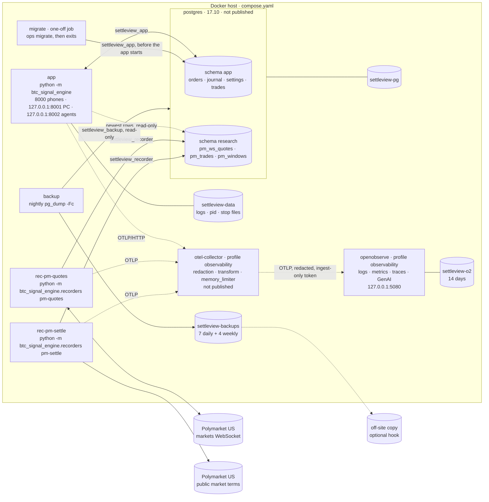
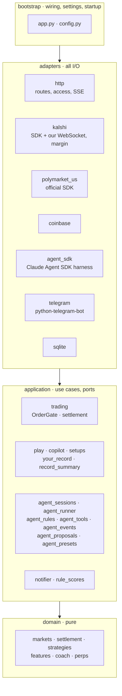
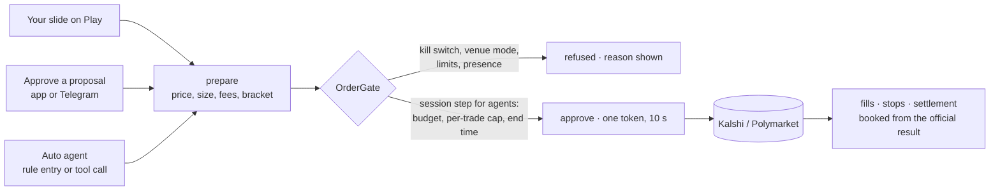
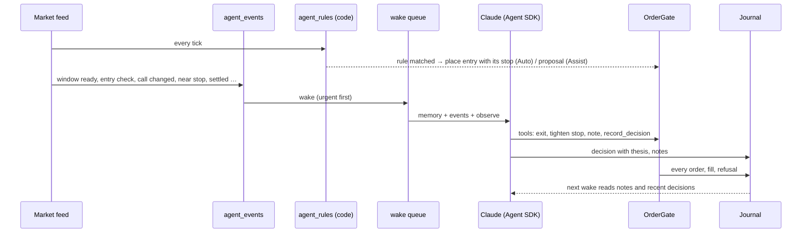
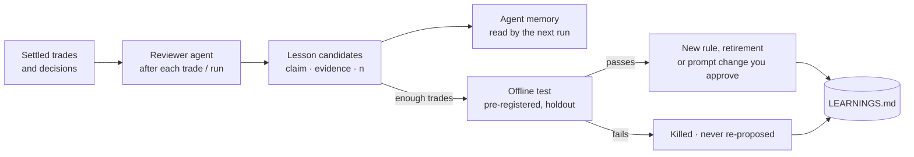

# Architecture

Settleview is one Python app process (FastAPI + asyncio) with a plain HTML/JS front end, a database (Postgres 17 in
every deployment; a SQLite file on a host without Docker and in tests, through the same code), and
adapters for each outside service, plus two small research recorder processes next to it (section 2). The code is hexagonal: `domain/` is pure, `application/` holds the use cases and
talks to the outside only through ports, `adapters/` do the I/O, and `bootstrap/` wires it together. The layering is
enforced by `lint-imports` (`.importlinter`).

## 1. System context

LAN or VPN only: the app is never exposed to the internet. Keys live in secret files (`./secrets` with Docker; `.env` without) and never leave the process.

## 2. Services (how it runs)

One image, one process per service, the same on Windows, Linux and macOS. With Docker the services are in
`compose.yaml`; without Docker the portable supervisor runs the same entry points as child processes.

In the cloud the `postgres` and `backup` services are replaced by the platform's managed Postgres (Azure Database for
PostgreSQL Flexible Server, Amazon RDS): automated backups, point-in-time restore, patching and failover by the
platform; the app sees only `BTCFLOW_DATABASE_URL`. Without Docker, the portable supervisor runs the same three Python
processes on a SQLite file (`btcflow.db`) and the recorders' file (`polymarket_us.db`).

- **Failure domains are split.** A deploy or crash of the app never stops data collection; a recorder never touches
  trading and gets only the Polymarket key it needs (read-only market data; the settlement recorder needs none).
- **Each service restarts on its own** (compose `restart: unless-stopped`, Swarm / cloud `replicas: 1`; or the
  supervisor's backoff) and has a liveness check: the app's `/api/health`, each recorder's newest-row age
  (`python -m btc_signal_engine.ops fresh`).
- **The app watches the recorders** read-only (application/recorder_health.py): a Telegram `data` alert after 2
  minutes of silence and when one is back, and yesterday's coverage in the daily summary.
- **Configuration** is environment only (`.env`, or `BTCFLOW_<NAME>_FILE` secrets); logs go to stderr in containers.
- **Telemetry is OpenTelemetry, off until an endpoint is set** (docs/operations.md, "Observability"): each service
  exports traces, metrics and logs over OTLP/HTTP to the OpenTelemetry Collector (`otel-collector`,
  deploy/otel-collector/config.yaml), whose standard redaction and transform processors remove tokens, keys, key
  paths, headers, query values and client addresses before anything reaches a backend; the services emit no prompts
  or bodies and hold no backend credential. An agent wake is a GenAI span with its tool calls as children. Locally the
  collector forwards to the opt-in `openobserve` service; in the cloud the same collector configuration runs beside
  the services (Azure Monitor, CloudWatch via ADOT, any OTLP backend).
- **Every service has a memory and CPU limit** (docs/operations.md, "Resource limits and Postgres settings"); Postgres's
  memory settings are sized to its limit.
- **One database server, four roles** (docs/operations.md, "Postgres"): `settleview_app` writes the schema `app` (the
  app, the migrate job) and only reads `research`; `settleview_recorder` writes `research` (the recorders) and cannot
  reach `app` at all; `settleview_research` reads only (research scripts: "research is read-only" is a database
  permission); `settleview_backup` reads everything for `pg_dump`. Passwords are secret files.
- **Migrations are a one-off job** (`migrate`), finished before the app starts; the app only checks the revision.
- **One code path, two databases.** The store's SQL is dialect-neutral SQLAlchemy (per-dialect `ON CONFLICT`,
  `RETURNING`); each engine sets its schema on the connection, so the same statements run on SQLite and Postgres.
  CI runs the whole suite on both and checks that every migration gives the same tables, columns and indexes.

## 3. Layers

## 4. One order path for everyone

A person's slide, an Assist approval (in the app or on Telegram) and an Auto agent all reach the venue through the
same gate. Nothing has a side door.

## 5. An agent run

Rules are code and run every tick; the model is woken only by events and decides with the same signals you see.

## 6. Learning loop (planned)

## Where things live

| Path | What |
| --- | --- |
| `btc_signal_engine/domain/` | Pure models: markets, settlement, strategies, features |
| `btc_signal_engine/application/` | Use cases: trading and the OrderGate, Play, agents, copilot, notifier, record |
| `btc_signal_engine/adapters/` | Kalshi, Polymarket US, Coinbase, Claude Agent SDK, Telegram, HTTP, the database (SQLite or Postgres) |
| `btc_signal_engine/bootstrap/` | Settings and wiring; the supervisor, `ops` commands and the recorders' entry point |
| `compose.yaml`, `Dockerfile`, `deploy/` | The services, the image, and thin start-at-boot examples per OS |
| `web/` | The front end (Alpine.js views, Lightweight Charts) |
| `scripts/` | Research harness (`experiments.py`) and tools |
| `docs/research/LEARNINGS.md` | The hypothesis register: every result, including the losses |
| `docs/plans/` | Plans for each feature |
| `tests/` | Unit, API, agent, Telegram and browser (Playwright) tests |
