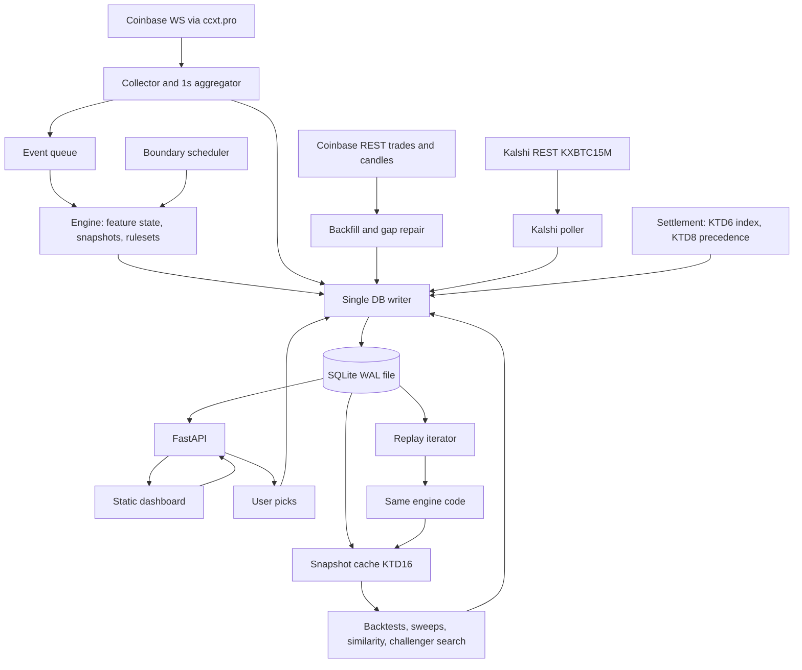
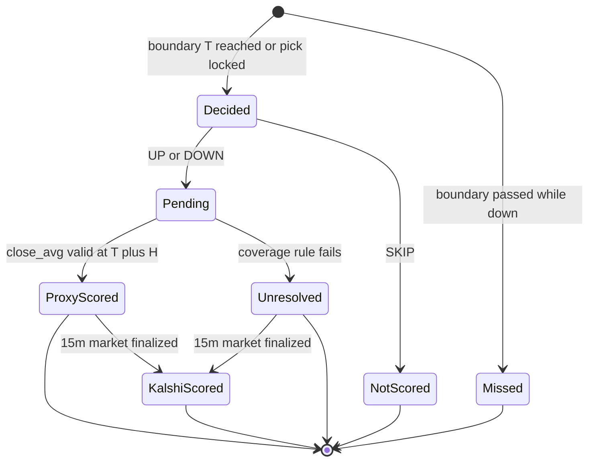
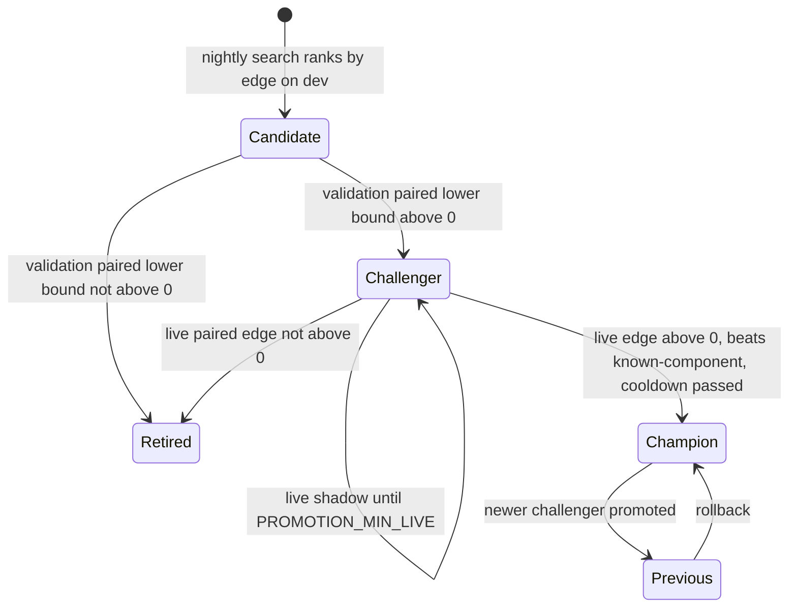
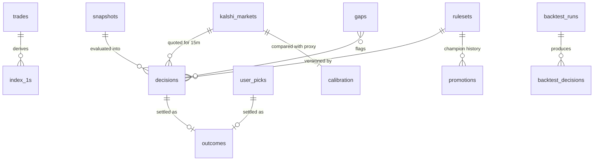
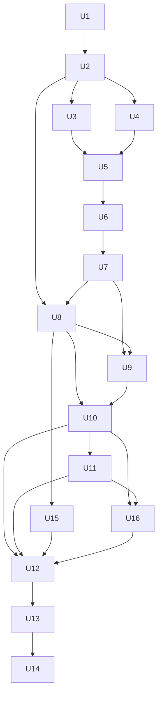

# BTC Flow Multi-Horizon Signal Engine - Plan

## Goal Capsule

- **Objective:** On a local dashboard, the user sees what the engine calls (UP, DOWN or SKIP) for the next 1, 5 and 15 minutes of BTC. They can make their own call next to it, then watch each call play out and get scored the way Kalshi would settle it. Over time the user can see, from their own database, how accurate the engine and they themselves have been, what the odds looked like in similar past conditions, and whether the engine is actually improving.
- **Means:** One lightweight Python service (collector, rules engine, settlement, self-improvement and API) writing to a single SQLite file, with a plain HTML/JS dashboard designed to explain itself (KTD1, KTD2).
- **Authority:** Product Contract requirements win on behavior. KTDs win on mechanism. Units override neither.
- **Stop conditions:** Stop and ask if:
  - Kalshi changes the KXBTC15M settlement rule or API shape;
  - Coinbase public trade history stops being reachable;
  - any requirement would need real-money trading or exchange order placement.
- **Execution profile:** Greenfield repo `btc-flow-engine/`. Release 1 is the whole plan (U1–U16), run locally. Build in dependency order, slice-first (see Sequencing), so a working data-to-scored-call path exists early.
- **Who finishes:** `ce-work` or a human implementer. The user runs it locally and reviews results. Publishing to a home server is follow-up work.

---

## Product Contract

### Summary

Build a local, self-explaining research platform that does five things:
- Collects Coinbase BTC-USD market data around the clock.
- Has versioned deterministic rules make UP/DOWN/SKIP calls at each horizon's clock-aligned start.
- Lets the user make their own call alongside the engine's.
- Scores every call with Kalshi's settlement rule.
- Uses the stored history for what-if odds, backtests, parameter sweeps, version comparison, and an automatic champion/challenger loop that promotes better rule versions only when they win on unseen data.

### Problem Frame

BTC Flow today is a browser-only page. It streams exchange data and fires heuristic alerts (engulfing, hammer, EMA 9/21 crossover with a volume filter, whale prints, book walls). But it stores nothing, so nobody can tell whether those signals predict anything.

The user wants to learn whether short-horizon BTC direction can be called better than chance, with Kalshi-style up/down contracts as the target. They also want to practice making calls themselves. That needs evidence rather than intuition:
- every call recorded, the engine's and the user's;
- every call scored by the rule Kalshi uses;
- results explained in plain language and compared against honest baselines, so a lucky streak or a built-in statistical artifact is not mistaken for skill.

Two external constraints shape the work. Binance is geo-blocked from the user's network, so Coinbase is the only usable exchange feed. Kalshi lists only a 15-minute BTC up/down contract, so 1m and 5m have no external settlement truth.

### Requirements

**Data collection**
- R1. A collector runs independently of any browser and persists Coinbase BTC-USD data:
  - trades, with price, size, aggressor side, trade ID, and exchange and ingest timestamps;
  - best bid/ask;
  - top-of-book depth metrics.
- R2. Duplicates, out-of-order events, reconnects, restarts and gaps are handled; every gap is recorded with its start, end and cause.
- R3. Historical Coinbase trades and candles can be backfilled for a configurable number of days, and gaps after a restart are filled from the same source.
- R4. Kalshi KXBTC15M markets are recorded: strike, open/close times, quotes at decision time, and final result and expiration value. Settled history can be backfilled.

**Features and rules**
- R5. A deterministic feature library computes the requested feature set over 5/15/30/60/180/300/900-second windows. It uses only data available at the decision timestamp, and completed candles for close-dependent features.
- R6. Prediction horizons are configuration-driven (initially 1m=60s, 5m=300s, 15m=900s). Every horizon has independent rule parameters, lookbacks, filters, history, statistics and settlement.
- R7. Rules are versioned rulesets that declare supported horizons, required features, entry and exclusion conditions, thresholds, direction and explanation text. Strategies A–E ship as initial hypotheses, defined in KTD19.
- R8. Any horizon may use features from any timeframe; the horizon only sets the settlement point.

**Decisions and settlement**
- R9. At each horizon's clock-aligned start, every active ruleset for that horizon emits UP, DOWN, SKIP or MISSED. Each decision carries the reference price, the full feature snapshot, data-quality flags, the ruleset version and a plain-language explanation.
- R10. Outcomes follow Kalshi's rule for every horizon (KTD6). The possible outcomes are WIN, LOSS, TIE, UNRESOLVED and NOT_SCORED.
- R11. 15m outcomes use Kalshi's published result when available and our proxy otherwise. Each outcome records which source scored it, and both values are kept for calibration.
- R12. Expected return uses the real Kalshi ask price and fee where a contract exists, and otherwise a labeled payout assumption whose default is set by KTD15.

**Research and evaluation**
- R13. A replay engine runs the same engine code over stored history, reconstructing exactly what was available at each decision time.
- R14. Backtests report, per horizon:
  - win rate, signal frequency and skip rate;
  - expected return;
  - streaks and drawdown;
  - uncertainty;
  - regime breakdown;
  - stability over time.

  They use chronological dev/validation/out-of-sample splits with purge gaps.
- R15. A Scenario Lab runs parameter sweeps per horizon or across all horizons. It reports observation counts and uncertainty with every number, and shows how many combinations were tried.
- R16. Similarity lookup finds past snapshots in the same feature bins and reports per-horizon UP frequency, sample size and uncertainty, using only data before the query time.
- R17. Live shadow mode records every active ruleset's decisions. It keeps separate live performance per horizon and version, shown side by side with that version's backtest results.

**Learning loop (user and engine)**
- R23. Before each window opens, the user can make their own UP or DOWN call per horizon. It is scored by the same rule as the engine and compared with the engine, the baselines and (for 15m) Kalshi's price (KTD18).
- R24. The engine improves itself over time with a per-horizon champion/challenger loop that automatically promotes a challenger only under KTD17. Every promotion is logged with its evidence and can be rolled back in one click.
- R25. A what-if panel takes either a moment (now or any past time) or user-entered conditions. For each horizon it shows the historical UP frequency in similar conditions with n and an interval, the known-component baseline (KTD15), the Kalshi-implied price where available, and what the champion would call.

**Dashboard and operations**
- R18. The dashboard shows 1 MIN, 5 MIN and 15 MIN cards with drill-in per horizon. Each card shows:
  - the decision, reference price, and timestamp with freshness;
  - the main conditions and the ruleset;
  - the win rate, only when evaluated data supports it, with sample size and interval;
  - the last scored result;
  - the user's own pick.
- R19. The dashboard has these views: Live Signals, My Calls, Decision History, What-If, Scenario Lab, Strategy Performance, Rulesets and Historical Replay. Active signals stay visibly separate from past decisions.
- R20. The user can clone a ruleset, edit its parameters, and activate it or make it champion without editing code.
- R21. No number is shown as a probability or win rate unless it comes from evaluated observations meeting the minimum sample size and appears with its interval. No simulated data is shown as real.
- R26. Every decision, outcome and statistic has a plain-language explanation. For a decision that means why the call was made and what then happened. For a statistic it means what the number means, why the baseline matters, and why a small sample is not evidence. Terms come with built-in glossary help, so the dashboard teaches as it is used.
**Real-time and Kalshi in the loop**
- R27. Between official calls, each card shows a live lean recomputed every second from the same rules: the direction the champion would call now, how strongly, and what would flip it. Live leans are never scored.
- R28. The 15m card shows Kalshi's live yes/no prices for the current window, polled from public data and stored as a time series, alongside the engine's call.
- R29. The user can link their Kalshi account read-only with an API key stored only on their machine; their real fills and positions are imported and shown against the engine's calls and the settled outcome. No order placement.
- R30. A bankroll simulation replays the calls a version (or the user) actually made over a chosen span with a starting amount and stake rule, buying contracts at real Kalshi asks (15m) or a labeled fair-price assumption, and reports ending balance, return, drawdown and every trade. For 15m, a challenger is promoted only if its simulated profit at real Kalshi prices over its live shadow period is positive (KTD17).
- R22. The service is configured only through environment variables and files, runs unchanged on Windows ARM64 and Linux, and ships with a container image and deployment notes.

### Key Decisions

- **Kalshi is the scoring model.** UP/DOWN follows Kalshi's KXBTC15M rule on every horizon, so 1m/5m/15m results are comparable to what a Kalshi trade would have paid. Governs R10, R11, R12. (session-settled: user-directed — chosen over scoring on a single Coinbase trade at expiry: the user named Kalshi as the target.)
- **History lives in our own database.** The service accumulates and backfills its own history rather than depending on a third-party historical store. Governs R1, R3, R4, R13. (session-settled: user-directed — chosen over relying on exchange history at query time: the user asked to store history in our DB.)
- **Very lightweight, off-the-shelf.** Three pieces: a static frontend, one Python process and one SQLite file, built on maintained libraries rather than hand-written math or charting. Governs R22. (session-settled: user-directed — chosen over the requested multi-component DuckDB/Parquet stack: the user asked for a very lightweight front end, back end and DB, plus off-the-shelf libraries.)
- **Local first, server-ready.** Release 1 runs on the laptop. The same build later deploys to a home server without a rewrite. Governs R22. (session-settled: user-directed — chosen over a laptop-only tool: the user plans to publish to their own home web later.)
- **Clock-aligned decisions.** Each horizon decides only at its own boundaries, mirroring how Kalshi markets open. Governs R9, R14. (session-settled: user-approved — chosen over continuous rolling evaluation, which remains available as research snapshots.)
- **Measure, tune, compare is the core loop.** Rulesets are immutable versions, and the dashboard compares versions on identical history and live windows. Governs R17, R20, R24. (session-settled: user-directed — the user's stated ideal state is seeing whether predictions are accurate and adjusting the algorithm.)
- **The user plays too.** The user makes their own calls alongside the engine's. Governs R23. (session-settled: user-directed — chosen over engine-calls-only and user-picks-only.)
- **The whole platform is release 1.** Backtests, Scenario Lab, similarity, what-if, replay and self-improvement all ship in the first local release. Governs R13–R17, R24, R25. (session-settled: user-directed — chosen over a clean-core-first release with research tools later.)
- **The engine auto-promotes.** When a challenger passes the promotion rule, it becomes champion without asking, and the switch is logged and reversible. Governs R24. (session-settled: user-directed — chosen over ask-before-promoting.)
- **Real-time lean, live Kalshi prices and a read-only account link are in scope; trading is planned separately.** Human-confirmed Kalshi orders get their own plan before any trading code exists. Governs R27, R28, R29. (session-settled: user-directed — chosen over keeping Kalshi to settlement data only: the user wants the engine's calls compared against the real market and their real positions, with the human making any trade.)
- **Clean and educational UX.** The dashboard is easy to understand and explains itself. Governs R18, R19, R26. (session-settled: user-directed — the user asked for a clean, easy-to-understand, educational experience.)

### Acceptance Examples

- AE1. Covers R9, R10. Given the 12:00:00 UTC boundary, when the engine runs, then the 1m, 5m and 15m rulesets each emit one decision, settling at 12:01:00, 12:05:00 and 12:15:00, and their outcomes are scored independently.
- AE2. Covers R10. Given a 15m window where the 60s average before close equals the 60s average before open to the cent, then the outcome is UP under the Kalshi tie policy: an UP decision is a WIN and a DOWN decision is a LOSS.
- AE3. Covers R11. Given a 15m decision whose Kalshi market finalized with `result: "no"` while our proxy says UP, then the outcome is DOWN with source `kalshi`, and the disagreement is kept for calibration.
- AE4. Covers R2, R9. Given the laptop slept from 12:03 to 12:20, then:
  - the 1m, 5m and 15m boundaries in that span are recorded as MISSED;
  - windows whose settlement minute fails the coverage rule (KTD6) are UNRESOLVED unless Kalshi provides the result.
- AE5. Covers R21. Given a ruleset with 12 settled non-SKIP decisions on 5m, then its card shows "not enough results yet (12 of 30)" and no win rate.
- AE6. Covers R13, R17. Given ruleset v2 is cloned from v1 with a higher pressure threshold, when both are backtested on the same window, then results are reported on identical decision timestamps, as a paired comparison, beside each version's live results since activation.
- AE7. Covers R23. Given the user taps UP for 5m at 12:04:40, then the pick locks for the 12:05–12:10 window. At 12:10 it is scored by the same rule as the engine, and My Calls shows the user's record next to the engine's and the baselines. A tap at 12:05:03 applies to the next window (12:10–12:15), not the one that already opened.
- AE8. Covers R24, R21. Given challenger v8 beats champion v5 on validation but its paired live interval still includes zero after the minimum live sample, then v8 is not promoted, and the Rulesets view says why in plain words.
- AE9. Covers R14, R21, R26. Given a 1m ruleset with a 74% win rate while the known-component baseline wins 75% on the same decisions, then its edge is shown as about −1 point and the explanation says the headline win rate came from the scoring rule, not from skill.

### Success Criteria

- Within a week of continuous local collection:
  - every horizon shows settled live decisions with sample sizes and intervals;
  - 15m proxy outcomes agree with Kalshi's published results on at least 98% of windows (otherwise the proxy composition is revisited per KTD7).
- On day one, after backfill, the user can backtest the 15m strategies against at least 30 days of real Kalshi results.
- Re-running a backtest on the same data and ruleset version gives identical results.
- Expectations are set honestly in the UI. Published out-of-sample evidence suggests short-horizon BTC direction accuracy around 50–55% (AUC ≈ 0.54 in one study), and confirming a 52% edge takes on the order of thousands of calls. The dashboard shows how far each result is from that bar.

### Scope Boundaries

- No real-money trading and no Kalshi order placement in this plan; a separate plan covers human-confirmed orders. A Kalshi API key is used only for read-only portfolio endpoints (R29).
- No user accounts or login in release 1. The API binds to localhost by default.
- The hosted chatgpt.site page is not changed; the extended dashboard is a new local copy.
- Futures data is never mixed into spot features or settlement.
- Considered and not built:
  - **A separate message queue or worker tier.** One process with a single writer handles about 10 trades/s comfortably. Revisit if ingest lag stays above 1s.
  - **Authenticated Kalshi WebSocket quotes.** REST polling at boundaries is enough for decision-time quotes. Revisit if sub-second quote freshness matters.
  - **Raw order-book storage, whether L2 deltas or top-10 snapshots.** No unit reads it, and Coinbase book history cannot be backfilled anyway. The per-second derived book metrics are kept forever. Revisit if a strategy needs depth beyond the 10 and 25 bps metrics.
  - **A "validated" label for similarity results.** Similarity stays labeled "historical frequency" with n and interval. Revisit if similarity is used beyond display and filtering.
  - **Reusing NautilusTrader, Freqtrade or hftbacktest as the engine.** None supports Windows ARM64 together with binary up/down scoring, and Freqtrade is candle-based. Revisit if the project moves to Linux-only and needs execution simulation.
  - **Machine-learning models.** The engine stays deterministic, and "improves itself" means rule-parameter search under KTD17. Revisit only after the deterministic baselines are understood.

#### Deferred to Follow-Up Work

- Publishing to a home server: reverse proxy, HTTPS, login for anything that writes (picks, clones, promotions, jobs), and off-box backups.
- Additional exchanges in the settlement proxy (Kraken, Bitstamp, Gemini via ccxt), only if calibration misses the 98% target.
- DuckDB for heavy analytics over the SQLite file.
- A validated reversal strategy to replace Strategy C's default SKIP.

### Sources

- Existing BTC Flow source (reference implementation): `index.html`, `app.js`, `rules.js`, `alerts.js` at https://btc-flow-live-ironman.mightyearth14.chatgpt.site/
- Kalshi public API, `https://api.elections.kalshi.com/trade-api/v2`. Endpoints used: `/markets?series_ticker=KXBTC15M&status=open|settled` and `/series/KXBTC15M`. Rule text comes from `rules_primary`. A settled market's object `status` reads `finalized`.
- Kalshi docs on rate limits and WebSocket auth: https://docs.kalshi.com/getting_started/rate_limits and https://docs.kalshi.com/websockets/websocket-connection
- CF Benchmarks BRTI, which is licensed and has no free feed: https://www.cfbenchmarks.com/indices/BRTI
- Coinbase Exchange public API: `https://api.exchange.coinbase.com/products/BTC-USD/{trades,candles,book}` and `wss://ws-feed.exchange.coinbase.com`
- Prior art used for baselines and expectations:
  - simple-kalshi-bot, a Python paper bot with "repeat previous result" and "60s momentum" strategies;
  - arXiv 2608.21888, which reports AUC ≈ 0.54 out of sample;
  - arXiv 2607.09426, on boundary effects;
  - pykalshi, a pure-Python Kalshi client.

---

## Planning Contract

### Key Technical Decisions

- KTD1. **Stack.** All of these have prebuilt Windows-ARM64 wheels, verified by dry-run install on 2026-10-28. statsmodels, pandas-ta (via numba), arch and pyarrow do not, so they are excluded. (session-settled: user-directed — chosen over hand-rolled clients/math: the user asked for off-the-shelf libraries.)
  - Python 3.12, with FastAPI and uvicorn (one worker).
  - SQLAlchemy Core and Alembic on SQLite in WAL mode.
  - pydantic-settings for env config.
  - ccxt (bundled `ccxt.pro`) for exchange WebSockets and REST, and httpx for Kalshi.
  - numpy/pandas for windows, TA-Lib for indicators and scipy for intervals.
  - APScheduler for boundary and nightly jobs.
  - pytest, hypothesis and time-machine for tests.
- KTD2. **Frontend.** Static HTML/CSS/JS served by FastAPI, with no build step. Alpine.js 3.x drives view state, one component per view that owns its fetch and state, with chart code in plain modules. TradingView Lightweight Charts 5.x draws the charts. Both libraries are vendored into `web/vendor/` at pinned versions, so the dashboard works offline and on a home server without CDN egress. The design reuses BTC Flow's dark style tokens and layout. The dashboard reads only our API and no longer connects to exchanges. (session-settled: user-directed — chosen over a framework SPA: the user asked for very lightweight.)
- KTD3. **SQLite as the single store, with one writer.** All writes go through one asyncio writer task that batches commits, every 250ms by default. Read paths use separate read-only connections. Backtests, sweeps and challenger searches run in a `ProcessPoolExecutor(max_workers=1)` job queue and return results to the writer. Multi-worker uvicorn is unsupported and refused at startup. (session-settled: user-approved — chosen over DuckDB/Parquet: it's built into Python, tolerant of continuous small writes, and one file to copy to a server.)
- KTD4. **One engine for live and replay.** The engine consumes an ordered stream of normalized events and boundary ticks: trades, plus the per-second `bbo_1s` and `book_metrics_1s` aggregates exactly as persisted. It never consumes raw ticker or book updates. Live feeds it from the collector queue and replay feeds it from the database, so there is no live-only code path. This is what makes backtest-vs-forward comparison fair (R13, R17).
- KTD5. **Availability rule.** A decision at boundary T sees only events with `exchange_ts < T` and `ingest_ts <= T + 2s`.
  - Per-second aggregates carry `ingest_ts` = the time the aggregate was emitted.
  - Replay applies the same filter using stored `ingest_ts`.
  - Backfilled events get `ingest_ts = exchange_ts` and a `backfilled` flag.
  - Candle-close features use only candles whose close time is ≤ T.
- KTD6. **Settlement rule (owner of the label definition).**
  - Each window [T, T+H] has an `open_avg` (the mean of the 60 one-second index prices in [T−60s, T)) and a `close_avg` (the same over [T+H−60s, T+H)), both rounded to cents.
  - The outcome direction is UP iff `close_avg >= open_avg`. Under `tie_policy=kalshi`, the default, an exact tie therefore counts as UP (AE2). Under `tie_policy=push`, a tie scores TIE and is excluded from the win rate.
  - The reference entry price is `open_avg`.
  - **Index price per second:** the last Coinbase trade price at or before that second, carried forward. It is identical in live and backfill. The BBO mid is stored only as a diagnostic.
  - **Coverage:** an average is valid when at least 54 of its 60 seconds have a price no older than 5s. Otherwise the outcome is UNRESOLVED unless Kalshi supplies the result.
  - For 1m, the open and close windows are adjacent, which is Kalshi's construction scaled to one minute. KTD15 handles the consequence.
- KTD7. **Proxy index v1 is Coinbase only, per KTD6.** Each finalized KXBTC15M market's `expiration_value` and `floor_strike` are compared with our `close_avg` and `open_avg`. The comparison is stored in `calibration` with direction agreement and the dollar-error distribution. U10 uses the p95 dollar error to flag *proxy-uncertain* windows on every horizon (|close_avg − open_avg| below that error) and reports win rates with and without them. Adding more exchanges is deferred until agreement drops below 98%.
- KTD8. **15m scoring source precedence.** A finalized Kalshi `result` wins over our proxy. Proxy outcomes are re-scored when Kalshi finalizes later; the overwrite is logged and the proxy value kept. For decisions in windows with a listed market, we store `kalshi_ticker`, `floor_strike`, `yes_ask` and `no_ask` from the first poll after T where both sides are quoted, within 30s. If no two-sided quote appears, the 15m EV for that decision is unavailable, not guessed.
- KTD9. **Retention.** These are kept forever: trades, 1-second BBO, book metrics (spread, depth within 10 bps and 25 bps per side, imbalance), the index, candles, snapshots, decisions, user picks, outcomes, Kalshi records and promotions. Raw L2 data is not persisted, since ccxt keeps the book in memory. Expected growth is about 35–45 MB/day.
- KTD10. **A ruleset is filters plus signal rules plus per-horizon params, and is immutable.**
  - Strategy D's filters run first and can veto to SKIP with a reason. Book-dependent checks are *not applicable* on backfilled periods: they are skipped and the decision carries a `book_unavailable` flag.
  - Signal rules (A, B, C, E) then run in declared order, combined as `first_match` or `unanimous`.
  - Version identity is `name@N` plus a SHA-256 over the canonical JSON of params, each rule module's `RULE_VERSION`, and `FEATURE_LIB_VERSION`.
  - Seed rulesets live in `rulesets/*.toml`, parsed with stdlib `tomllib`. New versions come from clone-and-edit, sweeps or the challenger search, and are stored in the DB.
  - A golden-feature test fails if feature output changes without a `FEATURE_LIB_VERSION` bump.
- KTD11. **Snapshots every minute; official decisions at horizon boundaries.** Every whole minute the engine stores one feature snapshot plus per-horizon research labels. These labels overlap for 5m/15m and are flagged as such. Snapshots are cached per (time range, `FEATURE_LIB_VERSION`) (KTD16). Official decisions per horizon happen only at that horizon's aligned boundaries.
- KTD12. **Statistics.**
  - Win rates get Wilson 95% intervals (scipy).
  - Expected return, overlapping research labels and paired version differences get moving-block bootstrap intervals (numpy). The block length is at least 2 for official 1m decisions, because consecutive windows share an average.
  - The minimum n to show a win rate is 30 settled non-SKIP decisions (`MIN_SAMPLE`).
  - Kalshi taker fees are modeled as `ceil_to_cent(0.07 × C × P × (1 − P))`. That formula comes from secondary sources and stays in config, labeled unverified until checked against Kalshi's fee schedule.
- KTD13. **Evaluation splits.** Splits are chronological, 60/20/20 for dev/validation/out-of-sample, with a purge gap between them of max feature lookback plus horizon. Sweeps rank on dev and report validation. Out-of-sample is evaluated only through an explicit "final check" action. Every such check is logged and counted per ruleset, and the count is shown beside every out-of-sample number.
- KTD14. **Boundary scheduler.**
  - APScheduler cron jobs fire at second 0 of each aligned minute, with `misfire_grace_time = 2s`.
  - Wall-vs-monotonic clock comparison detects sleep. Boundaries that passed while asleep are written as MISSED and never computed late.
  - Clock skew (`ingest_ts − exchange_ts`, median over 60s) is logged. Skew above 1s sets a data-quality flag that makes Strategy D skip.
  - On startup the engine hydrates its feature state by replaying stored events covering the maximum lookback, including candle history, with decisions disabled, before boundaries are enabled.
- KTD15. **Baselines.** Every result is shown next to four baselines computed on the same decisions:
  1. **Known-component baseline:** UP iff the last index price at T is above `open_avg`. Because `open_avg` is already known at T, this trivial rule wins about 75% of 1m windows, about 59% of 5m and about 55% of 15m under a random walk.
  2. The base-rate UP frequency.
  3. "Repeat the previous window's outcome".
  4. "60s momentum".

  For 15m there is also the Kalshi-implied probability (`yes_ask`). **Edge** is the paired difference versus the known-component baseline, and it is what the dashboard headlines, sweeps rank on and promotion requires. The default payout assumption for 1m/5m is the fair price implied by the known-component baseline's win rate, not even money.
- KTD16. **Feature snapshot cache.** Full event replay builds per-minute snapshots once per (time range, `FEATURE_LIB_VERSION`), reusing live snapshots where they exist. Backtests of further versions, sweeps, similarity and the challenger search evaluate rulesets over the cached snapshots, because rules are pure functions of (snapshot, params). Full replay is kept for first builds and the live/replay parity gate.
- KTD17. **Champion/challenger promotion, per horizon.** Promotion is automatic per the Key Decision.
  - A nightly job (configurable) sweeps around the champion's params on the cached dev segment and ranks candidates by edge (KTD15).
  - The best candidate becomes **challenger** only if, on validation, its paired edge over the champion has a bootstrap 95% lower bound above 0.
  - The challenger then runs live in shadow until it has at least `PROMOTION_MIN_LIVE` (default 200) settled non-SKIP decisions on boundaries shared with the champion.
  - It is promoted automatically when its paired live edge over the champion has a lower bound above 0 **and** its edge over the known-component baseline is positive, and, for 15m, its bankroll simulation at real Kalshi asks over the shadow period ends in profit (R30).
  - Guards:
    - at most one promotion per horizon per `PROMOTION_COOLDOWN_DAYS` (default 7);
    - every promotion is logged with the full evidence;
    - rollback restores the previous champion;
    - a challenger that fails is retired with its reason recorded.
- KTD18. **User picks.** A pick targets the *next* window per horizon and locks at that window's start T. A pick made after T applies to the following window (AE7). Picks are scored with KTD6, store the Kalshi quote and baselines for the same window, and are never used to train or tune rules.
- KTD19. **Seed strategies.** These are hypotheses with tunable defaults (`h` = horizon). The table is the authority for U6's seed TOML.

| Strategy | UP conditions (DOWN is the mirror) | Default params (1m / 5m / 15m) |
|---|---|---|
| A Momentum continuation | volume imbalance over flow window ≥ threshold; momentum over same window > 0; last 15s imbalance same sign; trend filter not opposite | flow window 15s/60s/180s; threshold 0.60/0.58/0.55; trend filter 5m/15m/15m |
| B Trend alignment | at least k of {1m, 5m, 15m} trend votes UP (EMA 9 > EMA 21 on completed candles) and short momentum (60s) agrees | k 2/2/3; requires 15m agree false/true/true |
| C Divergence | flow imbalance ≥ threshold opposite to 60s price direction → records "divergence" and always abstains | threshold 0.60 all |
| D Filters (veto) | stale data (last trade > 10s), skew flag, spread > max, realized vol (60s) above p95 of trailing 7 days, trades in 60s < min, warm-up, gap in lookback | spread max $5; min trades 20/30/30 |
| E Breakout | range of the prior N completed 1m candles below width threshold (consolidation), then a close above the range high with volume ≥ m × that range's average | N 10/20/45; width 0.05%/0.10%/0.20%; m 1.5 all |

- KTD20. **Hexagonal architecture (ports and adapters) in one deployable.** (session-settled: user-directed — chosen over feature folders and over a user-supplied template: the user asked for a well-architected structure and picked hexagonal.)
  - **Layers:**
    - `domain/` is pure and deterministic: models, features, strategies, settlement, statistics and explain. It does no I/O, never reads the clock, and imports nothing from other layers or from the I/O libraries (SQLAlchemy, httpx, ccxt, FastAPI, APScheduler).
    - `application/` holds the use cases (decide at boundary, settle, place pick, backtest, sweep, what-if, promote) and the port protocols in `ports.py`. It imports only `domain/`.
    - `adapters/` implements the ports (Coinbase, Kalshi, SQLite, scheduler) and the delivery edge (FastAPI plus static web).
    - `bootstrap/` is the composition root, the only place that wires adapters to use cases.
  - **Enforcement:** import-linter contracts in `.importlinter` (pure Python, verified installable on ARM64), run as a pytest test.
  - **Why it fits:**
    - Live and replay are two adapters feeding the same use cases, which is how KTD4 is realized.
    - Domain determinism makes golden and parity tests reliable.
    - Moving to the home server or adding an exchange touches only adapters.
  - **Tests** follow the layers: domain tests are pure unit tests, application tests use in-memory port fakes, and adapter tests are integration tests.

### High-Level Technical Design

Component and data flow:



Decision and outcome lifecycle (engine decisions and user picks):



Champion/challenger lifecycle per horizon (KTD17):



Ruleset evaluation per horizon (directional):

```text
for each active ruleset R supporting horizon H at boundary T:
  snap   = features(as_of=T)                      # KTD5 availability rule
  veto   = first filter in R.filters that trips    # Strategy D; book checks n/a on backfill
  if veto: decision = SKIP(reason=veto)
  else:
    votes = [rule.evaluate(snap, R.params[H]) for rule in R.signals]
    decision = combine(votes, R.combine)           # first_match | unanimous; none -> SKIP
  persist(decision, snap_id, R.version_hash, explanation)
```

Data model (main tables):



### Output Structure

```text
btc-flow-engine/
  pyproject.toml
  Dockerfile
  compose.yaml
  .env.example
  README.md
  alembic.ini
  .importlinter             # layer contracts (KTD20)
  rulesets/                 # seed ruleset TOML files
  btc_signal_engine/
    __main__.py             # `python -m btc_signal_engine` -> bootstrap.app
    domain/                 # pure, deterministic, no I/O
      models/               # events, snapshots, decisions, outcomes (dataclasses)
      horizons/             # horizon config, boundary math
      features/             # state, flow, momentum, volatility, candles, book, trend
      strategies/           # base, A-E rules, baselines, ruleset versioning
      settlement/           # index, settlement, scoring, fees
      statistics/           # intervals, bootstrap, ev, baselines, compare, streaks, regimes
      explain/              # plain-language text and glossary
    application/            # use cases; talk to the world only through ports
      ports.py              # MarketFeed, HistorySource, KalshiGateway, Repositories, Clock, JobRunner
      engine/               # engine, hydration
      replay/               # event iterator, snapshot cache, backtest runner, splits
      scenarios/            # sweeps, similarity, what-if
      improve/              # champion/challenger search and promotion
      picks/                # user picks
      calibration.py        # proxy vs Kalshi calibration
    adapters/               # implementations of ports and the delivery edge
      coinbase/             # ccxt stream, aggregator, REST backfill, gaps
      kalshi/               # httpx client, poller, settled backfill
      sqlite/               # SQLAlchemy Core tables, repositories, writer, migrations
      scheduler.py          # APScheduler boundaries and nightly jobs
      http/                 # FastAPI app, routers, API schemas, static web mount
    bootstrap/              # composition root
      config.py             # pydantic-settings
      app.py                # wires adapters into use cases, starts the loop
  web/                      # index.html, app.js, views/*.js, style.css, vendor/
  tests/
    architecture/           # import-linter contract test
    fixtures/               # synthetic, clearly labeled
```

### Sequencing



Release 1 contains every unit. The build is slice-first. The first milestone, a working path from real data to scored calls, is U1–U8 plus U15. U9–U11 and U16 follow, then U12–U14. Dashboard work can start against the U8/U15 API surface while research units are still in progress.

---

## Implementation Units

| U-ID | Title | Key files | Depends on |
|---|---|---|---|
| U1 | Project scaffold and config | `pyproject.toml`, `btc_signal_engine/bootstrap/config.py` | — |
| U2 | Storage and single writer | `btc_signal_engine/adapters/sqlite/` | U1 |
| U3 | Live Coinbase collector | `btc_signal_engine/adapters/coinbase/coinbase.py` | U2 |
| U4 | Historical backfill and gap repair | `btc_signal_engine/adapters/coinbase/backfill.py` | U2 |
| U5 | Feature library | `btc_signal_engine/domain/features/` | U3, U4 |
| U6 | Rulesets, strategies A–E, baselines, versioning | `btc_signal_engine/domain/strategies/`, `rulesets/` | U5 |
| U7 | Engine, scheduler and hydration | `btc_signal_engine/application/engine/` | U6 |
| U8 | Settlement, Kalshi integration, calibration | `btc_signal_engine/domain/settlement/`, `btc_signal_engine/adapters/kalshi/` | U2, U7 |
| U9 | Replay, snapshot cache and backtests | `btc_signal_engine/application/replay/` | U7, U8 |
| U10 | Statistics, baselines and performance | `btc_signal_engine/domain/statistics/` | U8, U9 |
| U11 | Scenario Lab, similarity and what-if | `btc_signal_engine/application/scenarios/` | U10 |
| U12 | HTTP API | `btc_signal_engine/adapters/http/` | U10, U11, U15, U16 |
| U13 | Dashboard | `web/` | U12 |
| U14 | Deployment and operations | `Dockerfile`, `compose.yaml`, `README.md` | U13 |
| U15 | User picks | `btc_signal_engine/application/picks/` | U8 |
| U16 | Champion/challenger self-improvement | `btc_signal_engine/application/improve/` | U10, U11 |
| U17 | Live lean | `btc_signal_engine/application/engine/lean.py` | U7 |
| U18 | Live Kalshi quotes on 15m | `btc_signal_engine/application/kalshi_sync.py` | U8 |
| U19 | Read-only Kalshi account link | `btc_signal_engine/adapters/kalshi/portfolio.py` | U8 |
| U20 | Bankroll simulation | `btc_signal_engine/application/simulate.py` | U10 |

### U1. Project scaffold and config

- **Goal:** A runnable package in the KTD20 layout, with environment-based config, port interfaces and enforced layer rules, that installs identically on Windows ARM64 (uv) and Linux.
- **Requirements:** R6, R22; KTD1, KTD20.
- **Dependencies:** none.
- **Files:** `pyproject.toml`, `.env.example`, `.gitignore`, `.importlinter`, `btc_signal_engine/__init__.py`, `btc_signal_engine/__main__.py`, `btc_signal_engine/bootstrap/config.py`, `btc_signal_engine/bootstrap/app.py`, `btc_signal_engine/domain/horizons/config.py`, `btc_signal_engine/application/ports.py`, `tests/test_config.py`, `tests/architecture/test_layers.py`.
- **Approach:**
  1. Pin direct dependencies to the versions verified by the dry-run install, with import-linter as a dev dependency.
  2. Define the port protocols in `application/ports.py`, with in-memory fakes under `tests/fakes/` so use cases are testable without I/O.
  3. Write the `.importlinter` contracts from KTD20.
  4. Settings cover:
     - the database path;
     - horizons (`PREDICTION_HORIZONS`, default `{"1m":60,"5m":300,"15m":900}`);
     - `TIE_POLICY`, `MIN_SAMPLE`, `BACKFILL_DAYS`;
     - Kalshi base URL and series ticker;
     - fee parameters and the payout-assumption mode;
     - `MAX_ACTIVE_PER_HORIZON`, `PROMOTION_MIN_LIVE`, `PROMOTION_COOLDOWN_DAYS` and the challenger search schedule;
     - API bind host and port (default 127.0.0.1).
  5. `bootstrap/app.py` is the only place adapters are constructed and injected into use cases. It starts the collector, scheduler, job queue and API in one asyncio loop, and refuses to start when more than one worker is configured (KTD3).
- **Test scenarios:**
  - The architecture test runs the import-linter contracts. A deliberate `import sqlalchemy` inside `domain/` fails it.
  - Horizons env `{"1m":60,"2m":120}` parses into two horizons; a value that is not a multiple of 60 is rejected with a clear error.
  - Defaults produce exactly the three initial horizons.
  - `TIE_POLICY=unknown` fails at startup.
- **Verification:** The package imports, and the config tests pass on Windows ARM64.

### U2. Storage and single writer

- **Goal:** The SQLite schema, migrations and the single batched writer.
- **Requirements:** R1, R2, R4, R9, R10, R23, R24; KTD3, KTD9.
- **Dependencies:** U1.
- **Files:** `alembic.ini`, `btc_signal_engine/adapters/sqlite/db.py`, `btc_signal_engine/adapters/sqlite/tables.py`, `btc_signal_engine/adapters/sqlite/writer.py`, `btc_signal_engine/adapters/sqlite/migrations/`, `tests/storage/test_writer.py`, `tests/storage/test_schema.py`.
- **Approach:**
  1. Create these tables:
     - market data: `trades` (unique `trade_id`), `bbo_1s`, `book_metrics_1s`, `index_1s`, `candles` (granularity, `source=rest|built`);
     - data health: `gaps`, `data_quality`;
     - engine: `snapshots`, `rulesets`, `decisions`, `user_picks`, `outcomes`;
     - Kalshi: `kalshi_markets`, `kalshi_quotes`, `calibration`;
     - research: `backtest_runs`, `backtest_decisions`, `jobs`, `oos_checks`, `promotions`.
  2. `decisions` is unique on (horizon, boundary, ruleset hash, run_id), with `run_id = 0` for live rows so the key applies.
  3. Timestamps are stored as integer UTC milliseconds.
  4. Write connections set WAL, `synchronous=NORMAL` and a busy timeout. Readers use `mode=ro`.
  5. Inserts are idempotent (`INSERT OR IGNORE` on natural keys).
- **Test scenarios:**
  - Writing the same trade twice yields one row.
  - Writing the same live decision twice (run_id 0) yields one row.
  - 10,000 queued events commit in batches; cancelling the task after enqueue but before commit loses at most one batch.
  - A read-only connection cannot write.
  - Migrations upgrade an empty file to head and are idempotent.
- **Verification:** Alembic creates the schema, and the writer sustains 1,000 events/s in a benchmark test.

### U3. Live Coinbase collector

- **Goal:** Continuous ingestion with reconnects, dedupe, gap recording, and per-second aggregates that are the only book/BBO input the engine sees.
- **Requirements:** R1, R2; KTD4, KTD5, KTD6, KTD9, KTD14.
- **Dependencies:** U2.
- **Files:** `btc_signal_engine/adapters/coinbase/coinbase.py`, `btc_signal_engine/adapters/coinbase/aggregator.py`, `btc_signal_engine/adapters/coinbase/gaps.py`, `btc_signal_engine/domain/models/events.py`, `tests/ingestion/test_aggregator.py`, `tests/ingestion/test_gaps.py`, `tests/ingestion/test_coinbase_normalize.py`.
- **Approach:**
  1. ccxt.pro `coinbaseexchange` provides `watchTrades`, `watchTicker` and `watchOrderBook` for BTC/USD. Trades are normalized into `TradeEvent` with exchange and ingest timestamps. Coinbase `side` is the maker side, so the aggressor is the opposite side; confirm against ccxt's raw `info`.
  2. Detect gaps: a trade-ID jump or 15s of socket silence records a gap and triggers U4's gap repair.
  3. The one-second aggregator emits `bbo_1s`, `book_metrics_1s` and `index_1s` (KTD6), each with `ingest_ts` set to the emission time. It writes them and puts them on the engine queue (KTD4).
  4. If the ccxt Coinbase stream proves unreliable, fall back to the raw `ws-feed.exchange.coinbase.com` subscription (`matches`, `ticker`, `level2_batch`, `heartbeat`), which was verified on 2026-10-28.
- **Patterns to follow:** BTC Flow `app.js` `ingest()` for dedupe-by-ID and side inversion, and its reconnect backoff (1.5s doubling to 30s).
- **Test scenarios:**
  - A Coinbase match with `side: "sell"` normalizes to aggressor BUY.
  - An out-of-order trade with a lower ID arriving later is stored once and does not move the per-second last price backwards.
  - Trade IDs 100, 101, 105 record one gap covering 102–104.
  - A second with no trade carries the last trade price forward and records the BBO mid only in the diagnostic column.
  - 20s of silence triggers a reconnect and records a gap with cause `stale`.
  - Integration: synthetic events through collector → writer → SQLite produce the expected `index_1s` and `book_metrics_1s` rows with `ingest_ts`.
- **Verification:** A 10-minute live run writes trades and 600 `index_1s` rows with no duplicates, and reconnects are logged.

### U4. Historical backfill and gap repair

- **Goal:** Fill history from Coinbase REST (trades, 1m candles) and Kalshi settled markets, and repair gaps after restarts.
- **Requirements:** R3, R4; KTD5, KTD6, KTD9.
- **Dependencies:** U2.
- **Files:** `btc_signal_engine/adapters/coinbase/backfill.py`, `btc_signal_engine/adapters/kalshi/client.py`, `btc_signal_engine/adapters/kalshi/backfill.py`, `tests/ingestion/test_backfill.py`, `tests/kalshi/test_kalshi_backfill.py`.
- **Approach:**
  1. Page Coinbase `/products/BTC-USD/trades` backwards via the `after` cursor, under the public rate limit; 30 days takes about 30 minutes. Rows get `backfilled=1` and `ingest_ts = exchange_ts`.
  2. Rebuild `index_1s` from the trades by the KTD6 rule. BBO and book metrics are not backfillable and are marked missing.
  3. Fetch `/candles?granularity=60` for the span to cross-check the built candles.
  4. Page Kalshi `/markets?series_ticker=KXBTC15M&status=settled` with a cursor into `kalshi_markets`. Those markets report object status `finalized`.
  5. Runs resume from the last stored cursor.
- **Test scenarios:**
  - A recorded REST page fixture with three trades writes three rows; re-running writes zero.
  - A gap from trade ID 1,000 to 1,500 requests exactly the missing range and closes the gap row.
  - HTTP 429 backs off and retries without skipping a page.
  - A Kalshi settled-page fixture stores `floor_strike`, `expiration_value` and `result` for each `finalized` market.
  - An hour rebuilt from REST trades yields the same `index_1s` as the same hour recorded live, for seconds with trades.
- **Verification:** A 1-day backfill yields about 500k trades, 86,400 `index_1s` rows and 96 Kalshi markets.

### U5. Feature library

- **Goal:** Pure, deterministic feature calculation as of a timestamp, over the requested windows.
- **Requirements:** R5, R8; KTD4, KTD5, KTD10.
- **Dependencies:** U3, U4.
- **Files:** `btc_signal_engine/domain/features/__init__.py` (defines `FEATURE_LIB_VERSION`), `btc_signal_engine/domain/features/state.py`, `btc_signal_engine/domain/features/flow.py`, `btc_signal_engine/domain/features/momentum.py`, `btc_signal_engine/domain/features/volatility.py`, `btc_signal_engine/domain/features/candles.py`, `btc_signal_engine/domain/features/book.py`, `btc_signal_engine/domain/features/trend.py`, `tests/features/test_flow.py`, `tests/features/test_momentum.py`, `tests/features/test_candles.py`, `tests/features/test_no_lookahead.py`, `tests/features/test_golden.py`.
- **Approach:**
  1. `FeatureState` keeps rolling per-second buckets (buy/sell volume, trade count, last price) for 900s, completed 1m/5m/15m candles for at least 14 hours, and the latest per-second book metrics.
  2. `snapshot(as_of)` returns a flat dict named `<feature>_<window>`, plus an availability map with reasons (`warmup`, `book_unavailable`).
  3. The feature families:
     - volume imbalance `(buy − sell)/(buy + sell)` and buy/sell pressure;
     - log-return momentum and acceleration;
     - trade frequency and volume acceleration;
     - realized volatility;
     - EMA 9/21 alignment per timeframe (TA-Lib);
     - candle structure (body/range, wicks, engulfing/hammer/shooting-star ported from `rules.js`);
     - trend per timeframe and cross-timeframe agreement count;
     - spread, book imbalance and depth;
     - the known-component value `last_index − open_avg` (KTD15).
  4. A `backfillable` flag per feature marks book features false.
- **Patterns to follow:** BTC Flow `rules.js` `analyze()` and `ema()`.
- **Test scenarios:**
  - 60s of trades with 40 BTC aggressor buy and 10 sell gives `imbalance_60 = 0.6`, and 5 large buys vs 50 small sells weights by volume, not count.
  - A path rising $10 over 30s then $20 over the next 30s gives positive momentum and positive acceleration.
  - The engulfing fixture flags bullish engulfing only once the second candle has closed.
  - No look-ahead (hypothesis): for random event streams, `snapshot(T)` is unchanged by appending events with `exchange_ts >= T`.
  - After 120s of data, `*_180`, `*_300` and `*_900` are unavailable with reason `warmup`.
  - Book features are null with reason `book_unavailable` in a backfilled period.
  - Golden: a fixed fixture's snapshot equals the stored JSON. Changing the output requires a `FEATURE_LIB_VERSION` bump.
- **Verification:** All feature tests pass, and `snapshot()` takes under 10ms on a full state (so 43,200 per-minute snapshots fit in about 7 minutes of a 30-day replay).

### U6. Rulesets, strategies A–E, baselines, versioning

- **Goal:** A versioned rules library with the KTD19 hypotheses, the KTD15 baselines, and seed rulesets per horizon.
- **Requirements:** R6, R7, R8, R20; KTD10, KTD15, KTD19.
- **Dependencies:** U5.
- **Files:** `btc_signal_engine/domain/strategies/base.py`, `btc_signal_engine/domain/strategies/momentum.py` (A), `btc_signal_engine/domain/strategies/trend_alignment.py` (B), `btc_signal_engine/domain/strategies/divergence.py` (C), `btc_signal_engine/domain/strategies/filters.py` (D), `btc_signal_engine/domain/strategies/breakout.py` (E), `btc_signal_engine/domain/strategies/baselines.py`, `btc_signal_engine/domain/strategies/ruleset.py`, `rulesets/momentum_v1.toml`, `rulesets/trend_alignment_v1.toml`, `rulesets/breakout_v1.toml`, `tests/strategies/test_rules.py`, `tests/strategies/test_baselines.py`, `tests/strategies/test_ruleset_versioning.py`.
- **Approach:**
  1. Each rule module declares `RULE_VERSION`, its required features, the horizons it supports, and a param schema with defaults per horizon. `evaluate(snapshot, params)` returns UP, DOWN or ABSTAIN with the conditions that held and a plain-language sentence.
  2. Baselines are rules too, but are never activated as champions.
  3. The loader creates DB versions from TOML, deduplicated by hash.
  4. `clone(version, overrides)` validates against the param schema and creates `name@N+1`.
- **Test scenarios:**
  - Momentum UP: imbalance 0.65 ≥ 0.60, positive 60s momentum, positive 15s imbalance and a 5m trend that is not opposite votes UP.
  - The same snapshot with a bearish 15m trend under the 15m params abstains.
  - 1m and 15m params give different votes on one snapshot.
  - D vetoes `stale` when the last trade is more than 10s old, and vetoes `warmup` when a required feature is unavailable.
  - A backfilled snapshot with null spread is not vetoed and carries `book_unavailable`.
  - `first_match` returns the first non-abstain vote; `unanimous` with conflicting votes gives SKIP.
  - Breakout: 20 flat candles within 0.10%, then a close above the high with 1.6× volume, votes UP on 5m.
  - The known-component baseline votes UP when the last index price is above `open_avg`.
  - Hashing: changing a param changes the hash, reordering keys does not, and bumping `RULE_VERSION` does.
  - Cloning with an unknown param or an out-of-range threshold is rejected.
- **Verification:** Seed rulesets load, and every decision type produces an explanation sentence.

### U7. Engine, scheduler and hydration

- **Goal:** Take a snapshot every minute, evaluate active rulesets at each horizon's aligned boundaries, record MISSED while down, and hydrate state on start.
- **Requirements:** R6, R9, R17; KTD4, KTD5, KTD11, KTD14.
- **Dependencies:** U6.
- **Files:** `btc_signal_engine/application/engine/engine.py`, `btc_signal_engine/adapters/scheduler.py`, `btc_signal_engine/application/engine/hydrate.py`, `btc_signal_engine/domain/horizons/boundaries.py`, `tests/decisions/test_engine.py`, `tests/decisions/test_boundaries.py`, `tests/decisions/test_scheduler.py`, `tests/decisions/test_hydrate.py`.
- **Approach:**
  1. `Engine.on_event()` updates the feature state.
  2. `Engine.on_boundary(T)`:
     - freezes the snapshot;
     - for each horizon where `T % H == 0`, evaluates the champion, any challenger and other active rulesets (up to `MAX_ACTIVE_PER_HORIZON`), plus the baselines;
     - emits the decisions and the snapshot row.
  3. The scheduler waits 2s after T before freezing (KTD5).
  4. On start, `hydrate` replays stored events covering the maximum lookback through `on_event` before boundaries are enabled (KTD14).
- **Test scenarios:**
  - Covers AE1. Decisions are emitted at 12:00 for 1m, 5m and 15m; at 12:01 only for 1m; at 12:05 for 1m and 5m.
  - A trade with `exchange_ts` 11:59:59.900 arriving at 12:00:01.500 is included at T = 12:00, and one arriving at 12:00:02.500 is excluded.
  - Covers AE4. A time-machine jump from 12:03:00 to 12:20:30 writes MISSED for each skipped boundary per horizon and ruleset.
  - A restarted engine with 24h of stored history produces the same snapshot at its first boundary as an uninterrupted engine.
  - Deactivating a ruleset leaves its pending decisions settleable.
  - Two rulesets on one horizon share one snapshot ID.
- **Verification:** In a 20-minute live run, each active ruleset produces 20 1m decisions, 4 5m decisions and 1–2 15m decisions. After a restart, 15m decisions resume without `warmup` skips.

### U8. Settlement, Kalshi integration, calibration

- **Goal:** Score every decision and pick by KTD6 with KTD8 precedence, capture Kalshi quotes, and keep calibration.
- **Requirements:** R4, R10, R11, R12; KTD6, KTD7, KTD8, KTD12.
- **Dependencies:** U2, U7.
- **Files:** `btc_signal_engine/domain/settlement/index.py`, `btc_signal_engine/domain/settlement/settlement.py`, `btc_signal_engine/domain/settlement/scoring.py`, `btc_signal_engine/adapters/kalshi/poller.py`, `btc_signal_engine/application/calibration.py`, `btc_signal_engine/domain/settlement/fees.py`, `tests/outcomes/test_settlement.py`, `tests/outcomes/test_scoring.py`, `tests/kalshi/test_poller.py`, `tests/kalshi/test_calibration.py`, `tests/kalshi/test_fees.py`.
- **Approach:**
  1. A settlement job runs every second. It scores decisions and picks whose `T+H` has passed, using `index_1s`.
  2. The Kalshi poller works around each 15m boundary. From T, it polls the open market whose `open_time == T` until it sees a two-sided quote, giving up after 30s (KTD8).
  3. The poller also fetches the last hour's settled markets until each is `finalized`. It then re-scores per KTD8 and writes calibration rows (direction agreement and dollar errors).
  4. SKIP gets `NOT_SCORED` but stores the actual direction. Research labels use the same function.
- **Test scenarios:**
  - Covers AE2. Equal averages under `kalshi` make UP a WIN; under `push` the outcome is TIE.
  - Covers AE3. The proxy says UP and Kalshi `result: "no"`, so the final outcome is DOWN with source `kalshi`, the proxy value is kept, and a calibration row is written.
  - A close window where 50 of 60 seconds have a price no older than 5s makes 5m UNRESOLVED. On 15m, the outcome waits for Kalshi.
  - Rounding to cents happens before comparison, so 80000.004 vs 80000.001 is a tie.
  - The fee for 10 contracts at $0.40 is $0.17.
  - A newly opened market with only a bid for 40s means no stored quote and no EV for that decision.
  - A Kalshi 5xx leaves the outcome proxy-scored, retries later, and does not block other settlements.
  - Integration: synthetic `index_1s` plus a mocked finalized market produce an outcome with both values and source `kalshi`.
- **Verification:** After a day live, every 15m decision older than 30 minutes is Kalshi-sourced, and the calibration agreement rate and p95 error are visible.

### U9. Replay, snapshot cache and backtests

- **Goal:** Deterministic replay through the same engine, a per-minute snapshot cache, and backtests per version and horizon.
- **Requirements:** R13, R14, R17; KTD4, KTD5, KTD13, KTD16.
- **Dependencies:** U7, U8.
- **Files:** `btc_signal_engine/application/replay/iterator.py`, `btc_signal_engine/application/replay/snapshot_cache.py`, `btc_signal_engine/application/replay/backtest.py`, `btc_signal_engine/application/replay/splits.py`, `tests/replay/test_iterator.py`, `tests/replay/test_snapshot_cache.py`, `tests/replay/test_backtest_determinism.py`, `tests/replay/test_splits.py`, `tests/replay/test_live_replay_parity.py`.
- **Approach:**
  1. The iterator merges `trades`, `bbo_1s` and `book_metrics_1s` by `(exchange_ts, kind, id)`. It starts at range start minus the maximum lookback, injects boundary ticks every 60s, applies the KTD5 filter, and emits decisions only from range start.
  2. The snapshot cache builds once per (range, `FEATURE_LIB_VERSION`) and reuses live snapshots (KTD16).
  3. The backtest runner evaluates the requested versions and horizons over cached snapshots. It writes `backtest_decisions` under a `backtest_runs` row that records the data range, versions, hashes and split boundaries, then settles them with U8's functions.
- **Execution note:** Prove live/replay parity first, on a recorded live session.
- **Test scenarios:**
  - Replaying a recorded 30-minute fixture reproduces the live decisions exactly: same decision, explanation and feature hash.
  - Covers AE6. Two versions on the same range produce decisions at identical boundary timestamps.
  - Running the same backtest twice gives identical rows.
  - A backtest over cached snapshots equals one over full replay for the same range and version.
  - Purge gap ≥ 900s + horizon between segments, and no window's settlement crosses a segment boundary.
  - Events with `ingest_ts > T + 2s` are excluded in replay exactly as in live.
- **Verification:** The first 30-day 15m backtest of all seed rulesets, including the snapshot build, completes in under 15 minutes. A repeat backtest on the cached range completes in under 1 minute.

### U10. Statistics, baselines and performance

- **Goal:** Per-horizon results for each ruleset version and for the user's picks, live and backtest, always next to the baselines and uncertainty.
- **Requirements:** R12, R14, R17, R21, R23, R26; KTD7, KTD12, KTD13, KTD15.
- **Dependencies:** U8, U9.
- **Files:** `btc_signal_engine/domain/statistics/intervals.py`, `btc_signal_engine/domain/statistics/bootstrap.py`, `btc_signal_engine/domain/statistics/returns.py`, `btc_signal_engine/domain/statistics/baselines.py`, `btc_signal_engine/domain/statistics/compare.py`, `btc_signal_engine/domain/statistics/streaks.py`, `btc_signal_engine/domain/statistics/regimes.py`, `btc_signal_engine/domain/statistics/performance.py`, `tests/statistics/test_intervals.py`, `tests/statistics/test_bootstrap.py`, `tests/statistics/test_returns.py`, `tests/statistics/test_baselines.py`, `tests/statistics/test_compare.py`, `tests/statistics/test_streaks.py`, `tests/statistics/test_performance.py`.
- **Approach:**
  1. `performance(subject, horizon, source, range)` takes a subject that is either a ruleset version or the user's picks. It returns:
     - counts: n, wins, losses, ties, unresolved;
     - skip rate and signal frequency;
     - win rate with its Wilson interval (null below `MIN_SAMPLE`);
     - every KTD15 baseline on the same decisions, with edge versus the known-component baseline;
     - EV with its bootstrap interval;
     - max losing streak and drawdown;
     - weekly rolling win rate;
     - a regime breakdown;
     - a split by book availability;
     - the proxy-uncertain share, with win rates with and without those windows (KTD7).
  2. `compare(a, b, horizon, range)` reports shared boundaries, the boundaries where the calls differ, and the paired win-rate and EV difference with a bootstrap interval.
  3. Each result has a plain-language explanation hook used by `explain/` (U13).
- **Test scenarios:**
  - 60 wins in 100 gives a Wilson interval of about [0.502, 0.691].
  - n=29 returns a null win rate with reason `insufficient_sample`; n=30 returns a value (covers AE5).
  - On a synthetic random walk, the known-component baseline wins about 75% on 1m (±2 points over 5,000 windows), about 59% on 5m and about 55% on 15m.
  - Covers AE9. A rule at 74% against a baseline of 75% reports edge ≈ −1 point.
  - An UP bought at `yes_ask` $0.55 that wins returns `1 − 0.55 − fee`; a loss returns `−0.55 − fee`.
  - Paired compare: two versions that differ on 40 of 500 shared boundaries compute the difference over those 40 only.
  - W W L L L W L L L L gives a max losing streak of 4.
  - A fixed-seed bootstrap is reproducible, and its interval widens with block length on autocorrelated data.
  - UNRESOLVED and NOT_SCORED are excluded from the win rate but reported.
- **Verification:** Performance for a seeded fixture matches hand-computed values.

### U11. Scenario Lab, similarity and what-if

- **Goal:** Parameter sweeps, as-of similarity lookups and the what-if panel backend.
- **Requirements:** R15, R16, R21, R25; KTD11, KTD12, KTD13, KTD15, KTD16.
- **Dependencies:** U10.
- **Files:** `btc_signal_engine/application/scenarios/sweep.py`, `btc_signal_engine/application/scenarios/similarity.py`, `btc_signal_engine/application/scenarios/bins.py`, `btc_signal_engine/application/scenarios/whatif.py`, `tests/scenarios/test_sweep.py`, `tests/scenarios/test_similarity.py`, `tests/scenarios/test_whatif.py`.
- **Approach:**
  1. A sweep takes a base version, a param grid (at most `MAX_SWEEP_COMBOS`, default 200), horizons or all, and a range. It evaluates ephemeral versions over cached snapshots (KTD16), ranks by edge on dev, and reports validation. Each result row carries n, win rate with interval, edge with interval, EV and skip rate. The table header states how many combinations were tried, with a plain warning that the best of many looks better than it is.
  2. "Promote to version" creates `name@N+1`.
  3. Similarity bins five features: imbalance_60, momentum_60, realized-vol tercile, 5m trend and 15m trend. Bin edges are stored as `bins_version`. A lookup returns per-horizon UP frequency, n, Wilson interval and effective n (n ÷ overlap factor), using only snapshots strictly before the query time. It is always labeled "historical frequency".
  4. What-if takes either a timestamp (its snapshot) or user-entered values for the binned features. It returns per horizon:
     - the similarity result;
     - the known-component baseline;
     - the Kalshi-implied price, when the time has a quoted market;
     - the champion's call with its explanation.
  5. A ruleset may use similarity as an as-of filter param.
- **Test scenarios:**
  - A 3×3 grid produces 9 rows, each with n and intervals; a grid over the cap is rejected with the count.
  - A sweep over cached snapshots matches per-combination full backtests on a small fixture.
  - A similarity query at T ignores a matching snapshot at T+1 min.
  - Overlapping 15m research labels report effective n ≈ n/15.
  - A bin-edge change bumps `bins_version`, and old results keep theirs.
  - What-if with user-entered values `imbalance_60=0.6, 15m trend=UP` returns all three horizons with n and intervals, and returns "not enough history" when n < `MIN_SAMPLE`.
- **Verification:** A 50-combination sweep over 30 cached days of 15m finishes in under 5 minutes and shows validation results only.

### U12. HTTP API

- **Goal:** Endpoints for the dashboard and for scripts.
- **Requirements:** R9, R14–R21, R23–R26; KTD3, KTD17, KTD18.
- **Dependencies:** U10, U11, U15, U16.
- **Files:** `btc_signal_engine/adapters/http/app.py`, `btc_signal_engine/adapters/http/schemas.py`, `btc_signal_engine/adapters/http/routers/live.py`, `btc_signal_engine/adapters/http/routers/picks.py`, `btc_signal_engine/adapters/http/routers/decisions.py`, `btc_signal_engine/adapters/http/routers/performance.py`, `btc_signal_engine/adapters/http/routers/rulesets.py`, `btc_signal_engine/adapters/http/routers/research.py`, `btc_signal_engine/adapters/http/routers/jobs.py`, `btc_signal_engine/adapters/http/routers/market.py`, `btc_signal_engine/adapters/http/routers/health.py`, `tests/api/test_live.py`, `tests/api/test_picks.py`, `tests/api/test_decisions.py`, `tests/api/test_rulesets.py`, `tests/api/test_research.py`, `tests/api/test_jobs.py`.
- **Approach:**
  1. **`GET /api/live`** is keyed by horizon seconds. Each entry carries:
     - `decision` (UP/DOWN/SKIP/null) and `status` (warming, deciding, pending, skipped, missed, stale);
     - `strategy` (version), `reference_price`, `decided_at`, `settles_at`, `explanation` and `conditions`;
     - `data_quality`;
     - `win_rate` (null below `MIN_SAMPLE`), `n`, `interval` and `edge`;
     - `last_result`;
     - `my_pick`;
     - `kalshi` (15m quote).

     The response also carries `timestamp`, `instrument` and `server_time`.
  2. **Pick and history endpoints:**
     - `POST /api/picks` places a pick per KTD18, and `GET /api/picks` lists them with outcomes.
     - `GET /api/decisions` filters by horizon, version, outcome, source and time, with cursor pagination.
     - `GET /api/performance` returns live vs backtest and engine vs picks.
     - `GET /api/compare` returns the paired comparison.
  3. **Ruleset endpoints:**
     - `GET /api/rulesets` lists versions, with champion and challenger state and the promotion log.
     - `POST /api/rulesets/{id}/clone` and `/activate` manage versions.
     - `POST /api/rulesets/{id}/champion` makes a manual champion choice.
     - `POST /api/promotions/{id}/rollback` reverts a promotion.
  4. **Research jobs and lookups:**
     - `POST /api/backtests`, `POST /api/sweeps` and `POST /api/oos-check` queue jobs, and `GET /api/jobs/{id}` reports queued, running, failed or done, with elapsed time.
     - `GET /api/similar` returns similarity results.
     - `POST /api/whatif` runs a what-if query.
     - `GET /api/replay?ts=` replays a past moment.
  5. **Market and health:**
     - `GET /api/market/candles` and `GET /api/market/trades` serve chart data.
     - `GET /api/health` reports feed lag, gaps, skew, DB size and the job queue.
- **Test scenarios:**
  - `/api/live` with no decisions returns each horizon with `decision: null, status: warming`.
  - `/api/live` win-rate fields are null below `MIN_SAMPLE`.
  - A pick posted at T−20s for 5m targets the window starting at T; a pick at T+3s targets the next window (covers AE7).
  - Clone with valid overrides returns 201; invalid overrides return 422 listing each bad param.
  - A second job queues behind the first and reports `queued`; a failed job reports its error.
  - Rollback restores the previous champion and logs the rollback.
  - `/api/replay?ts=` with no snapshot at that time returns the nearest prior snapshot and says so.
- **Verification:** The OpenAPI schema is generated, and the router tests pass against a fixture DB.

### U13. Dashboard

- **Goal:** A clean, self-explaining extended BTC Flow page with three horizon cards and all views.
- **Requirements:** R18, R19, R20, R21, R23–R26; KTD2.
- **Dependencies:** U12.
- **Files:** `web/index.html`, `web/style.css`, `web/app.js`, `web/vendor/` (pinned Alpine.js and Lightweight Charts), `web/views/live.js`, `web/views/mycalls.js`, `web/views/history.js`, `web/views/whatif.js`, `web/views/scenario.js`, `web/views/performance.js`, `web/views/rulesets.js`, `web/views/replay.js`, `btc_signal_engine/domain/explain/text.py`, `btc_signal_engine/domain/explain/glossary.py`, `tests/explain/test_text.py`, `tests/api/test_static.py`.
- **Approach:**
  1. **Layout.** Keep BTC Flow's header, colors and tape. Use Lightweight Charts for candles and volume, with past-decision markers that encode the outcome by both color and shape (▲ win, ✕ loss, ○ skip). Navigation is tabs with hash routes, so Replay and drill-ins have shareable URLs. Live is the default view.
  2. **Live view.** Three cards (1 MIN, 5 MIN, 15 MIN), each with big UP/DOWN/SKIP text, a countdown to settlement, a one-sentence "why" and an "I'd go UP / DOWN" pick control. Below them sits a "just settled" strip. Each item there reads like "Engine said UP · it went DOWN · loss", with the user's pick next to it.
  3. **Card states.** Each state has defined content:
     - warming (shows what is still loading);
     - deciding (T to T+2s);
     - pending, with a countdown;
     - SKIP, with the reason in words;
     - MISSED;
     - UNRESOLVED last result;
     - disconnected, when the API is unreachable or the response is older than 3s. In this state the cards grey out and a banner reads "Disconnected, last update hh:mm:ss", so stale calls never look live.
  4. **Drill-in.** Shows the feature breakdown in plain words, the baselines, the what-if odds for now, and performance with edge.
  5. **The other views:**
     - **My Calls:** the user's record vs the engine and the baselines.
     - **History:** a filterable table.
     - **What-If:** a moment picker or condition sliders, with results per horizon.
     - **Scenario Lab:** a grid form and job rows (queued/running/failed/done with an elapsed timer). Submit is disabled while a job runs, the job survives view switches, and the results table shows the combinations-tried warning and a promote button.
     - **Performance:** per-horizon tables, live vs backtest, plus the paired compare picker (two versions, one horizon, identical timestamps). It also has a "Final check (out-of-sample)" button that shows a confirmation with the prior check count, and that count appears beside OOS numbers.
     - **Rulesets:** a list with champion and challenger badges, a param form generated from each rule's schema with inline 422 errors, "Save as new version", Activate, Make champion, a "limit reached" state, and the promotion log with Rollback.
     - **Replay:** a time picker that shows market state, decisions and outcomes.
  6. **Explanations and glossary.** `explain/` produces the plain-language sentences for decisions, outcomes and stats, for example: "Win rate 54% (n=212, likely 47–61%). The trivial 'already known' rule scores 55% here, so no edge yet." Glossary tooltips cover edge, baseline, interval, SKIP, Kalshi settlement and known-component.
  7. **Responsiveness and accessibility.** Poll `/api/live` every second. Announce card changes, not every tick, through a polite `aria-live` region. Tabs are keyboard-operable. Cards stack at narrow widths, and tables scroll inside their containers.
- **Test scenarios:**
  - The static index and vendored assets are served with correct content types and no external URLs.
  - The explain text for a 1m rule at 74% with baseline 75% names the baseline and says there is no edge (covers AE9).
  - The explain text for n=12 says "not enough results yet (12 of 30)" (covers AE5).
  - Browser UI rendering is covered by the manual smoke check in Verification rather than automated browser tests, since the logic lives in the API and explain modules.
- **Verification:** Manual smoke at 1280px and 375px:
  - no horizontal page scroll, and all views reachable by keyboard;
  - cards update within 2s of a boundary;
  - a pick placed before T shows up scored in My Calls after settlement;
  - a card below `MIN_SAMPLE` shows no percentage;
  - stopping the server greys the cards within 3s;
  - cloning a ruleset in Rulesets creates a new version;
  - Replay at a past time shows that moment's calls.

### U14. Deployment and operations

- **Goal:** Make local running easy, and make later publishing to a home server a deployment step, not a rewrite.
- **Requirements:** R22.
- **Dependencies:** U13.
- **Files:** `Dockerfile`, `compose.yaml`, `.dockerignore`, `README.md`, `docs/operations.md`.
- **Approach:**
  1. The `python:3.12-slim` image installs the TA-Lib wheel and runs one non-root uvicorn worker, with `/data` as a volume. Compose uses `restart: unless-stopped` and env from `.env`.
  2. The README is a local quick start: uv on Windows ARM64 (and why pyarrow and statsmodels are absent), the first backfill, starting the app, and opening the dashboard.
  3. `docs/operations.md` covers:
     - backups with the SQLite online backup API;
     - moving the DB to a server;
     - time sync;
     - reading `/api/health`;
     - a short "before publishing to your home web" checklist that points to the deferred work (reverse proxy, HTTPS, login for write actions).
- **Execution note:** This is packaging. Prove it by building and running the container against a copied DB.
- **Test scenarios:**
  - Test expectation: none -- packaging and docs; covered by the container smoke check in Verification.
- **Verification:** `docker compose up` on Linux serves the dashboard and resumes collecting into a DB copied from the laptop.

### U15. User picks

- **Goal:** Let the user make their own UP/DOWN calls per horizon and score them exactly like the engine's.
- **Requirements:** R23; KTD6, KTD8, KTD18.
- **Dependencies:** U8.
- **Files:** `btc_signal_engine/application/picks/service.py`, `tests/picks/test_picks.py`.
- **Approach:**
  1. `place_pick(horizon, direction, now)` resolves the target window as the next boundary strictly after `now` and stores the pick with `placed_at`. One pick per window per horizon is allowed, and it can be changed until T.
  2. At T the pick locks and is linked to that window's snapshot, the known-component baseline value and the Kalshi quote.
  3. U8's settlement scores it.
  4. Picks are excluded from the challenger search and sweeps (KTD18).
- **Test scenarios:**
  - Covers AE7. A pick at 12:04:40 for 5m targets 12:05, and a pick at 12:05:03 targets 12:10.
  - Changing a pick before T replaces it; a change after T is rejected for that window.
  - A locked pick settles with the same outcome as an engine decision with the same direction on the same window.
  - A pick on a window that settles UNRESOLVED shows UNRESOLVED and is excluded from the user's win rate.
- **Verification:** Picks placed during a live run appear scored and line up with the engine's results for the same windows.

### U16. Champion/challenger self-improvement

- **Goal:** The engine improves itself per horizon by searching, shadow-testing and automatically promoting better rule versions under KTD17.
- **Requirements:** R24, R21; KTD15, KTD16, KTD17.
- **Dependencies:** U10, U11.
- **Files:** `btc_signal_engine/application/improve/search.py`, `btc_signal_engine/application/improve/promotion.py`, `tests/improve/test_search.py`, `tests/improve/test_promotion.py`.
- **Approach:**
  1. A nightly job per horizon runs a bounded sweep around the champion's params on cached dev snapshots (U11) and ranks by edge.
  2. The validation gate decides whether the best candidate becomes the challenger, which is activated in shadow.
  3. On each settlement tick, the promotion check evaluates the challenger against KTD17's live criteria and cooldown. It promotes or retires the challenger and writes a `promotions` row with the evidence: n, the paired difference with its interval, and edge vs the known-component baseline.
  4. Rollback restores the previous champion.
  5. Plain-language summaries for the Rulesets view come from `explain/`.
- **Test scenarios:**
  - On a synthetic fixture where a param change truly adds edge, the search proposes it and it passes validation.
  - On pure-noise data, no candidate passes the validation gate over 20 nightly runs, beyond the expected false-positive rate (≤ 1 of 20 at a 95% one-sided bound).
  - Covers AE8. A challenger at 200 live decisions whose paired interval includes 0 is not promoted, and the explanation says why.
  - A challenger whose edge over the known-component baseline is ≤ 0 is never promoted, even if it beats the champion.
  - A second promotion inside the cooldown is deferred.
  - Rollback restores the previous champion, and the next decisions use it.
- **Verification:** After a week of live running, the Rulesets view shows each horizon's champion, any challenger with its progress toward `PROMOTION_MIN_LIVE`, and a promotion log whose entries carry their evidence.

### U20. Bankroll simulation

- **Goal:** "What if I'd let it trade?": replay a subject's real calls over a span with a starting amount and stake rule (R30).
- **Requirements:** R30; KTD12, KTD15, KTD17.
- **Dependencies:** U10.
- **Files:** `btc_signal_engine/application/simulate.py`, `tests/application/test_simulate.py`, the `/api/simulate` route.
- **Approach:** SKIP and unresolved windows place no trade; contracts are bought at the decision-time Kalshi ask or the labeled known-component fair price; fees per KTD12; fixed or percent stakes never spend more than the balance.
- **Test scenarios:** a win and a loss at real asks match hand-computed P&L with fees; a SKIP places no trade; three losses at a 50% stake compound down without going negative; missing quotes use the labeled assumption.
- **Verification:** The What-If view turns an hour of the champion's calls into an ending balance and curve.

### U17. Live lean

- **Goal:** Each second, evaluate every horizon's champion on a snapshot as of now and expose the call, strength and nearest flip condition (R27).
- **Requirements:** R27; KTD4, KTD5.
- **Dependencies:** U7.
- **Files:** `btc_signal_engine/application/engine/lean.py`, `tests/decisions/test_lean.py`.
- **Approach:** Reuse `FeatureState.snapshot` at the latest whole second and `ruleset.evaluate`; strength is the champion rule's margin over its thresholds scaled to 0–1. Leans are held in memory and served by `/api/live`; never written as decisions.
- **Test scenarios:** A snapshot whose buy share is 0.66 against a 0.60 threshold leans UP with strength > 0; a lean never creates a `decisions` row; leans update when new trades arrive within the same minute.
- **Verification:** The live card's lean changes within 2s of a burst of one-sided trades.

### U18. Live Kalshi quotes on 15m

- **Goal:** Poll the current KXBTC15M market every 2s, store quotes as a time series, and expose the latest on the 15m card (R28).
- **Requirements:** R28; KTD8.
- **Dependencies:** U8.
- **Files:** `btc_signal_engine/application/kalshi_sync.py`, `btc_signal_engine/adapters/sqlite/tables.py` (`kalshi_quotes`), migration `0002`, `tests/application/test_kalshi_quotes.py`.
- **Approach:** Public REST only; store bid/ask/last per poll; the decision-time quote of KTD8 is unchanged.
- **Test scenarios:** Two polls store two quote rows; a poll during a different window does not overwrite the current window's quote; the 15m card returns the newest quote.
- **Verification:** During a live run the 15m card's Kalshi price updates every few seconds and matches kalshi.com.

### U19. Read-only Kalshi account link

- **Goal:** Import the user's Kalshi fills and positions with a locally stored API key and show them against engine calls and outcomes (R29).
- **Requirements:** R29.
- **Dependencies:** U8.
- **Files:** `btc_signal_engine/adapters/kalshi/auth.py`, `btc_signal_engine/adapters/kalshi/portfolio.py`, tables `kalshi_fills` and `kalshi_positions` (migration `0002`), API routes, `tests/kalshi/test_portfolio.py`.
- **Approach:** RSA-PSS request signing per Kalshi's API-key scheme (`cryptography`); key id and private-key file path come from environment variables, never the database or the browser; only GET portfolio endpoints are implemented, so the client cannot place orders.
- **Test scenarios:** A signed request carries the documented headers and a verifiable signature; imported fills are idempotent by fill id; a fill on a KXBTC15M market joins to its 15m window and the engine's call; with no key configured the feature reports "not linked" and makes no requests.
- **Verification:** With a real key, the dashboard lists the user's recent BTC 15m fills next to the engine's calls.

---

## Verification Contract

| Gate | Command or check | Applies to |
|---|---|---|
| Unit and integration tests | `.venv/Scripts/python -m pytest` (Windows) or `python -m pytest` (Linux/container) | Every unit |
| Layer contracts | `tests/architecture/test_layers.py` (import-linter) passes | Every unit |
| Look-ahead property test | `tests/features/test_no_lookahead.py` passes with the hypothesis default profile | U5, U9 |
| Live/replay parity | `tests/replay/test_live_replay_parity.py` passes on a recorded fixture | U7, U9 |
| Golden features | `tests/features/test_golden.py` passes, and `FEATURE_LIB_VERSION` is bumped for intended changes | U5, U6 |
| Baseline sanity | Known-component baseline ≈ 75% / 59% / 55% on the synthetic random walk | U10 |
| Live smoke (laptop) | Run `python -m btc_signal_engine` for 20 minutes: 1m decisions and picks settle, `/api/health` lag under 2s, no duplicate trades | U3, U7, U8, U15 |
| Kalshi settlement check | After an hour, every eligible 15m decision has source `kalshi` and calibration rows exist | U8 |
| Backfill backtest | 30-day backfill, then a 15m backtest of the seed rulesets completes with baselines and intervals shown | U4, U9, U10 |
| Dashboard smoke | U13 Verification checklist at 1280px and 375px | U13 |
| Container smoke | `docker compose up` serves the dashboard against a copied DB | U14 |

Synthetic fixtures live under `tests/fixtures/`. Each one is named and labeled synthetic, and none is loaded outside tests.

---

## Definition of Done

- Real Coinbase data is collected continuously and persisted locally. Gaps are recorded and repaired where Coinbase history allows, and the engine hydrates its state after restarts.
- One boundary produces independent 1m/5m/15m decisions, each reproducible by replay. Each carries its features, ruleset hash and plain-language explanation.
- Engine decisions and the user's picks are scored at the correct settlement times by KTD6. 15m results are Kalshi-sourced when available, and calibration is reported.
- Every result is shown with n, an interval and the KTD15 baselines, and edge over the known-component baseline is the headline. Nothing is shown below `MIN_SAMPLE`, and similarity is labeled historical frequency.
- The user can:
  - clone, activate and compare rulesets;
  - run backtests, sweeps and what-if queries;
  - replay any past moment.
- The champion/challenger loop runs nightly and promotes only under KTD17. Every promotion is logged with its evidence and can be rolled back.
- The dashboard is clean and self-explaining across all views, with glossary help, at desktop and phone widths.
- All gates in the Verification Contract pass. The README covers local quick start, and `docs/operations.md` covers backups and the pre-publishing checklist.
- No abandoned experimental code, unused dependencies or dead modules remain.

---

## Risks & Dependencies

| Risk | Impact | Mitigation |
|---|---|---|
| The known-component effect inflates short-horizon win rates | The user or the challenger loop mistakes a scoring artifact for skill | KTD15: edge vs the known-component baseline is the headline, the ranking key and a promotion requirement (AE9). |
| Auto-promotion overfits | The champion drifts to noise | KTD17: validation gate, paired live gate, cooldown, logged evidence, rollback, and the noise-data test in U16. |
| Kalshi changes the KXBTC15M rule, ticker or API fields | 15m scoring breaks | Store `rules_primary` per market and alert when it changes; stop condition in the Goal Capsule. |
| A Coinbase-only proxy drifts from BRTI near ties | 1m/5m labels differ from what Kalshi would pay | Calibration with the p95 dollar error and the proxy-uncertain split (KTD7). |
| ccxt Coinbase stream quirks | Wrong aggressor side corrupts flow features | Normalization test on raw `info`, and the proven raw-WebSocket fallback (U3). |
| Laptop sleep or clock drift | Missing or misaligned decisions | MISSED records, skew flag, Strategy D veto, and startup hydration (KTD14). |
| Quiet seconds in backfilled history | Fewer resolvable 1m/5m backtest windows than live | One coverage rule in both modes (KTD6). The UNRESOLVED share is reported per horizon. |
| Fee formula unconfirmed | EV misstated | Kept in config and labeled unverified until checked against Kalshi's fee schedule. |
| Publishing to the home web without auth | Strangers place picks or trigger jobs | Localhost-only binding in release 1. Login and a reverse proxy are on the pre-publishing checklist (deferred). |
