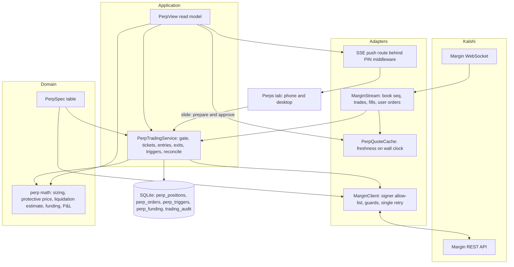
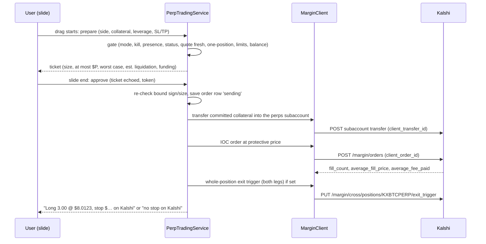
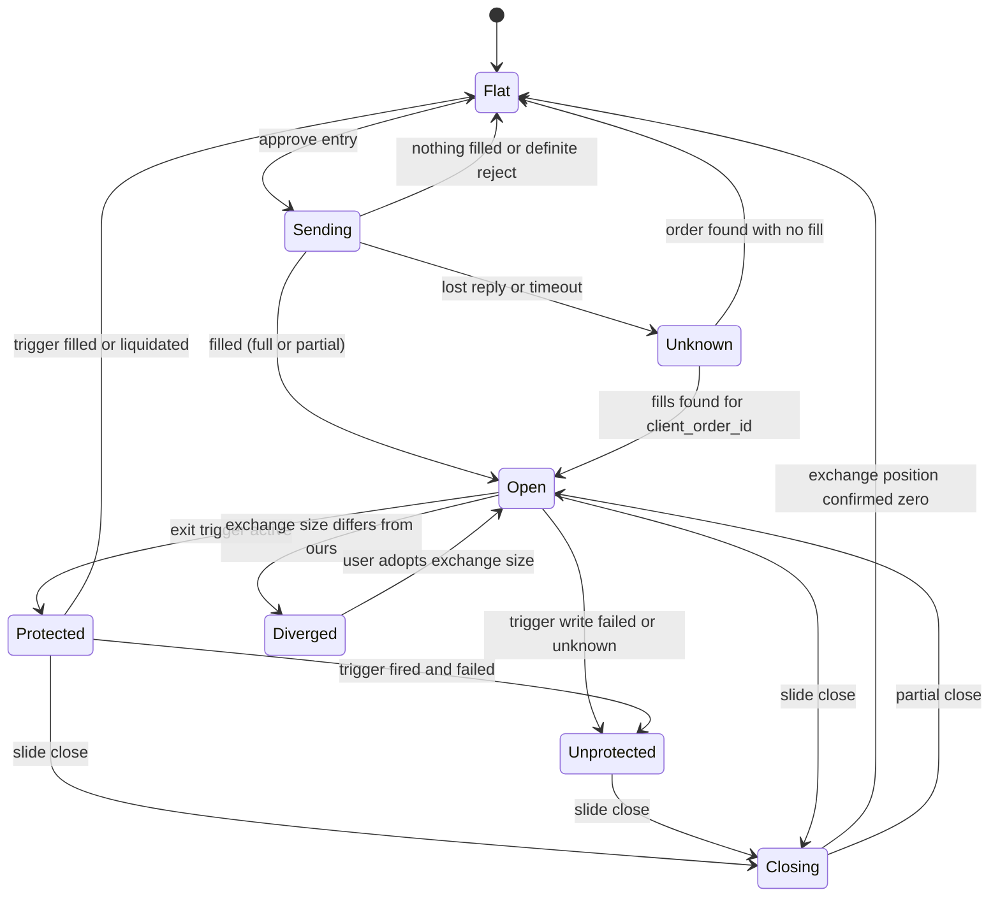

# Kalshi BTC Perps Tab - Plan

## Goal Capsule

- **Objective:** From Settleview on the phone or desktop, the user can open, add to, reduce and close a Kalshi BTC perpetual (KXBTCPERP) position with a deliberate slide, seeing before every slide what it costs at worst, where it would be liquidated and what funding will cost, and never losing more than the collateral they chose to commit.
- **Means:** a separate perps trading service and guarded margin client trading from a dedicated Kalshi perps subaccount funded per trade (KTD1, KTD2, KTD3).
- **Authority:** the user's product rules in Key Decisions win over everything else; Kalshi's published perps spec (`perps_openapi.yaml`, `perps_asyncapi.yaml`) wins over this plan on API facts; R-IDs win over KTDs on behavior; KTDs win over units on mechanism.
- **Stop conditions:**
  - Stop and ask the user if the demo checks in U1 show that collateral cannot be moved into a numbered perps subaccount through the API, or that a liquidation in that subaccount can draw on the main perps account (Kalshi calls subaccounts 1–63 "numbered cross subaccounts"; KD4 and R8 depend on them being separate).
  - Stop and ask if Kalshi's liquidation rules (help article 15357646, margin docs) allow a numbered subaccount's equity to go below zero with the deficit reaching the main perps account or the user; otherwise quote Kalshi's rule as the source of R8's wording.
  - Stop and ask if U1 measures the subaccount transfer at more than the 300 ms slide-to-sent budget, with the measured time and its expected effect on how often market-style entries fill.
  - Stop and ask if an aggressive IOC through the touch is rejected by price banding (KTD4 depends on it).
  - Never place, amend or cancel a real-money order without the user's explicit go-ahead in the session; real tests are run with the user (U10).
- **Execution profile:** high-risk money path. Every unit lands with its tests; the full suite and import contracts pass before any deploy; nothing reaches the live app (the deploy checkout) until the user says deploy.
- **Who finishes:** the implementer builds and verifies U1–U9 locally and on Kalshi's demo exchange; the user runs the small real-money test in U10 with the implementer watching the logs.

---

## Product Contract

### Summary

Add a Perps tab to Settleview for Kalshi's BTC perpetual, built like Play: one position at a time, market-style entries by default, a leverage slider that sizes the position against collateral the user commits into a dedicated perps subaccount, an estimated liquidation price and worst case shown before the slide, funding shown before and during the trade, optional exchange-held take-profit and stop, and the same limits, kill switch and no-silent-fallback rules as the rest of the app.

### Problem Frame

The user trades Kalshi's BTC perpetual in Kalshi's own app and has a margin account enabled for the API (`GET /margin/enabled` returned `true` with the existing production trading key; `/margin/balance` showed a small test balance). Settleview, which the user now treats as the whole product, cannot trade it.

A perp is a different risk from the 15-minute Up/Down contracts Settleview already trades: there is no fixed $1 payout, losses are bounded only by liquidation, funding is charged every 8 hours, and Kalshi's API does not offer the isolated margin or per-order leverage that Kalshi's app shows. Without care, a leverage slider on the API's shared cross-margin account would show a risk the exchange does not enforce. The Perps tab has to make the real risk visible and true before the user commits, while keeping Settleview's rule that the human makes every call.

### Requirements

**Trading actions**
- R1. The user can open a long or short KXBTCPERP position, add to it in the same direction, reduce it, and close it, each with a deliberate slide (the existing slide-to-confirm mechanics).
- R2. Settleview holds at most one perp position at a time; an entry in the opposite direction of an open position is refused with "Close your long first" (or short), and no action can turn a long into a short or the reverse except an entry from flat.
- R3. Entries are market-style by default: they fill at the best available prices up to a protective price shown before the slide as "at most $P"; a stricter all-or-nothing option and a user limit price are available as opt-in settings.
- R4. Every exit (reduce, close) can only shrink the position and is allowed even while the kill switch is on.

**Risk shown before every slide**
- R5. Before an entry, the screen shows the size (contracts and BTC), notional, estimated fee, the protective price, the worst-case cost, the estimated liquidation price (labelled as an estimate), and the next funding time with the estimated cost for that size and direction.
- R6. The leverage slider sets the position size as committed collateral × leverage, with its maximum taken from Kalshi's own market estimate, never hard-coded.
- R7. Before an add, the screen shows the new average entry, new size and new estimated liquidation price.

**Collateral and limits**
- R8. The most a perp position can lose is the collateral committed into the dedicated perps subaccount for it; the screen states this in plain words.
- R9. The user's trade limits apply to perps on committed collateral: the per-trade limit caps collateral committed per entry or add, and the per-day limit is one combined daily total across event-contract stakes and perps collateral, on the existing UTC day (defaults none, as today, with the typed confirmation to raise).
- R10. An entry is refused with a visible reason when the perps balance available to commit is unknown, stale, or too small.

**Protection and outcomes**
- R11. The user can set, change and remove a take-profit and a stop that Kalshi holds and fires on its own servers; none is set by default; both are drawn on the chart and shown on the position card with their state (none, pending, active, failed).
- R12. When a stop or take-profit fires, fails, or the position is liquidated or reduced by the exchange, the screen says exactly what happened from recorded fills (size, average price, realized P&L including fees and funding), never an estimate.
- R13. While the position is open, the screen shows the mark price, unrealized P&L, distance to the liquidation price with amber and red bands, funding paid or received so far, and the time to the next funding.
- R14. If a position is open with no exchange-held stop because setting it failed, the screen shows a persistent "position open, no stop on Kalshi" warning with the close slide beside it.

**Integrity and freshness**
- R15. Every number shown comes from Kalshi or the app's own calculation from Kalshi data; missing data shows "—" with a reason, and every refusal names its cause in plain English.
- R16. Trading is refused with a reason while Kalshi reports trading paused (including the weekly Thursday maintenance) and resumes only after the app has re-checked the account.
- R17. Positions or orders in the same account that Settleview did not create are shown, block new entries until the user adopts them, and never block exits; positions held in Kalshi's app (isolated) are shown read-only and counted toward limits.
- R18. When the order outcome is unknown (lost reply, timeout), the screen says "checking whether your order went through" and blocks new entries until the outcome is known; it never reports failure without proof.

**Experience**
- R19. The Perps tab follows the approved hi-fi light and dark designs and the desktop two-column layout, with Kalshi's own wording where one exists (long, short, mark price, funding, liquidation price, take profit, stop loss).

### Success Criteria

- A price change on Kalshi's perps book reaches the open screen in under 250 ms, slide-end to order-sent is under 300 ms (server timing log), and the perps path causes no event-loop stall over 50 ms.
- On Kalshi's demo exchange, every flow in the Verification Contract passes, and the liquidation estimate, recomputed at the actual average fill price and size, gives a distance from entry to liquidation within 5% of the distance Kalshi's `/margin/risk` reports, checked at low leverage and at the slider's maximum.
- A real-money round trip of $5 or less, run by the user, opens, protects, closes and reconciles to the exact figures on Kalshi's statement.

### Key Decisions

- KD1. **The user makes every call with a slide; nothing trades on its own.** Governs R1, R4, R11. (session-settled: user-directed — chosen over any automation: the user found automated trading overplayed and wants a decision aid.)
- KD2. **Entries are market-style by default, like Kalshi's own app.** Governs R3. (session-settled: user-directed — chosen over a tight price tolerance after a fixed limit refused a fill the venue's app would have taken.)
- KD3. **No take-profit or stop by default; protection is opt-in, visible and user-set.** Governs R11, R14. (session-settled: user-directed — chosen over default stops after app-set stops closed trades on ordinary noise.)
- KD4. **Trade from a dedicated numbered perps subaccount funded with only the committed collateral.** Governs R8, R10. (session-settled: user-directed — chosen over trading from the main perps account with "whole balance at risk" wording: it makes the slider's leverage what Kalshi actually enforces.)
- KD5. **Keep the leverage slider; it sizes the position against committed collateral, one position at a time.** Governs R2, R6. (session-settled: user-directed — chosen over showing account-level leverage only, after learning the API offers cross margin only.)
- KD6. **Limits default to none; the user sets them; the app never silently falls back.** Governs R9, R10, R15. (session-settled: user-directed — chosen over app-imposed caps: "add capability to these platforms, not limit".)
- KD7. **The daily limit is one combined total across event contracts and perps.** Governs R9. (session-settled: user-directed — chosen over a separate allowance per venue: "$20 a day" should mean $20 in total.)

### Scope Boundaries

- Not in this plan: Polymarket perpetuals (US order placement is blocked), cross-margin strategies or multiple simultaneous perp positions, resting (good-till-cancelled) entry orders, trailing stops, automated or scheduled trading of any kind, and moving money between the event-contract balance and the perps account (the user funds the perps account in Kalshi's app).
- Considered and not built:
  - Auto-closing on the kill switch: it would add hidden automation on a manual position; revisit only if the user asks for a "flatten everything" button.
  - App-watched stops as a fallback when an exchange stop fails: a stop that only works while the app runs would hide its own failure mode; the failed state is shown instead (R14).
  - A shadow (simulated) perps mode: Kalshi's demo exchange offers margin, which tests the real API instead of a simulation.
  - A standing pre-funded balance in the perps subaccount: faster entries, but committed collateral would no longer bound the loss (R8).
  - Lowering the global stall threshold: it would flood the log from event-contract paths without attributing anything to perps (KTD14 measures instead).
  - Cancel-all on kill: Kalshi's cancel-all can cancel orders placed up to a minute after the request.

#### Deferred to Follow-Up Work

- Out-of-app alerts (trigger failed, near liquidation, liquidated) via a push channel; until then the screen states that warnings show only while it is open.
- The rest of the real-time rebuild for the 15-minute Play screen (push instead of polling); this plan builds the push channel and uses it for Perps only.
- Switching the margin client onto Kalshi's official SDK once it supports margin endpoints.

---

## Planning Contract

### Key Technical Decisions

- KTD1. **A separate `PerpTradingService`, not another strategy of `TradingService`.** `TradingService` assumes window contracts throughout (UP/DOWN to yes/no, prices in 0–1, a 99¢ ceiling, window cutoffs, $1/$0 settlement, per-window limits); the perp service copies its proven patterns instead: ticket binding and approval tokens, ordered gate refusals, the shared kill-switch setting, `PlayLimits`, persist-before-send, unknown-order resolution, `_Steps` timings and the audit trail.
- KTD2. **Our own guarded margin client over httpx, as a documented exception to "Kalshi REST goes through the official SDK".** `kalshi_python_async` 3.35.0 has no margin endpoints. The client keeps the SDK backend's transport rules: our single retry loop is the only retry and reuses the same `client_order_id`, writes are never resent by the transport, redirects are not followed, idle sockets are dropped before Kalshi closes them. Its signer has its own allow-list of margin paths only (`/trade-api/v2/margin/...`, the margin WebSocket handshake, the transfer between the main perps account and the configured subaccount), excluding cancel-all, subaccount creation (done once in U1's script) and every `/margin/isolated/*` write; a read-only isolated-positions GET is allowed only if U1 finds one.
- KTD3. **One numbered perps subaccount owned by Settleview; committed collateral is that subaccount's equity after the transfer.** Instantiates KD4 (governs R8, R10).
  - The subaccount number is a setting validated at startup against Kalshi's list; an unknown or missing subaccount refuses trading with a reason.
  - An entry or add tops the subaccount up to the target collateral, never on top of an unswept balance; the gate refuses while an unexplained balance sits there.
  - The transfer happens on approve, not on prepare (pre-funding on prepare was rejected: it moves money before the user consents). If U1 shows transfers settle asynchronously, the order waits for a confirmed "funded" balance; the 300 ms slide-to-sent target is still measured from slide end with the transfer included, and a transfer that alone exceeds it is a Goal Capsule stop condition.
  - The sweep back after a close is its own step with a `client_transfer_id`, saved before it is sent, resumed after a restart, and run only once the exchange shows a zero position (margin held by a position cannot be transferred).
- KTD4. **Market-style entries are immediate-or-cancel limit orders at a protective price 0.5% through the touch, rounded toward safety onto Kalshi's tick.** Kalshi's margin API has no market order type. The protective price is bound into the ticket and shown as "at most $P"; the worst case is computed at that price. If the book moves past "at most $P" between prepare and approve, the order fills nothing and the screen says "Nothing filled at or better than $P; nothing is open" as a normal outcome. Exits use the same mechanism with `reduce_only`.
- KTD5. **No resting orders in v1: every order is immediate-or-cancel or fill-or-kill.** This removes flip-by-resting-order, close-blocked-by-resting-order and anchoring problems, and `reduce_only` is only accepted with these two time-in-force values anyway.
- KTD6. **Take-profit and stop use Kalshi's whole-position cross exit trigger, set right after the entry fills, always sending both legs.** It follows adds and reduces automatically; a count-based trigger with `client_trigger_id` was rejected because it goes stale after an add. Anchoring a trigger to an immediate-or-cancel entry is expected to fail because the order is already finished; U1 confirms. Editing a whole-position trigger clears any leg left out, so every edit re-sends the current other leg. A failed or unknown trigger write puts the position in the visible no-stop state (R14), with no automatic retry beyond the transport retry.
- KTD7. **The pre-trade liquidation price is our own estimate from Kalshi's risk parameters, replaced by Kalshi's `/margin/risk` figure once the position exists.** Kalshi reports liquidation prices only for existing positions. The estimator is a pure function, calibrated on the demo exchange (U1) and always labelled "estimate".
- KTD8. **The exchange position is the truth; Settleview holds intent and history.** Positions are not streamed, so the service polls `GET /margin/positions` and `/margin/risk`, uses `fill.post_position` as a fast hint, and reconciles orders and fills over REST after every WebSocket reconnect (fill and order messages carry no sequence numbers).
- KTD9. **Approvals bind the position's sign and size and the trigger's last update time.** A second device approving an add, or a trigger edit made elsewhere, is refused with `position_changed` or `trigger_changed` instead of doubling the position or overwriting a newer stop.
- KTD10. **Trading pauses are driven by Kalshi's status, not a clock.** `/margin/exchange/status` and the market status gate every write; the Thursday maintenance window appears only as advisory text before entry.
- KTD11. **A server-to-browser push channel (server-sent events) behind the PIN middleware feeds the Perps screen.** Kalshi's ticker channel is limited to one message per second, so the screen's price comes from the order book and trade channels, coalesced to at most one push every 100 ms. A WebSocket was rejected: the push is one-way and server-sent events need no new package. The stream authenticates by the existing session cookie and closes cleanly on shutdown. The perps lock is held only around gate and send, never across a network read.
- KTD14. **Latency is measured per perps step, not by lowering the global stall threshold.** The stall detector stays at 500 ms for warnings (it watches the whole loop and cannot attribute a stall to perps); a loop-lag histogram and `_Steps` timings on prepare, transfer, send and trigger prove the 50 ms and 300 ms targets. The persist-before-send SQLite write runs synchronously on the loop as it does for event contracts, and its time is part of the measured send step.
- KTD15. **The slide prepares on drag start and approves on slide end.** The user sees the bound ticket while dragging; one combined prepare-and-approve call was rejected because it would show no ticket before the commitment.
- KTD16. **A small shared control protocol lets kill, resume and presence reach both trading services.** Heartbeat, kill, resume and the killed check read the one shared `killed` setting; perps registers as an additional service, never the primary whose answer the routes return; a perps failure during kill is logged and audited and never stops the event services from being killed.
- KTD12. **Perp markets live in their own `PerpSpec` table in `domain/markets.py`.** A perp row in the window-market table would wrongly add KXBTCPERP to the 15-minute gateway's allow-list and create a span tab. Lookups raise on unknown keys, as the market table does.
- KTD13. **New tables for perps (`perp_positions`, `perp_orders`, `perp_triggers`, `perp_funding`); the shared `trading_audit` and `trading_settings` are reused with strategy `perps` and env names `perp_demo` and `perp_prod`.** The binary bracket table's required columns (`window_end`, `take_profit`, yes/no sides) do not fit a perp.

### Assumptions

These are agent bets made to complete the plan; the user has not confirmed them.

- A gap of roughly 100 ms between the entry fill and the exchange stop being set is acceptable, given anchoring is expected not to work for immediate-or-cancel entries.
- The kill switch blocks entries and adds only; it never blocks exits and never closes a position by itself.
- Liquidation-distance warning bands default to amber under 5% and red under 2% of the mark, user-editable, display only.
- When a position in the same account appears that Settleview did not open, exits stay allowed and entries are blocked until the user taps "Adopt".
- The default protective band is 0.5% through the touch, user-editable.
- Fee estimates use the user's rate from `GET /margin/fee_tiers` and are shown with "≈" because Kalshi does not document fee rounding.

### High-Level Technical Design

Components and data flow:

Entry sequence (market-style, with an optional stop):

Position state (server side):

### Implementation Constraints

- Every perp write passes the adapter guards before transport: ticker allow-list from `PerpSpec`, subaccount allow-list, string prices on Kalshi's tick, string counts, `reduce_only` with immediate-or-cancel or fill-or-kill on every exit, a perps-only hard notional ceiling setting (a bug guard sized for leveraged notional, separate from the event contracts' `trading_order_hard_ceiling`), no cancel-all and no isolated paths.
- Prices and counts follow Kalshi's units: one contract is 0.0001 BTC, prices are dollars per contract (about $8 at $80k BTC), the tick is $0.0001 per contract.
- The project rules hold: no silent fallbacks, no fake data, never read `.env` or key files, no new packages (httpx and websockets are already present), every live test is recorded in `docs/research/LEARNINGS.md`.

### System-Wide Impact

- **Trading routes:** heartbeat, kill and resume reach the perps service through KTD16; kill keeps exits allowed on both services.
- **Trade limits:** today the per-day limit is enforced per service from its own ledger; per KD7 both services read one shared "committed today" figure (event stakes plus perps collateral, UTC day) through a small shared port, so the existing phone services' day check changes too. The limits screen states what a dollar means per venue (stake for event contracts, committed collateral for perps) and that the per-window limit does not apply to perps.
- **Settings and audit:** the perps service uses strategy `perps` and envs `perp_demo` and `perp_prod`; the `killed` key stays shared, and `limits_changed` stays under strategy `play`.
- **Balances:** the event-contract balance loop is unchanged; perps poll `/margin/balance` on prepare and on a slow tick (the available-balance read costs 50 rate-limit tokens), with the existing 300-second staleness refusal.
- **Rate limits and connections:** Kalshi's perps rate-limit buckets are separate from event contracts'; the per-user WebSocket cap is shared but far from reached; a 429 carries no retry hint, so it goes through the single retry loop's backoff.
- **Startup and shutdown:** migration, then subaccount validation, then a REST reconcile, and only then "ready"; streams and the monitor start after routes register; on shutdown the save-send-record step is shielded from cancellation so a restart resolves through the `sending` state, and the stream closes last.
- **Code being removed now:** U6–U8 are written against the code left after the current cleanup (bots, lab and research engine removed); nothing is inherited from the removed auto-approve or session code.
- **AGENTS.md:** add the margin-client exception next to the SDK rule (KTD2), widen "What this repo is" beyond up/down markets, and note that the U1 order checks and U10 run only with the user's explicit in-session go-ahead.

### Sources and Research

- Kalshi perps contract: `perps_openapi.yaml`, `perps_asyncapi.yaml` and docs pages from docs.kalshi.com (margin, price banding, rate limits), read 2026-10-29; help.kalshi.com articles 15357587 (contract specs), 15357613 (funding), 15357637 (TP/SL), 15357646 (liquidation).
- Repo patterns: `btc_signal_engine/adapters/kalshi/trading.py` (guards, `TradingAuth` allow-list, exception contract, single retry loop), `btc_signal_engine/adapters/kalshi/backend.py` (`HttpxBackend` shape, transport rules), `btc_signal_engine/adapters/kalshi/stream.py` (sequence tracking, resnapshot, backoff), `btc_signal_engine/adapters/polymarket_us/market_data.py` (freshness cache), `btc_signal_engine/application/trading.py` (gate, tickets, limits, audit, `_Steps`), `btc_signal_engine/application/play_limits.py`, `btc_signal_engine/adapters/http/access.py` (PIN middleware covers WebSocket and streaming scopes), `btc_signal_engine/bootstrap/stall.py`.
- Live account check 2026-10-29 (read-only): margin enabled for the production trading key; a small test balance.

---

## Implementation Units

### U1. Demo exchange verification of the unconfirmed API facts

**Goal:** Settle every API fact this plan marks unconfirmed before code depends on it, on Kalshi's demo exchange.

**Requirements:** R3, R6, R8, R11, R16, R18; stop conditions in the Goal Capsule.

**Dependencies:** none.

**Files:**
- `scripts/quick/perps_demo_checks.py` (new; demo host only, refuses any other host before sending)
- `docs/research/LEARNINGS.md` (record results)

**Approach:**
1. Read-only checks: the subaccount transfer request body and whether it settles synchronously, the ticker (`GET /margin/markets`), tick size, fractional trading flag, risk parameters, fee tiers, notional risk limit, exchange status, WebSocket handshake signing path, and whether any read-only endpoint lists positions held in Kalshi's app (isolated).
2. Order checks with the user's go-ahead (demo money): an immediate-or-cancel bid a few ticks and 0.5% through the ask (accepted? fill price?), a duplicate `client_order_id` (status and code), creating a numbered subaccount and transferring into and out of it, proving a liquidation in that subaccount cannot draw on the main perps account, anchoring an exit trigger to an immediate-or-cancel entry (expected 409), a whole-position trigger covering a later add, which mark price fires a stop and what order a fired leg sends, `/margin/risk` liquidation price for 1-contract positions at low leverage and at the slider's maximum against the estimator inputs, and how the demo liquidation appears in the fills list, `fill` WebSocket messages and `/margin/positions` (captured as U4 fixtures).
3. Record each result as a fact in LEARNINGS with the date and mark it demo-only.

**Execution note:** run before U3 and U6 depend on any of these facts; stop and ask the user if a stop condition is met.

**Test expectation:** none -- this is a verification script run against the demo exchange; its output is recorded evidence.

**Verification:** every API fact named in KTD3, KTD4, KTD6, KTD7 and in the Open Questions items assigned to U1 has a recorded demo result; the Assumptions remain for the user to confirm.

### U2. Perp domain maths and market table

**Goal:** Pure functions for sizing, protective price, worst case, liquidation estimate, funding estimate and P&L, plus the `PerpSpec` table.

**Requirements:** R3, R5, R6, R7, R8, R12, R13.

**Dependencies:** U1 for the calibration numbers used in tests.

**Files:**
- `btc_signal_engine/domain/perps.py` (new)
- `btc_signal_engine/domain/markets.py` (add `PerpSpec` and lookups, KTD12)
- `tests/domain/test_perps.py` (new)
- `tests/domain/test_markets.py`

**Approach:**
- Size (contracts) = committed collateral × leverage ÷ per-contract mark price (dollars per contract), rounded down to Kalshi's count step; leverage maximum from the market's `leverage_estimates`.
- Worst case (the loss figure shown before the slide, per R8) = committed collateral plus entry and exit fees; the order's notional at the protective price is shown separately as the position size.
- Protective price per KTD4, rounded toward safety (a long's cap rounds down, a short's floor rounds up).
- Liquidation estimate per KTD7 from collateral, size, entry and Kalshi's maintenance and initial margin multipliers.
- Funding estimate = rate × size × contract-scaled mark, signed by direction, plus the one-interval cap worst case.
- P&L = realized + unrealized + funding − fees, from Kalshi's figures.

**Patterns to follow:** `btc_signal_engine/domain/strategy/play.py` (pure helpers with plain-number inputs), `btc_signal_engine/domain/markets.py` (`UnknownMarket` on any unknown key).

**Test scenarios:**
- $20 committed at 5× with BTC at $80,000 (mark $8.0000 per contract) gives $100 notional = 0.00125 BTC = 12.50 contracts, rounded down to the count step.
- A leverage above the market's estimate is refused by the sizing function with a reason.
- A long protective price 0.5% above an ask that falls between ticks rounds down onto the tick; a short's rounds up.
- For $5 committed in 3 contracts at a protective price of $8.0500, the position size shown is 3 × 8.05 = $24.15 notional and the worst-case loss shown is $5 plus the 12 bp entry and exit fees.
- For the demo-recorded positions at low and maximum leverage, the estimate recomputed at the fill price gives a distance from entry to liquidation within 5% of the distance from Kalshi's `/margin/risk`.
- Funding for a long with a positive rate is a cost; for a short it is income; a zero rate gives zero.
- An unknown perp key raises `UnknownMarket`; the window-market lookups never return the perp.

**Verification:** all domain tests pass and the import contracts hold (domain imports nothing from adapters).

### U3. Guarded margin REST client

**Goal:** A margin client with its own signer allow-list, guards and transport rules (KTD2).

**Requirements:** R1, R2, R4, R15, R18.

**Dependencies:** U1, U2.

**Files:**
- `btc_signal_engine/adapters/kalshi/margin.py` (new: `MarginAuth`, `MarginClient`)
- `tests/kalshi/test_margin_client.py` (new)
- `tests/kalshi/margin_fake.py` (new: recording mock transport, lost-reply and 409 modes)
- `AGENTS.md` (document the exception)

**Approach:**
- Operations: markets, order book, exchange status, risk parameters, fee tiers, balance, positions, risk, orders list, fills, funding estimate and history, create order, decrease, cancel one, exit trigger get, put and delete, subaccount create and transfer.
- Guards before transport per Implementation Constraints; the exception contract matches the event-contract client (`definitive`, `status`); a 409 on create leads to a list-and-match by `client_order_id` and otherwise an unknown outcome, never a rejection.
- Timestamps: one tested parser for RFC3339 (REST), milliseconds (WebSocket) and seconds (funding).

**Patterns to follow:** `btc_signal_engine/adapters/kalshi/trading.py` (`_check`, `_send`, `place_limit` conflict handling, module docstring with verified facts), `btc_signal_engine/adapters/kalshi/backend.py` (`HttpxBackend` reply shape), `tests/kalshi/test_sdk_backend.py` (transport guarantee tests).

**Test scenarios:**
- A signed request to a margin path on the allow-list carries the three Kalshi headers; a request to `/margin/isolated/...` or cancel-all raises before any request is recorded.
- An exit without `reduce_only`, or with `reduce_only` and good-till-cancelled, is refused before transport.
- An order for a ticker not in `PerpSpec` or a subaccount other than the configured one is refused before transport.
- A 503 then 201 on create sends two requests with the same `client_order_id`; a POST is never resent by the transport itself.
- A lost reply followed by a 409 resolves to the existing order found by list-and-match; if it is not found, the result is unknown (not definitive), never rejected.
- A 302 is not followed and comes back as a non-definitive error.
- Prices are sent as strings on the tick and counts as strings with two decimals.

**Verification:** client tests pass; AGENTS.md states the exception and its rules.

### U4. Margin WebSocket stream and quote cache

**Goal:** Live book, trades, ticker, fills and user orders for KXBTCPERP with sequence tracking and a fresh-quote cache.

**Requirements:** R13, R15, R16, R18; Success Criteria latency.

**Dependencies:** U3.

**Files:**
- `btc_signal_engine/adapters/kalshi/margin_stream.py` (new)
- `tests/kalshi/test_margin_stream.py` (new)
- `tests/fixtures/kalshi_margin_ws/` (captured demo messages from U1)

**Approach:**
- Subscribe `orderbook_delta`, `trade`, `ticker`, `fill`, `user_orders`; apply book deltas strictly in sequence order and request a snapshot on any gap.
- Emit health changes and a `resync` event on every connect so the service reconciles over REST.
- The quote cache answers nothing when older than 2 seconds on the wall clock; best bid and ask come from the book, mark and funding from the ticker.
- Backoff 1 second doubling to 30, reset after a minute connected.

**Patterns to follow:** `btc_signal_engine/adapters/kalshi/stream.py` (sequence machinery, backoff, injectable connect and clock), `btc_signal_engine/adapters/polymarket_us/market_data.py` (freshness cache).

**Test scenarios:**
- A snapshot then deltas in order produce the expected best bid and ask.
- A sequence gap triggers a snapshot request and no quote is served until it arrives.
- A quote older than 2 seconds returns nothing.
- A reconnect emits a `resync` event before any fill is passed on.
- Captured demo fill and user-order messages parse into the expected events, including `order_source` system for trigger fires.

**Verification:** stream tests pass on captured fixtures; no price outside the book is ever served.

### U5. Perp persistence

**Goal:** Tables for positions, orders, triggers and the funding ledger (KTD13).

**Requirements:** R12, R13, R17, R18.

**Dependencies:** U2.

**Files:**
- `btc_signal_engine/adapters/sqlite/tables.py`
- `btc_signal_engine/adapters/sqlite/migrations/versions/0011_perps.py` (new)
- `tests/storage/test_perp_tables.py` (new)

**Approach:** `perp_positions` (direction, size, entry, committed collateral, leverage chosen, state, close reason including liquidated and exchange-reduced, realized P&L, fees, funding total), `perp_orders` (client order id, role, side, price, count, time in force, reduce only, fills, average price, fees, outcome), `perp_triggers` (exchange id, legs, state, last update time, fired order id), `perp_funding` (funding time, rate, amount; unique on market and funding time).

**Patterns to follow:** migrations 0009 and 0010 (create with `checkfirst`).

**Test scenarios:**
- The migration creates all four tables on a fresh database and is a no-op when run twice.
- A duplicate funding row for the same market and funding time is rejected.

**Verification:** migration and table tests pass; existing tables are untouched.

### U6. Perp trading service

**Goal:** The service that gates, tickets, enters, adds, reduces, closes, protects and reconciles one perp position (KTD1).

**Requirements:** R1–R18.

**Dependencies:** U2, U3, U4, U5.

**Files:**
- `btc_signal_engine/application/perp_trading.py` (new)
- `btc_signal_engine/application/play_limits.py` and `btc_signal_engine/application/trading.py` (shared committed-today figure, KD7)
- `tests/perps/test_gate.py`, `tests/perps/test_entry_exit.py`, `tests/perps/test_triggers.py`, `tests/perps/test_reconcile.py`, `tests/perps/test_outcomes.py` (new)

**Approach:**
1. Modes `perp_demo` and `perp_prod` with the existing real-money confirmation; mode persisted per the existing settings key pattern.
2. Gate order: mode ready and reconciled, kill switch (entries and adds only), presence, Kalshi trading active (KTD10), quote fresh, one-position rule and sign check (R2), limits on committed collateral (R9), available perps balance (R10), notional risk headroom, protective price inside Kalshi's band, and a stop (when set) not at or past the ticket's estimated liquidation price (code `stop_past_liquidation`, naming both prices; Kalshi's 400 `stop_loss_past_liquidation` on a trigger edit maps to the same refusal).
3. Tickets bind side, size, collateral, leverage, protective price, time in force, legs, the position's sign and size, and the trigger's last update time (KTD9); approval expires after 10 seconds as today.
4. Entry per the entry sequence in High-Level Technical Design: save the row, transfer collateral (KTD3), send the order, set the trigger (KTD6), record fills, fees and the resulting state.
5. Exits are reduce-only (R4); a close confirms a zero exchange position before saying "Flat", then sweeps the subaccount balance back. The same saved, resumable sweep runs after an entry or add that fills nothing or is definitely rejected, so the committed collateral returns and the gate reopens.
6. Monitor tick (lock only around gate and send, KTD11): poll positions, risk, triggers and funding; resolve unknown orders by list-and-match; detect trigger fired, failed, liquidation and exchange reduction from fills (R12, R14); detect foreign positions and orders (R17).
7. Timing log per prepare and approve in milliseconds.

**Patterns to follow:** `btc_signal_engine/application/trading.py` (`OrderGate.check`, `ticket_hash`, `_issue`, `_bound`, `_refuse`, `_enter` persist-before-send, `_resolve_unknown`, `_reconcile_locked`, `closed_sentence`, `_Steps`), `btc_signal_engine/application/play_limits.py`, `tests/trading/test_gate_refusals.py`, `tests/trading/test_market_buy.py`, `tests/trading/helpers.py` (`drop_first_post_response`).

**Test scenarios:**
- Each gate step refuses with its own code and sends nothing, in the order listed.
- An opposite-direction entry with a long open is refused; for every action and every exchange position sign, no request can change the sign except an entry from flat.
- With the kill switch on, an entry and an add are refused while a reduce, a close and a stop edit are sent; turning on the kill switch sends nothing itself.
- A lost reply on an entry leaves the position unknown, blocks a new entry, and resolves to Open with the right size once the order is found.
- A partial fill of 1.40 of 3.00 records 1.40, the trigger request carries no count, and the message says the rest was cancelled.
- A trigger write that fails after a fill leaves the position Unprotected and produces the no-stop warning once, with no further write.
- Changing only the stop re-sends the current take-profit; an edit whose bound last-update time is stale is refused with `trigger_changed`.
- Two approvals racing on an add: the second is refused with `position_changed`.
- A liquidation fill closes the position with reason liquidated and P&L from Kalshi's realized figures; a partial liquidation keeps it open at the new size.
- Kalshi reporting trading inactive refuses every write with `exchange_paused`; after it resumes, writes stay refused until a reconcile completes.
- A restart with a row in `sending` and a fill on the exchange resolves to Open; a restart with an open row and a flat exchange closes it with the reason taken from fills.
- A Kalshi-app isolated position is shown and counted toward limits but does not block entries; a foreign size in our subaccount marks the position Diverged and blocks entries until adopted.
- A per-trade limit of $10 refuses committing $15 with the limit named; an unreadable limits setting refuses with `limits_unreadable`.
- With a $20 daily limit and $15 already staked on event contracts today, a perps entry committing $10 is refused naming the combined total; the event services' day check likewise counts perps collateral.
- The funding ledger adds one row per funding time and P&L matches Kalshi's figures within $0.01 on a fixture.
- An entry whose stop is at or past the estimated liquidation price is refused with `stop_past_liquidation` before any transfer or order.
- An entry that fills nothing returns the committed collateral through the saved sweep and the next entry passes the gate.
- An all-or-nothing entry is sent fill-or-kill and a limit-price entry is sent at the user's price; both are bound into the ticket.

**Verification:** perps service tests pass with the margin fake; prepare-to-send timing under 300 ms in the fake-transport timing log.

### U7. Perps routes and push channel

**Goal:** HTTP routes for the Perps tab and a server-sent-events push channel (KTD11).

**Requirements:** R1, R5, R11, R13, R15, R19; Success Criteria latency.

**Dependencies:** U6.

**Files:**
- `btc_signal_engine/adapters/http/perp_routes.py` (new)
- `btc_signal_engine/adapters/http/push.py` (new: SSE fan-out)
- `btc_signal_engine/adapters/http/trading_routes.py` (kill, resume and heartbeat reach the perps service)
- `btc_signal_engine/application/perp_view.py` (new read model)
- `tests/api/test_perp_routes.py`, `tests/api/test_push.py` (new)

**Approach:**
- Routes: view (one payload with quote, mark, funding, position, triggers, limits, readiness and reasons), prepare, approve, exit prepare, trigger set and remove, adopt.
- The push channel sends the read model's changed fields at most every 100 ms and a heartbeat every 15 seconds; the client falls back to a visible "stale" state, never to old numbers, when the stream drops.
- Kill, resume and presence fan out to both trading services through a small shared protocol.

**Patterns to follow:** `btc_signal_engine/adapters/http/play_routes.py`, `btc_signal_engine/adapters/http/trading_routes.py` (required strategy, refusal bodies as HTTP 200), `btc_signal_engine/application/play.py` (`now_view`: no data means a reason, never a number).

**Test scenarios:**
- The view with a stale quote has no buy readiness and states the quote age.
- A remote client without a PIN session cannot open the push channel; a signed-in one receives a heartbeat and a changed quote.
- Pushes for 50 quote changes inside 100 ms coalesce to one message with the newest values.
- Kill from the existing route sets the shared switch and the perps view reports it.
- A malformed prepare body is a 422; a refused prepare is HTTP 200 with the code and reason.

**Verification:** route and push tests pass; the PIN middleware guards the push route.

### U8. Wiring, settings and loops

**Goal:** Build the perps service and loops at startup and make them observable.

**Requirements:** R10, R16; Success Criteria stalls.

**Dependencies:** U6, U7.

**Files:**
- `btc_signal_engine/bootstrap/app.py`
- `btc_signal_engine/bootstrap/config.py` (perps enabled flag, subaccount number, protective band, warning bands)
- `btc_signal_engine/bootstrap/stall.py` (a loop-lag histogram reporting lags over 50 ms; the 500 ms stall warning is unchanged, KTD14)
- `.env.example`
- `tests/perps/test_perp_wiring.py` (new)

**Approach:**
- Build one `MarginClient` per mode: `perp_demo` from the existing demo key settings against Kalshi's demo REST and WebSocket hosts, `perp_prod` from the production trading key against the production hosts; each client refuses the other environment's host before signing, and a mode whose key is missing is refused with a stated reason.
- Validate the configured subaccount and margin access at startup and refuse perps trading with a stated reason if either check fails.
- Loops: margin stream, monitor tick, balance and risk poll, funding poll. Distinct env names keep perp events out of the window services' stream pump.
- Register the service with the trading routes for kill, resume and presence.

**Patterns to follow:** the phone services' wiring and `you_loop` in `btc_signal_engine/bootstrap/app.py`; `trading_from_settings` returning None with a logged reason when keys are missing.

**Test scenarios:**
- With perps disabled, no margin loop starts and the Perps view reports "Perps are switched off".
- With an unknown subaccount number, the service refuses trading with that reason.
- Perp stream events never reach the window trading services.
- In `perp_demo` mode no request is signed with the production key or sent to a production host, and the reverse.

**Verification:** wiring tests pass; the app starts with perps on and off; the loop-lag histogram shows no perps-path lag over 50 ms during a demo session.

### U9. Perps tab on phone and desktop

**Goal:** The Perps screen in the approved hi-fi style (R19).

**Requirements:** R1–R7, R11–R18.

**Dependencies:** U7.

**Files:**
- `web/views/perps.js` (new component)
- `web/perpchart.js` (new: mark line, entry, liquidation, stop and take-profit lines, warning bands)
- `web/index.html` (a Perps choice next to Kalshi and Polymarket, and its panel)
- `web/style.css`
- `web/views/play.js` (limits card wording only)

**Approach:**
- Before entry: direction, collateral, leverage slider (R6), the derived numbers of R5 with "estimate" labels, optional stop and take-profit fields, the slide (prepare on drag start, approve on slide end).
- In a position: the card of R13, trigger state as a field (none, pending, active, failed), the no-stop warning (R14), outcome messages from the server (R12), foreign and Kalshi-app positions (R17), "checking whether your order went through" (R18), paused state (R16), data freshness indicator.
- In-position actions, each a slide with a ticket (KTD15): Close (full size), Reduce (quarter, half, three-quarter presets or a contract count; default half), Add (the entry collateral and leverage controls). Each ticket shows the exit's "at least $P", the size remaining and the estimated realized P&L after fees; an Add ticket shows the R7 figures.
- Stop and take-profit are entered as prices, with the distance from the mark and the dollar effect beside them; a stop on the wrong side of the mark or past the liquidation estimate is refused inline with the reason; setting, changing or removing either in a position is a slide with a ticket (KD1, KTD9). Chart lines are display-only.
- An "Entry options" disclosure under the leverage slider holds the opt-in fill modes of R3 (all-or-nothing, a limit price) and the protective band; the warning bands sit in the position card's menu; all persist through the validated local-storage pattern, and any non-default option shows as a chip on the ticket.
- A collateral status line on the flat and position screens shows funding, in position, returning, or "$N in the perps subaccount, not in a position" with a "Return to perps balance" slide that runs the saved sweep; entries stay disabled with that reason while it shows.
- When several states apply, one banner shows by priority (unknown order, failed or missing stop, diverged, paused, stale data, near liquidation) with the rest collapsed into a count; exits stay enabled in every state except Kalshi paused or stale data, and every disabled slide states why. Adopt is a confirm button showing the exchange size before adopting.
- The limits card states that the daily limit is one combined total across both venues, what a dollar means per venue (stake for event contracts, committed collateral for perps), that the per-window limit does not apply to perps, and keeps the typed confirmation to raise.
- Wording follows Kalshi's (long, short, mark price, funding, liquidation price, take profit, stop loss).

**Patterns to follow:** `web/views/play.js` (slide, freeze and snap-back, validated localStorage, refusals shown word for word), `web/playchart.js` (colours only from CSS tokens, re-theme on change), the hi-fi tokens in `web/style.css`.

**Test scenarios:**
- Test expectation: browser checks rather than unit tests — headless screenshots in light and dark at 390×844 and 1440×900 for flat, entry ticket, reduce and add tickets, open and protected, open and unprotected, near liquidation (amber and red), paused, unknown order, diverged, collateral waiting to return, and two states at once, with all non-GET requests blocked.

**Verification:** screenshots match the hi-fi language; every number on screen traces to a payload field.

### U10. Demo run and small real-money test

**Goal:** Prove the whole path on Kalshi's demo exchange, then with real money under $5, run with the user.

**Requirements:** all; Success Criteria.

**Dependencies:** U1–U9.

**Files:**
- `docs/research/LEARNINGS.md`

**Approach:**
1. Demo: every flow in the Verification Contract table.
2. With the user's explicit go-ahead: one long of the smallest size with a stop, an add, a stop edit, a partial reduce, a close, and reconciliation to Kalshi's statement; flatten and sweep the subaccount after.
3. Record results and timings in LEARNINGS.

**Test expectation:** none -- live verification run; results are recorded evidence.

**Verification:** every row of the Verification Contract passes; the real test matches Kalshi's figures to the cent.

---

## Verification Contract

| Gate | How | When |
|---|---|---|
| Unit and integration tests | `.venv/Scripts/python.exe -m pytest` (check pytest's own exit code) | every unit |
| Import contracts | `.venv/Scripts/lint-imports` | every unit |
| Demo facts | `scripts/quick/perps_demo_checks.py` against the demo host only | U1, before U3 and U6 rely on them |
| Demo flows | enter long and short, add, reduce, close, stop set and edited and fired, take-profit fired, failed trigger shown, unknown order resolved, paused refusal, restart with an open position, isolated app position shown | U10 |
| Latency | server timing log slide-to-sent under 300 ms (transfer included); push delivery under 250 ms; loop-lag histogram no perps-path lag over 50 ms | U7, U8, U10 |
| Real money | user-run round trip of $5 or less, flattened after, reconciled to Kalshi's statement | U10, with the user's go-ahead |

---

## Definition of Done

- U1–U10 are complete with their test scenarios passing, the full suite green and import contracts kept.
- Every requirement R1–R19 traces to a passing test or a recorded demo or real-money check.
- AGENTS.md documents the margin-client exception; LEARNINGS records the demo facts and the real-money result.
- No experimental or abandoned code is left in the diff; the perps feature is off by default until the user turns it on.
- Nothing is deployed to the live app until the user says deploy.

---

## Appendix

### Open Questions

- Deferred to implementation: whether Kalshi's subaccount transfer settles synchronously, and its request body; U1 settles both before U3.
- For the user, only if U1 finds no read-only endpoint for positions held in Kalshi's app: R17 would change to say those positions are not visible to Settleview and are not counted toward limits, and the limits screen would say so.
- Deferred to implementation: Kalshi's exact error code for a duplicate `client_order_id`, the maximum `client_order_id` length, which mark price fires exit triggers and what order a fired leg sends, and whether an immediate-or-cancel order far through the touch is accepted; U1 settles each, and the immediate-or-cancel check is a stop condition in the Goal Capsule.
- Deferred to implementation: Kalshi's fee rounding (shown with "≈" until known).
