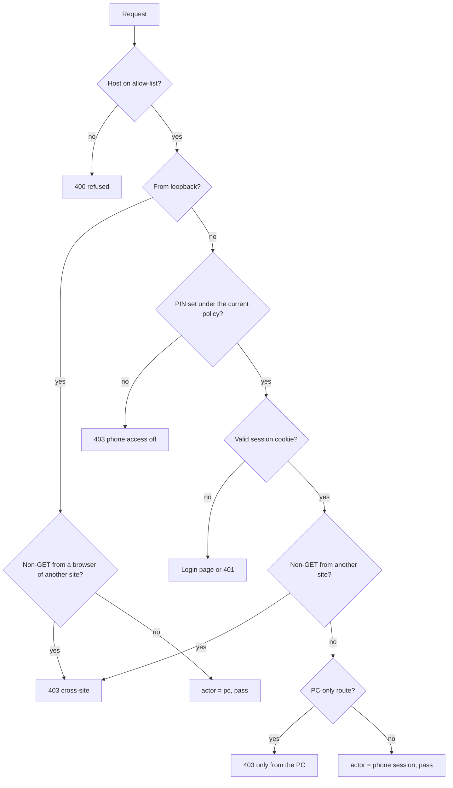
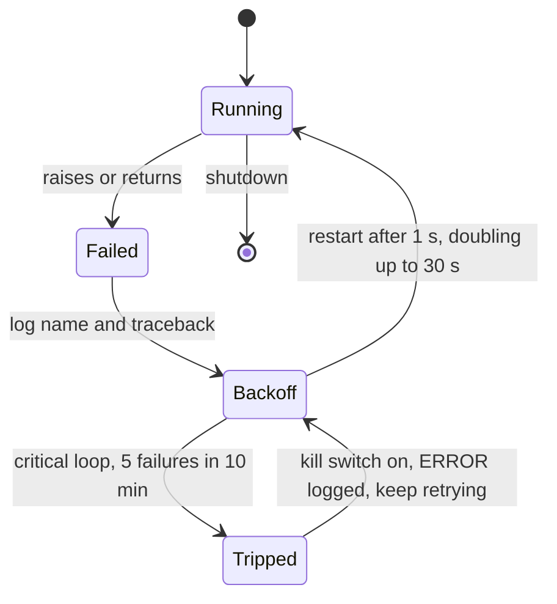
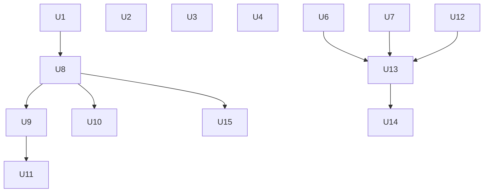

# Performance, Security and Reliability Remediation - Plan

## Goal Capsule

- **Objective:** The Play screen stays responsive and the app stays up through a whole trading session. Only the owner, from their own PC or a signed-in phone within the limits set on the PC, can change how the app trades. When the app is unhealthy, the owner can see it.
- **Means:** Fix the 2026-10-30 review's findings in this repo, in four phases. First stop the event-loop stalls (Phase A), then make deploy restarts graceful and supervise the loops (Phase B), then close the access-control gaps (Phase C), then add health, logs and data lifecycle (Phase D) (KTD1–KTD9).
- **Authority:** AGENTS.md hard rules > this plan's Requirements > KTDs > unit Approach text.
- **Stop conditions:** Stop and ask the owner if any of these happen: a step would need a new Python package (psutil, for example); a fix would change order-placement behavior; exits appear that don't match a deploy.
- **Execution profile:** Code changes with pytest coverage, in this checkout. No unit touches the live app on :8000, its deploy checkout, any exchange endpoint, `.env` or key files.
- **Who finishes:** The implementer lands the units and their tests. The owner deploys to the deploy checkout and watches `data_run.log` and `watchdog.log` for the Success Criteria.

---

## Product Contract

### Summary

Remove the causes of event-loop stalls and make the Play read path cheaper. Instrument the process so the cause of the restarts can be found, then fix it. Restrict who can change trading settings, and make PINs and audit records stronger. Supervise background loops, extend health reporting and logs, and give the database a backup routine and a growth limit.

### Problem Frame

The 2026-10-30 review of this app (Kalshi KXBTC15M and Polymarket US 15m/5m, human-approved trading) found three groups of problems, all verified against the code and the live logs.

**Performance.** One asyncio thread runs the market feeds, the 0.5 s stop and fill monitor, order placement and the web server. On 2026-10-29 between 22:46 and 00:02, `data_run.log` recorded 16 stalls of 0.5–3.8 s. The logged stacks show these causes:

- WebSocket frames decompressed on the loop (9 of 16 stalls).
- A blocking SQLite scan in `rv_p95` (3 of 16; the longest, 3.8 s, came just after a restart).
- PBKDF2 PIN hashing inside the ASGI middleware (2 of 16).
- The coach's per-boundary feature computation (`coach.tick` computing indicators) (1 of 16).
- An SSL read (1 of 16).

While a stall lasts, quotes, index stops and fill checks pause, and the phone shows "server took too long".

**Restarts.** `watchdog.log` shows 29 exits with code -1 in one day, with no traceback in the log. They are deploys, not crashes: each exit falls 1–6 s after a `git checkout` of new code in the live deploy checkout (its reflog shows, for example, a checkout at 22:45:38 and an exit at 22:45:39, and a checkout at 00:13:49 and an exit at 00:13:50). Code -1 is what a forced process kill leaves. Each forced kill skips shutdown. Rows waiting in the database writer's buffer are lost, the app is down for about 10 s, and trading stays blocked until reconciliation finishes and the exchange clock has seen 25 Coinbase trades. A burst of startup stalls follows each restart.

**Security and operations.**
- Any request from loopback is trusted with no `Host` or `Origin` check, so DNS rebinding or a cross-site POST can drive the API. The worst case is switching to prod and approving an order.
- PINs can be 4 digits, and lockouts are counted per IP only.
- A signed-in phone can switch to prod and raise limits.
- Audit rows don't record who acted.
- One crashed loop takes down the whole process. The database writer drops a batch when a commit fails.
- A frozen Kalshi feed can look fresh for up to about 20 s.
- `/api/health` covers only Coinbase. There is no log rotation, no scheduled backup and no limit on database growth (1.8 GB, growing 35–45 MB a day).
- The Docker image uses Python 3.12 while the project requires 3.13.

### Requirements

**Responsiveness**
- R1. Logging in from a phone, right or wrong PIN, never blocks the event loop.
- R2. No periodic analytics read (`rv_p95` and similar scans) runs on the event loop.
- R3. Receiving market data no longer stalls the loop for more than 500 ms.
- R4. Serving `/api/play/now` and `/api/play/scoreboard` costs a bounded amount of work that doesn't grow with trade history or the number of open phones.

**Uptime**
- R5. A deploy stops the app gracefully: buffered writes are flushed and tasks are stopped before the process exits, so no rows are lost.
- R6. A loop that fails is logged by name and restarted. The bracket monitor and the web server keep running when any other loop fails.
- R7. A database write that fails is retried, not dropped, and the writer keeps running.

**Access control**
- R8. Requests whose `Host` is not on the app's allow-list are refused, including requests from loopback.
- R9. A state-changing request sent by a browser from another site is refused, including requests from loopback.
- R10. Switching to production, raising or removing a limit, phone-access management and the API docs work only from the PC.
- R11. New PINs are 6–8 digits. A PIN set under the old 4-digit rule stops working until the owner sets a new one on the PC.
- R12. Wrong PINs are capped across all addresses as well as per address.
- R13. Every trading audit row records whether the PC or a phone acted, and which phone session.
- R14. Every response carries a Content-Security-Policy that allows only the app's own scripts and styles.

**Visibility and data**
- R15. The Kalshi feed counts as stale when no message has arrived for 12 s, and its quotes carry their real receive time.
- R16. `/api/health` reports each venue stream's state, the writer backlog, each loop's last heartbeat, stalls in the last hour, uptime and memory use.
- R17. The app writes its own rotating log file, and failures that repeat appear at WARNING level.
- R18. The database is backed up online once a day, and older backups are pruned.
- R19. Coinbase trade rows older than the retention window move to an archive database file. Nothing is lost, and research scripts keep working.
- R20. The Docker image runs Python 3.13, has a health check, and is built in CI.

### Success Criteria

- Over a full evening (at least 4 h) on the deployed build, `data_run.log` shows no stall over 500 ms caused by PIN hashing or `rv_p95`. Stalls from any cause total at most 2 per hour.
- After U6 lands and the deploy routine uses the graceful stop, every exit in `watchdog.log` over 24 h matches a deploy and logs a clean shutdown line, and no writer rows are lost across a deploy.
- From a page served by another origin, a scripted cross-site POST to `/api/trading/resume` gets a 403, and a request carrying a rebinding `Host` header gets a 400.

### Key Decisions

- **The restarts are diagnosed before they are fixed.** The logged evidence now settles the diagnosis: the exits are deploys that kill the process, so the fix is a graceful stop. Governs R5. (session-settled: user-approved — chosen over writing a speculative memory fix up front: the cause is unknown, and a guessed fix could hide it)
- **A phone can trade only within the limits set on the PC.** Governs R10. (session-settled: user-approved — chosen over keeping phones fully privileged: a stolen phone session could otherwise switch to real money and remove the limits)
- **The minimum PIN length goes up to 6 digits, and an existing shorter PIN must be set again.** Governs R11. (session-settled: user-approved — chosen over keeping 4 digits with stronger lockouts only: 10,000 combinations is too small against address rotation)
- **The Play screen keeps polling, with server-side reuse; push updates are deferred.** Governs R4. (session-settled: user-approved — chosen over moving the Play screen to server-sent events now: polling with caching fixes the cost without a new transport)
- **Old Coinbase trades are archived, not deleted.** Governs R19. (session-settled: user-approved — chosen over deleting old rows: research depends on this history)

### Scope Boundaries

- No change to order placement, sizing, fees or strategy logic.
- No HTTPS or reverse proxy. LAN-only use stays the documented posture.
- No change to research scripts, except to point any reader of old Coinbase `trades` rows at the archive (U14).
- The deploy routine and `btcflow-watchdog.cmd` live outside this repo. U6 provides the graceful stop, and the owner switches the deploy routine to use it.
- **Considered and not built:**
  - A tamper-evident (hash-chained) audit log. The owner is the only writer of their own SQLite file, so a hash chain proves nothing to anyone else. Revisit if audit records are ever shared with a third party.
  - Persisting PIN lockouts across restarts. The global cap (R12) and the longer PIN (R11) close the brute-force gap. Revisit if `watchdog.log` still shows frequent restarts after U6.
  - Signing Kalshi requests with the exchange clock. Kalshi's tolerance is large compared with normal drift, and `/api/health` already reports the clock offset. Revisit if auth errors appear in the logs.
  - Caching `trading_orders` reads. The table has about 500 rows and the read costs under 1 ms. Revisit above 50k rows.
  - Backing off the Kalshi REST poll during a stream outage. It is within limits and only runs while the stream is down. Revisit if Kalshi rate-limits.
  - Caching the kill-switch setting read on the Play path. It is one single-row read per poll. Revisit if it shows up in stall stacks.
  - Memory instrumentation and crash dumps for the restarts. Deploys explain the exits. Revisit if an exit appears that matches no deploy.

#### Deferred to Follow-Up Work

- Server-sent events (push) for the Play screen.
- Moving the Coinbase order-book parser to a worker thread. This happens only if stalls continue after U3 (see Open Questions).

### Open Questions

- Deferred: whether turning off WebSocket compression (U3) is enough to stop the data-receive stalls, or whether the Coinbase `level2_batch` parser also needs to leave the loop. The decision rule is in U3.

---

## Planning Contract

### Key Technical Decisions

- KTD1. **CPU-heavy or blocking work moves to worker threads with `asyncio.to_thread`, not to new processes.** PBKDF2 and SQLite release the GIL, so threads remove the stall without adding a process boundary. Covers R1, R2.
- KTD2. **WebSocket compression is turned off on the connections we open ourselves (Coinbase, Kalshi).** Decompressing a large frame is what stalled the loop, and the bandwidth cost is small. The Polymarket SDK opens its own connections and stays as it is unless the stall evidence names it.
- KTD3. **The Play read path caches per window and per whole second.** It caches the index series and the 5-minute fair odds. The scoreboard is limited in SQL. Covers R4.
- KTD4. **The request gate checks the `Host` first, then the client.** From the PC it then checks the browser's origin. From a phone it checks the PIN policy, the session, the origin and the PC-only routes, in that order (diagram below). The access middleware enforces it and records the actor on the request scope for later layers to read. Covers R8, R9, R10, R13.
- KTD5. **The actor reaches the application layer through a context variable defined in `application/`.** The HTTP adapter sets it, and `TradingService._audit` reads it. This keeps the hexagonal import rule (adapters depend on application, not the reverse) and avoids changing every service method's signature. Covers R13.
- KTD6. **The new PIN rule is stored on the PIN record as a `policy` version.** A record without the version is treated as "phone access off until reset". A hash can't reveal the PIN's length, so a version is the only way to know which rule a PIN was set under. Covers R11.
- KTD7. **Loops are supervised by a small supervisor in `bootstrap/` that restarts them with backoff.** Each loop is classed as critical (the `you` monitor, the writer, the web server) or ordinary. A critical loop that fails 5 times in 10 minutes triggers the kill switch for new entries and logs at ERROR. The process keeps running, so open positions stay monitored. Covers R6.
- KTD8. **Each schema change gets its own Alembic migration.** Whichever schema unit lands second takes the next revision number and sets its parent revision to the head at that time. With the planned order that is `0011` for the `trading_audit.bracket_id` index (U4) and `0012` for the `actor` column (U11). Alembic stays the only schema path.
- KTD9. **The graceful stop is a stop file that only the PC can create.** The app watches for `data/stop.request`. When the file appears, the app runs its normal shutdown path, deletes the file and exits with code 0. A deploy script creates the file and waits for the exit before checking out new code. A file needs no new network route and no Windows signal support, and only someone on the PC can write it. The memory figure in health uses the process-memory API through `ctypes` on Windows, because no new packages may be added without the owner's OK. Covers R5, R16.

### High-Level Technical Design

Request gate (KTD4):

Loop lifecycle under the supervisor (KTD7):

Unit order:

### Sequencing

Phase A (U1–U4) first, because it removes measured stalls and makes later stall counts meaningful. Phase B (U6, U7) next: every later deploy then stops the app cleanly. Phase C (U8–U11) can then land in order. Phase D (U12–U15) last. Each unit can be deployed on its own once its dependencies have landed.

---

## Implementation Units

| U-ID | Title | Key files | Depends on |
|---|---|---|---|
| U1 | PIN hashing off the loop | `adapters/http/access.py` | none |
| U2 | Analytics off the loop | `bootstrap/app.py`, `application/coach.py` | none |
| U3 | No WebSocket compression on our sockets | `adapters/coinbase/stream.py`, `adapters/kalshi/stream.py`, `bootstrap/stall.py` | none |
| U4 | Cheaper Play reads and audit index | `application/play.py`, `application/trading.py`, `bootstrap/app.py`, migration `0011` | none |
| U6 | Graceful stop for deploys | `bootstrap/app.py`, `adapters/polymarket_us/market_data.py`, `scripts/deploy_stop.ps1` (new) | none |
| U7 | Loop supervision and a writer that doesn't drop rows | `bootstrap/supervisor.py` (new), `bootstrap/app.py`, `adapters/sqlite/writer.py` | none |
| U8 | Host allow-list, cross-site check, CSP | `adapters/http/access.py`, `config.py`, `web/index.html` | U1 |
| U9 | PC-only routes | `adapters/http/access.py`, `trading_routes.py`, `play_routes.py`, `web/views/play.js` | U8 |
| U10 | PIN policy v2 and a global failure cap | `adapters/http/access.py`, `web/views/play.js` | U8 |
| U11 | Actor on audit rows | `application/actor.py` (new), `application/trading.py`, `application/play_limits.py`, migration `0012` | U9 |
| U12 | Kalshi staleness from silence | `adapters/kalshi/stream.py`, `bootstrap/app.py` | none |
| U13 | Health, log file, quieter failures made visible | `adapters/http/app.py`, `bootstrap/app.py` | U6, U7, U12 |
| U14 | Daily backup and trade archive | `bootstrap/maintenance.py` (new), `adapters/sqlite/db.py` | U13 |
| U15 | Docker image and CI build | `Dockerfile`, `compose.yaml`, `.github/workflows/ci.yml`, `pyproject.toml`, `adapters/http/access.py` | U8 |

### U1. PIN hashing off the loop

**Goal:** A phone login never blocks the event loop (R1).

**Requirements:** R1

**Dependencies:** None

**Files:**
- `btc_signal_engine/adapters/http/access.py`
- `tests/api/test_access.py`

**Approach:**
- Split the login into three steps so the failure caps stay exact when logins run in parallel:
  1. Under the guard's lock, on the loop: refuse if the address or the global counter (U10) is locked, refuse if a hash is already running for that address, then record the attempt as a pending failure.
  2. Run only the PBKDF2 comparison in a worker thread (KTD1).
  3. Under the lock: on success, remove the pending failure and clear the address's failures. On failure, keep it and apply the lockout rules.
- `/api/access/pin` hashes when a PIN is set. It is PC-only but runs on the loop too, so move its hashing to a worker thread the same way.

**Patterns to follow:** `adapters/sqlite/writer.py` already moves blocking work off the loop (`run_in_executor`).

**Test scenarios:**
- A correct PIN logs in and sets the cookie, as before.
- A wrong PIN counts one failure, and five lock the address, as before.
- 10 concurrent wrong-PIN logins from one address hash at most one at a time and lock the address after exactly 5.
- While a login is being hashed, another coroutine on the loop keeps running (a fake slow hash proves the loop isn't blocked).

**Verification:** `tests/api/test_access.py` passes. On the deployed build, `data_run.log` shows no stall stack containing `hash_pin`.

### U2. Analytics off the loop

**Goal:** The hourly 7-day snapshot scan and the coach's per-boundary feature computation no longer run on the loop (R2).

**Requirements:** R2

**Dependencies:** None

**Files:**
- `btc_signal_engine/bootstrap/app.py`
- `btc_signal_engine/application/coach.py`
- `tests/trading/test_you_wiring.py` (or a new `tests/bootstrap/test_rv_p95.py`)
- `tests/coach/`

**Approach:**
- `rv_p95()` returns only the cached value. A refresh task recomputes it hourly in a worker thread (KTD1) and swaps the cached tuple. It runs once at startup and then hourly, as a supervised ordinary loop once U7 lands.
- Compute the coach's feature snapshot (`state_snapshot_fn`, which runs the indicator library) in a worker thread before `coach.tick` uses it. The coach's own evaluation stays on the loop.
- Check `flags()` (two small selects per boundary) while here. Leave it as it is unless it shows up in stall stacks.

**Test scenarios:**
- Before the first refresh, `rv_p95()` returns None, which the engine already handles.
- After a refresh with 600 or more `rv_60` values, it returns the 95th percentile, and with fewer it returns None (the current rule).
- A refresh that raises keeps the previous value and logs a warning.
- A slow fake feature snapshot does not block another coroutine on the loop, and the coach still receives its result.

**Verification:** No stall stack in `data_run.log` contains `rv_p95` or `decision_loop`'s store select.

### U3. No WebSocket compression on our sockets

**Goal:** Market data no longer stalls the loop while it is decoded (R3).

**Requirements:** R3

**Dependencies:** None

**Files:**
- `btc_signal_engine/adapters/coinbase/stream.py`
- `btc_signal_engine/adapters/kalshi/stream.py`
- `btc_signal_engine/bootstrap/stall.py`
- `tests/ingestion/` and `tests/kalshi/` stream tests
- `tests/api/test_stall_watch.py`

**Approach:**
- Pass `compression=None` to the `websockets.connect` calls in both adapters (KTD2).
- Make the existing StallWatch stack dump include the task name (`asyncio.current_task`) when one is available, so stalls can be attributed to a specific stream.
- **Decision rule:** if, over the 4 h evening in the Success Criteria, more than 2 stalls an hour still show `websockets` frames, move the Coinbase `level2_batch` book rebuild to a worker thread. Only the parsed top-of-book and depth numbers come back to the loop. If the stalls name the Polymarket SDK, record it and ask the owner.

**Execution note:** This is mostly configuration. Prove it with the deployed stall count rather than unit tests.

**Test scenarios:**
- The connect helpers are called with compression disabled (assert on the fake's `connect` arguments).

**Verification:** Stall stacks attributed to `permessage_deflate` fall to 2 or fewer per hour on the deployed build.

### U4. Cheaper Play reads and audit index

**Goal:** Each Play poll does a bounded amount of work, whatever the trade history (R4).

**Requirements:** R4

**Dependencies:** None

**Files:**
- `btc_signal_engine/application/play.py`
- `btc_signal_engine/application/trading.py`
- `btc_signal_engine/bootstrap/app.py`
- `btc_signal_engine/adapters/sqlite/tables.py`
- `btc_signal_engine/adapters/sqlite/migrations/versions/0011_audit_bracket_index.py`
- `tests/api/test_play_routes.py`
- `tests/trading/` scoreboard tests
- `tests/storage/test_schema.py`

**Approach:**
1. Cache `index_series_fn` and the 5-minute `fair_fn` result by `(window start, whole second)` (KTD3). Within one second, every phone and both tabs reuse one read.
2. Make `trades()` push its order and limit into SQL. It currently loads every row since time 0 and sorts in Python.
3. Replace the per-bracket `_pnl_source` query with one query for every listed bracket's `manual_exit` audit rows.
4. In migration `0011`, add an index on `trading_audit(bracket_id)`.

**Patterns to follow:** The existing `_rv_p95` (computed_at, value) cache tuple. Migration files `0009_strategy_modes.py` and `0010_index_stop.py`.

**Test scenarios:**
- Two `now_view` calls in the same second read the index series once. A call in the next second reads it again.
- The scoreboard with `last=20` returns the 20 newest attempts, with the same P&L and `pnl_source` as before, for a history of 600 brackets.
- `pnl_source` is "estimated" for a manual exit whose audit says the bid was estimated, from the batched query.
- The migration upgrades a database without the index, and the schema test sees the index.

**Verification:** Existing Play route tests still pass unchanged. The scoreboard does one brackets query and one audit query whatever the history length.

### U6. Graceful stop for deploys

**Goal:** A deploy stops the app cleanly instead of killing it, so no buffered rows are lost (R5).

**Requirements:** R5, R16 (memory figure)

**Dependencies:** None

**Files:**
- `btc_signal_engine/bootstrap/app.py`
- `btc_signal_engine/adapters/polymarket_us/market_data.py`
- `scripts/deploy_stop.ps1` (new)
- `docs/operations.md`
- `tests/bootstrap/test_graceful_stop.py` (new)
- `tests/polymarket_us/` market-data tests

**Approach:**
1. A supervised ordinary loop checks for `data/stop.request` every second (KTD9). When it appears, `Runtime.run` takes its normal shutdown path: flush the writer, cancel and await the tasks, close the clients. It then deletes the file, logs "clean shutdown (deploy)" and exits with code 0.
2. `scripts/deploy_stop.ps1` creates the file and waits up to 30 s for the python process to exit. If it still hasn't exited, the script falls back to killing it and says so. The owner's deploy routine calls it before checking out new code.
3. Log every exit that passes through Python (an `atexit` line), so a future exit that isn't a deploy is visible.
4. Fix the leak visible in code. `PolymarketMarketData._prune` leaves empty deques and `_pruned`/`_covered` entries for every past slug, which is a new slug every 5 and 15 minutes. Delete them once a slug is past its window and unsubscribed.
5. Log one INFO line every 10 minutes with the process's private bytes (`ctypes` on Windows, `resource` elsewhere). U13 also reports it in health.

**Test scenarios:**
- Creating the stop file makes `Runtime.run` flush pending writer rows and return. The rows are in the database, and the stop file is gone.
- A stop request while a flush is failing still exits once the writer reaches its retry limit (U7), and logs what was not written.
- With no stop file, nothing changes.
- After a slug's window ends and it is unsubscribed, `_prune` removes its `_trades`, `_pruned` and `_covered` entries. A slug still subscribed keeps them.

**Verification:** A deploy through the script leaves a "clean shutdown (deploy)" line, `watchdog.log` shows exit code 0 for it, and the Success Criteria's 24 h check holds.

### U7. Loop supervision and a writer that doesn't drop rows

**Goal:** One failing loop no longer ends the process, and failed writes are retried (R6, R7).

**Requirements:** R6, R7

**Dependencies:** None

**Files:**
- `btc_signal_engine/bootstrap/supervisor.py` (new)
- `btc_signal_engine/bootstrap/app.py`
- `btc_signal_engine/adapters/sqlite/writer.py`
- `tests/bootstrap/test_supervisor.py` (new)
- `tests/storage/test_writer.py`

**Approach:**
1. `Runtime.run` hands every loop from `loops()`, plus the collector and the server, to the supervisor (KTD7). Each loop records a heartbeat time that U13 reads.
2. The nested tasks (the Kalshi market stream, the stream pump, per-environment `st.run()`) are supervised too. `_stop_stream` logs the exceptions it currently swallows.
3. When `_apply` raises, `BufferedStore.flush` keeps the failed batch as its own unit in a retry queue, and the writer loop backs off instead of exiting. Each flush retries one failed batch first, in its own transaction, and then commits new writes separately, so one bad batch never blocks later rows. Each queued write is stored as (method name, args, kwargs) next to its callable, so it can be written out as JSON. A batch that has failed 10 times goes to `data/logs/writer-dead-letter.jsonl` and is dropped, with an ERROR log.
4. On shutdown, cancel the tasks, wait for them to finish, and only then close the writer.

**Test scenarios:**
- An ordinary loop that raises is restarted after its backoff, and the other loops keep running.
- A critical loop that fails 5 times in 10 minutes turns on the kill switch and logs at ERROR, and the `you` monitor keeps running.
- A loop that returns normally is treated as a failure and restarted.
- A flush whose commit raises "database is locked" keeps the batch, and the next flush writes it.
- After 10 failures the batch goes to the dead-letter file and later batches still flush.
- On shutdown, cancelled tasks finish before the writer closes (assert the order through fakes).

**Verification:** The `loops()` wiring tests still pass. In a test, a forced exception in `periodic` doesn't end `Runtime.run`.

### U8. Host allow-list, cross-site check, CSP

**Goal:** Close DNS rebinding and cross-site POSTs, including from loopback (R8, R9, R14).

**Requirements:** R8, R9, R14

**Dependencies:** U1 (same middleware; avoids conflicting edits)

**Files:**
- `btc_signal_engine/adapters/http/access.py`
- `btc_signal_engine/config.py`
- `web/index.html`
- `docs/operations.md`
- `tests/api/test_access.py`

**Approach:**
1. Build the Host allow-list at startup (KTD4): `127.0.0.1`, `localhost`, `[::1]`, this machine's LAN IPv4/IPv6 addresses, and any `BTCFLOW_ALLOWED_HOSTS` entries, each with the configured port. When a `Host` misses, re-list the machine's current addresses (at most once every 30 s) before refusing, so a DHCP change or a VPN interface brought up later still works. Requests whose `Host` is still unknown get 400, and each refused Host is logged at WARNING (rate-limited). This applies to HTTP and WebSocket scopes. `docs/operations.md` says that a VPN DNS name must be added through `BTCFLOW_ALLOWED_HOSTS`.
2. For any non-GET/HEAD/OPTIONS request, local or phone: refuse with 403 when `Sec-Fetch-Site` is present and is not `same-origin` or `none`, or when `Origin` is present and doesn't match an allowed host. Requests with neither header (curl, scripts on the PC) pass.
3. Apply the same check to `/login` POST.
4. Add a `Content-Security-Policy` to `SECURITY_HEADERS`: `default-src 'self'`, `script-src 'self' 'unsafe-eval'` plus the hashes below, `style-src 'self' 'unsafe-inline'` (the login page's inline style), `img-src 'self' data:`, `connect-src 'self'`, `frame-ancestors 'none'`.
   - `'unsafe-eval'` is needed because the vendored standard Alpine build compiles its directive expressions at runtime. Switching to Alpine's CSP build would mean rewriting every expression in `web/index.html`, which is out of scope. Scripts still load only from the app's own origin.
   - The login page's inline keypad script (`_login_page`) gets a `'sha256-…'` hash, computed in `access.py` from the same string the page serves. It can't move to a file, because a phone without a session is redirected to `/login` for every other path.
   - Move the inline theme head script in `web/index.html` to a file, or hash it the same way.

**Test scenarios:**
- A loopback request with `Host: evil.example:8000` gets 400.
- A loopback POST to `/api/trading/resume` with `Origin: http://evil.example` gets 403. With `Sec-Fetch-Site: cross-site` and no Origin, also 403.
- A loopback POST with no Origin and no Sec-Fetch headers passes (scripts on the PC).
- A phone POST with a matching Origin passes, as today.
- A cross-site POST to `/login` gets 403 and counts no PIN failure.
- Every response, `/api` and static, carries the CSP header, and the Play page loads with no CSP violations. Check the inline theme script specifically.
- An Alpine-driven control on the Play page (the settings gear) still responds under the CSP.
- The `/login` response's CSP header contains the hash of the keypad script it serves, and keypad entry works on a phone.
- A newly added local address is accepted as Host after the re-list, and an unknown Host is refused and logged.

**Verification:** `tests/api/test_access.py` passes. The Play screen loads in a browser on the PC and on a phone with no CSP console errors.

### U9. PC-only routes

**Goal:** A phone can't switch to production, raise or remove limits, manage phone access, or read the API docs (R10).

**Requirements:** R10

**Dependencies:** U8

**Files:**
- `btc_signal_engine/adapters/http/access.py`
- `btc_signal_engine/adapters/http/trading_routes.py`
- `btc_signal_engine/adapters/http/play_routes.py`
- `web/views/play.js`
- `web/index.html`
- `tests/api/test_access.py`
- `tests/api/test_play_routes.py`

**Approach:**
1. The middleware already knows whether a request is local. It writes the actor to `scope["state"]` (KTD4).
2. Make `/api/access*`, `/api/docs` and `/api/openapi.json` local-only by prefix.
3. `/api/trading/mode` refuses a phone when the target mode is `prod`. Switching away from prod stays allowed from a phone, so a phone can always reduce risk.
4. `/api/play/limits` POST refuses a phone when the change raises or removes a limit. `PlayLimits.set` already computes `raised`; reuse that. Lowering a limit stays allowed.
5. `/api/trading/resume` (kill switch off) becomes PC-only. `/api/trading/kill` stays open to phones.
6. On the phone, the settings sheet shows these controls disabled, with "Change this on the PC". The phone learns that it isn't the PC from the 403 that `/api/access` already returns.

**Test scenarios:**
- A phone switching to prod gets 403 "Only from the PC itself", while the PC succeeds.
- A phone switching from prod to shadow succeeds.
- A phone lowering the per-trade limit succeeds, while raising it or clearing it gets 403.
- A phone turning the kill switch on succeeds, while turning it off gets 403.
- A phone GET of `/api/docs` gets 403.

**Verification:** Route tests pass. On a phone, the settings sheet shows the PC-only controls disabled with the message.

### U10. PIN policy v2 and a global failure cap

**Goal:** Stronger PINs and a brute-force cap that address rotation can't get around (R11, R12).

**Requirements:** R11, R12

**Dependencies:** U8

**Files:**
- `btc_signal_engine/adapters/http/access.py`
- `web/views/play.js`
- `web/index.html`
- `docs/operations.md`
- `tests/api/test_access.py`

**Approach:**
1. `PIN_RE` becomes 6–8 digits. `PinStore` writes `policy: 2` on the record (KTD6).
2. `pin_set` is true only for a record with `policy` >= 2. An older record makes phones see a new message: "Phone access needs a new 6–8 digit PIN — set it on the PC." The PC's Phone access card says the same.
3. Add a global counter: 20 wrong PINs across all addresses within 10 minutes locks every login for 15 minutes and logs at WARNING. The per-address rule stays.
4. Update `docs/operations.md` (PIN length, the global cap).

**Test scenarios:**
- Setting a 5-digit PIN is refused, and a 6-digit PIN is accepted and stored with `policy` 2.
- A stored record without `policy` makes phones get 403 with the new-PIN message. The PC's `/api/access` reports that a reset is needed.
- 20 wrong PINs from 20 different addresses lock out a 21st address with the right PIN until the 15-minute lock expires.
- 40 concurrent wrong PINs from many addresses trigger the global lock after exactly 20.
- A correct login from an address that isn't locked, under the global count, still works.

**Verification:** Access tests pass. The operations doc states the new rules.

### U11. Actor on audit rows

**Goal:** Every trading audit row says whether the PC or which phone session acted (R13).

**Requirements:** R13

**Dependencies:** U9 (the actor on the request scope)

**Files:**
- `btc_signal_engine/application/actor.py` (new)
- `btc_signal_engine/adapters/http/access.py`
- `btc_signal_engine/application/trading.py`
- `btc_signal_engine/application/play_limits.py`
- `btc_signal_engine/adapters/sqlite/tables.py`
- `btc_signal_engine/adapters/sqlite/migrations/versions/0012_audit_actor.py`
- `tests/trading/` audit tests
- `tests/architecture/test_layers.py` (must keep passing)

**Approach:**
- `application/actor.py` holds a context variable (KTD5).
- The middleware sets it per request: `pc`, or `phone:<first 8 characters of the session nonce>` (never the full cookie).
- `_audit` writes it into the new nullable `actor` column. Background loops write `system`.
- The limits-change audit in `play_limits.py` records it too.

**Test scenarios:**
- An approve through the HTTP route from loopback writes `actor` "pc" on its audit rows.
- The same approve from a signed-in phone writes `phone:` followed by 8 characters, never the full token.
- A settlement written by the monitor tick writes `system`.
- The migration adds the column to an existing database without touching existing rows (`actor` stays NULL).
- `lint-imports` still passes (adapters import `application.actor`, not the reverse).

**Verification:** Audit and architecture tests pass. A new audit row viewed in `trading_audit` carries an actor.

### U12. Kalshi staleness from silence

**Goal:** A silent Kalshi socket is stale within 12 s, and quotes keep their real age (R15).

**Requirements:** R15

**Dependencies:** None

**Files:**
- `btc_signal_engine/adapters/kalshi/stream.py`
- `btc_signal_engine/bootstrap/app.py`
- `tests/kalshi/test_live_quotes.py`

**Approach:**
- `KalshiStream.health()` adds a silence test: stale when `now - last_msg_ms > 12_000`, using the stream's own clock. The test applies only while the stream has at least one order-book market subscribed. A private trading stream with no open position can legitimately receive nothing for hours.
- `fresh_market_quote` returns `ts` = the time the stored quote was received, not `now`. The silence test catches a frozen socket.
- Check that the 1 s requote doesn't advance `last_msg_ms`. It must count only received messages.

**Test scenarios:**
- A stream with a subscribed market and no message for 13 s reports stale. One with a message 11 s ago doesn't.
- The forced requote keeps re-sending the book but doesn't reset the silence clock.
- A stream silent for 13 s makes `fresh_market_quote` return None, so the REST book is used.
- An idle private trading stream with no subscribed markets stays not-stale after an hour of silence.

**Verification:** Kalshi stream tests pass. During a forced silence in a test, `stream_ok` turns false within 12 s.

### U13. Health, log file, quieter failures made visible

**Goal:** The owner can tell from one endpoint and one log file whether the app is healthy (R16, R17).

**Requirements:** R16, R17

**Dependencies:** U6 (memory figures), U7 (loop heartbeats), U12 (stream health)

**Files:**
- `btc_signal_engine/adapters/http/app.py`
- `btc_signal_engine/bootstrap/app.py`
- `btc_signal_engine/bootstrap/stall.py`
- `docs/operations.md`
- `tests/api/` health tests

**Approach:**
1. Extend `/api/health` with:
   - `streams`: Kalshi and Polymarket per environment (connected, stale, last message age).
   - `writer_pending`.
   - `loops`: name, last heartbeat age, restarts.
   - `stalls_last_hour` (StallWatch keeps a rolling count).
   - `uptime_s` and `memory_mb`.
   - An overall `status` that is `degraded` when any part is stale.
2. Add a `RotatingFileHandler` at `data/logs/app.log`, 10 MB x 10 files, next to the existing stderr handler.
3. Raise the Kalshi live-poll failure (`kalshi_live_loop`) to WARNING, rate-limited to once a minute. Make the Polymarket balance failure log the exception type and message.
4. Document the new health fields and the log location in `docs/operations.md`.

**Test scenarios:**
- Health with every part fresh reports `live`. With the Kalshi stream stale, it reports `degraded` and names the stream.
- A loop restarted by the supervisor shows its restart count.
- StallWatch's rolling count drops a stall older than one hour.
- A repeated Kalshi poll failure logs one WARNING per minute, not one per attempt.

**Verification:** Health route tests pass. `data/logs/app.log` appears and rotates in a test with a small size limit.

### U14. Daily backup and trade archive

**Goal:** The database is backed up daily and stops growing without limit, with nothing lost (R18, R19).

**Requirements:** R18, R19

**Dependencies:** U13 (logs and health show the job's outcome)

**Files:**
- `btc_signal_engine/bootstrap/maintenance.py` (new)
- `btc_signal_engine/bootstrap/app.py`
- `btc_signal_engine/adapters/sqlite/db.py`
- `btc_signal_engine/config.py`
- `docs/operations.md`
- `tests/storage/test_maintenance.py` (new)

**Approach:**
1. A supervised daily job runs at a quiet minute (just after a 15-minute boundary).
2. **Backup:** SQLite's online backup API, run in a worker thread, to `data/backups/btcflow-YYYY-MM-DD.db`. Keep 7 daily and 4 weekly copies.
3. **Archive:** copy Coinbase `trades` rows older than `trades_retention_days` (default 60) into `data/btcflow-archive.db`, which has the same table, then delete them from the live database. Trading's synchronous writes share the database's write lock, so size each batch so that its delete commits in well under 500 ms. Measure on a copy of the real database to pick the size. Copy first, verify the row counts, then delete.
4. Leave `index_1s`, `book_1s` and every trading table untouched. Research reads `index_1s`.
5. Measure the buffered writer's commit time and backlog with `synchronous=FULL` at a realistic row rate. Adopt it on the write engine only if the backlog stays bounded, so a power cut can't lose the last committed bracket.
6. Before landing, grep `scripts/` for readers of the Coinbase `trades` table in `btcflow.db`. Each one either attaches the archive or is confirmed to need only recent rows.

**Test scenarios:**
- A backup of a database being written to produces a readable copy with the same row counts at the backup moment.
- Pruning keeps 7 daily and 4 weekly backups and deletes the rest.
- Archiving moves rows older than the retention window to the archive. Every moved `trade_id` exists in the archive before it is gone from the live database.
- An archive run interrupted between copy and delete leaves duplicates only in the archive (safe to re-run), and a re-run finishes cleanly (insert-or-ignore).
- A database with nothing older than the retention window is left untouched.
- A synchronous store insert during an archive run completes without a lock error.

**Verification:** Maintenance tests pass. On the deployed build, `data/backups/` gains one file per day, and the live database's `trades` row count stops growing beyond about 60 days of trades.

### U15. Docker image and CI build

**Goal:** The documented server deploy runs a tested interpreter and can report its health (R20).

**Requirements:** R20

**Dependencies:** U8

**Files:**
- `Dockerfile`
- `compose.yaml`
- `.github/workflows/ci.yml`
- `pyproject.toml`
- `btc_signal_engine/config.py`
- `btc_signal_engine/adapters/http/access.py`
- `docs/operations.md`
- `tests/api/test_access.py`

**Approach:**
- Base the image on `python:3.13-slim`.
- Add a `HEALTHCHECK` that calls `/api/health` on loopback inside the container.
- Add a CI job that builds the image (no push).
- Pin `tzdata` exactly like the other dependencies.
- Inside a container, the PC's requests arrive from the bridge gateway rather than loopback. Add `BTCFLOW_LOCAL_CLIENTS` (default: loopback only) so `compose.yaml` can name the gateway. The Host allow-list from U8 still applies, so this doesn't reopen rebinding. Listing the gateway is safe only while `compose.yaml` publishes the port on `127.0.0.1` and no proxy forwards to the container. Otherwise every phone and proxied client becomes the PC. Keep that binding with a comment saying so, log a WARNING at startup whenever the setting names a non-loopback address, and state the rule in `docs/operations.md`.

**Execution note:** This is packaging. Prove it with the CI image build and a container smoke run, not unit tests.

**Test scenarios:**
- Test expectation: the access middleware treats a client listed in `BTCFLOW_LOCAL_CLIENTS` as the PC and an unlisted one as a phone (one test in `tests/api/test_access.py`).

**Verification:** The CI image build succeeds. `docker compose up` reports healthy, and `/api/access` works from the host.

---

## Verification Contract

| Gate | Command | When |
|---|---|---|
| Unit and integration tests | `.venv/Scripts/python.exe -m pytest` (check pytest's own exit code) | Every unit |
| Import contracts | `.venv/Scripts/lint-imports` (re-run once if the first run fails) | Every unit, especially U11 |
| Migration | Run the tests with the schema migrated once per run (the existing conftest does this); upgrade a copy of a real database, never `data/btcflow.db` itself | U4, U11 |
| Image build | CI's new image build job | U15 |
| Deployed evidence (owner) | Read `data_run.log` stall lines and clean-shutdown lines, and compare `watchdog.log` exits with the deploy checkout's reflog over the Success Criteria windows | After deploying Phase A, U6 and U7 |

No test or check may connect to an exchange, read `.env` or key files, or touch the app on :8000 (AGENTS.md hard rules).

---

## Definition of Done

- Every unit's test scenarios exist and pass, and `pytest` and `lint-imports` pass on the whole repo.
- R1–R20 are each met by a landed unit.
- `docs/operations.md` covers the PIN rules, health fields, log location, backups and the archive.
- No dead or experimental code from abandoned attempts is left in the diff.
- Nothing in the diff places, amends or cancels orders, changes trading behavior, or reads secret files.
- The owner has the deploy notes: which units change the database (migrations `0011` and `0012`, the U14 archive), that phone users need a new PIN after U10, and that deploys must call `scripts/deploy_stop.ps1` before checking out new code.

---

## Appendix

### Sources

- Stall evidence: `data_run.log` 2026-10-29 22:46–00:02 (16 stalls; stacks in `websockets/extensions/permessage_deflate.py`, `bootstrap/app.py` `rv_p95`, `adapters/http/access.py` `hash_pin`, `application/coach.py` `tick`). The live deploy checkout runs `d3d8572`. All of these causes are present in this branch.
- Restart evidence: `watchdog.log` (29 exits with code -1 on 2026-10-29), each 1–6 s after a `checkout ... FETCH_HEAD` in the deploy checkout's reflog. The Windows `RADAR_PRE_LEAK_64` event on 2026-10-28 names a Python 3.12 build, not the app's 3.13 interpreter.
- Request gate today: `adapters/http/access.py` `AccessMiddleware.__call__` (loopback passes through with no Host or Origin check), `_same_origin` (phones only), `PIN_RE` (4–8 digits).
- Loop wiring: `bootstrap/app.py` `Runtime.run` (`asyncio.wait(FIRST_COMPLETED)`), `loops()`.
- Writer: `adapters/sqlite/writer.py` `flush` (the batch is removed before `_apply`).
- Kalshi freshness: `adapters/kalshi/stream.py` `health()`, `bootstrap/app.py` `fresh_market_quote` (stamps `ts: now`).
- Play read path: `application/play.py` `now_view`, `scoreboard`. `application/trading.py` `trades`, `_pnl_source`, `killed`.
- Measured costs (read-only database, 2026-10-30): `trading_audit` scan by `bracket_id` 10.7 ms (13,294 rows, no index). 5-minute fair history 1,862 rows in 4.2 ms. `trades` 12.9M rows. Database 1.8 GB.
