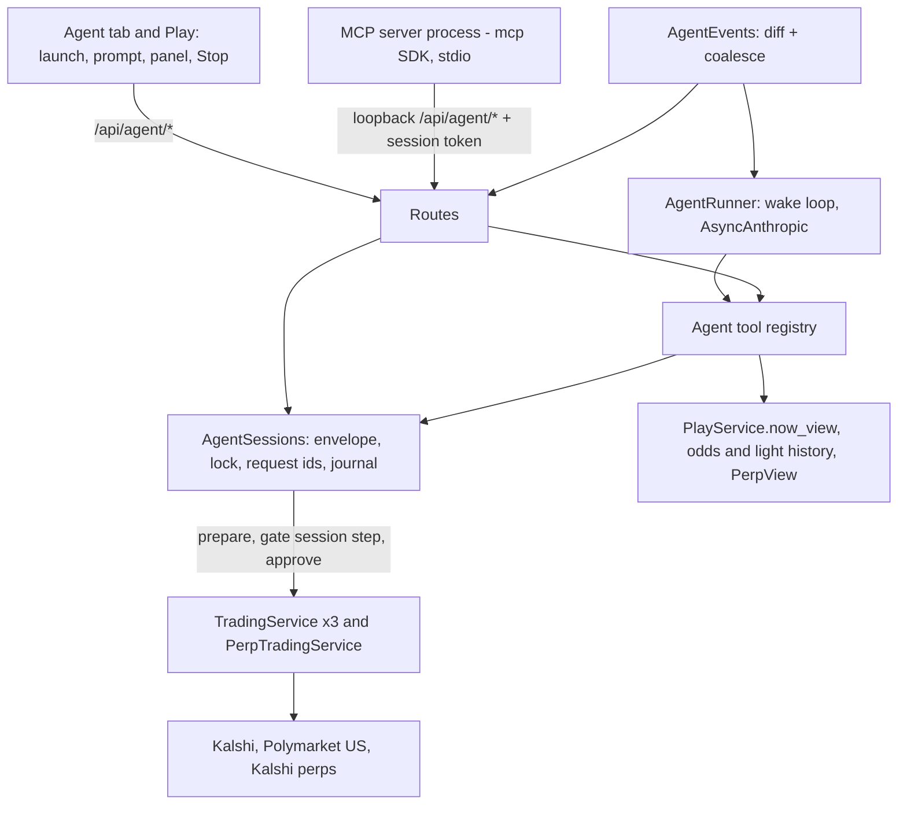
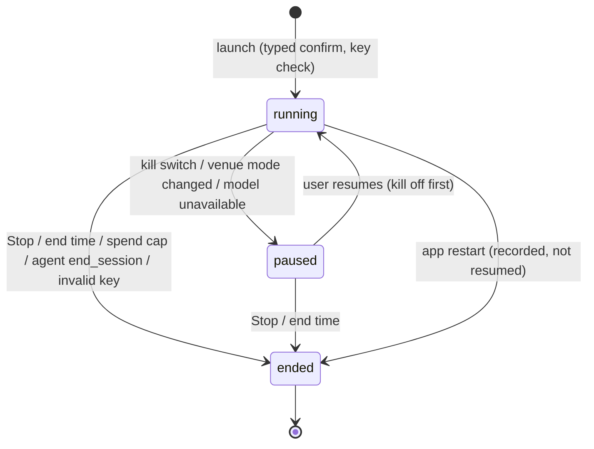
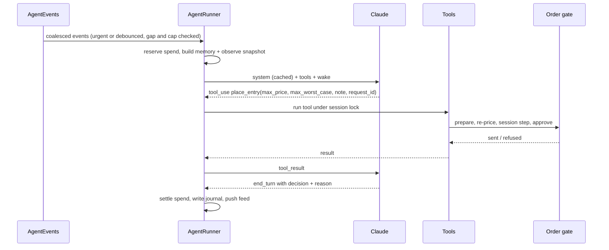

# Agent Mode and MCP Tools - Plan

## Goal Capsule

- **Objective:** The user can start an AI agent from Settleview (PC or phone) that trades their accounts on its own judgment, using the same signals they see, inside limits they set, while they watch every decision live in the app and can stop it at any moment.
- **Means:** bounded agent sessions enforced inside the app's existing order gate (KTD1, KTD3), an event-driven wake loop on the user's own Anthropic key (KTD6, KTD7), and one tool set served in-process to the app's agent and over MCP to outside agents (KTD4, KTD9).
- **Authority:** the user's words in this plan's Key Decisions > R-IDs > KTDs > units. AGENTS.md hard rules still bind every implementer (no real money in tests, never read `.env` or keys, research DBs read-only, no pushes).
- **Stop conditions:** stop and ask if a unit would need an order path that skips `prepare` -> OrderGate -> `approve`, if `pywin32` or `jiter` will not load under Application Control (U1), or if any test would touch the live app on :8000.
- **Execution profile:** Deep. Ten units in four phases; U1-U3 are the foundation and land first.
- **Who finishes:** `ce-work` builds and verifies locally; deploys happen only when the user says "deploy"; the first live session (U10) needs the user's go-ahead in-session.

---

## Product Contract

### Summary

Add an Agent mode beside today's Human mode. The user launches a time-boxed, budgeted agent session from the app, picks a Claude model, edits the system prompt if they like, and the app's agent wakes on market events, reads the same signals the human sees, and decides entries and exits itself. A live panel shows its reasoning, orders, refusals, fills, spend and time left, with Stop. The same tools are served to outside agents (for example Claude Code) through an MCP server built on the official SDK.

### Problem Frame

Settleview is built around a human making every call: an order needs the Play screen open and touched within 3 minutes, and each slide approves a ticket that expires in 10 seconds. The bots and auto-approve sessions were removed on 2026-10-29. The user now wants an agent to trade headless while they observe, using their own Anthropic credits (about $200), with the agent free to use its judgment rather than follow the app's ENTER call. A first attempt at a supervised agent run was refused by the presence gate, which is the gate doing its job: headless trading needs an explicit, audited permission that the user grants and the app enforces, not a workaround.

### Actors

- A1. The user: launches, watches, stops; keeps every risk-raising control (limits, mode, kill resume, prompt edits).
- A2. The in-app agent: a Claude model the app wakes on events, acting through the agent tools inside one session.
- A3. An external agent: any MCP client (for example Claude Code) using the same tools inside a session the user launched for it.

### Requirements

**Sessions and limits**
- R1. The user launches an agent session from the app (PC, or phone behind the typed real-money confirmation), choosing: in-app or external agent, model (in-app only), allowed venues (Kalshi 15m, Polymarket 15m, Polymarket 5m, perps), budget, per-trade cap, end time, API-spend cap (in-app only), perps max leverage and collateral.
- R2. The budget is the most the session may lose: realized net loss plus the worst case of every position the session opened (including ones the user has since taken over) never exceeds it; winnings may fund further trades. A perps position's worst case is the app's existing figure, the whole perps balance plus fees (cross margin); perps therefore fits only while the perps balance is within the remaining budget, and is refused with that reason otherwise.
- R3. The effective limit on every agent order is the strictest of the session limits, the user's trade limits (per-trade, combined daily total), the cash backstop and market protection; the agent can never widen any of them.
- R4. A session ends at its end time, on Stop, when its API-spend cap is reached, when the agent calls `end_session`, when the API key is found invalid, or on app restart; the kill switch, a venue mode change or an unavailable model pauses it, and only the user can resume or end a paused session.
- R5. Stopping or ending never sells positions by default: open agent positions keep their take-profit and stops and are handed to the user in Play, marked as from the agent. A launch option, off by default, sells them at the bid on stop.
- R6. A session pins the trading mode of each allowed venue at launch; if the user switches a venue's mode mid-session, the session pauses with the reason shown.

**What the agent sees and does**
- R7. The agent sees every number the Play and Perps screens show for its allowed venues, computed by the same server code: window and time left, prices, the call and its six lights (1m/5m/15m pressure, market mid, our model, crowd), the BTC gap and range, could-make and could-lose, market worst case and fit, positions with advice, balances, limits, scoreboard, perps view.
- R8. The agent also gets histories the screen draws: the window's odds (Up/Down bid/ask over time) on every venue, the BTC series, and each light's flips this window.
- R9. The agent decides entries and exits on its own judgment; it is not limited to the app's ENTER call.
- R10. Every agent order goes through the same prepare -> OrderGate -> approve path as the slide, re-priced at send time, and is refused if the re-priced ticket exceeds the agent's stated price or worst case; nothing is ever sent past a refusal.
- R11. The agent may manage only positions its session opened; the user can always sell, move take-profit or set stops on agent positions, and a position the user edits becomes the user's.
- R12. Agent perps entries always carry a stop-loss.

**Event-driven decisions**
- R13. The app wakes the agent on events (new window, entry closing, window ending with a position, call or light change, price move, BTC near the strike, exit advice, fill or settlement, order refused, perps risk, limit hit, session ending, a note from the user, an alarm the agent set) and never on every tick.
- R14. Wakes are bounded: one at a time per session, a minimum gap, a per-hour cap, a per-wake tool-turn cap; urgent events still wake at the cap, ordinary ones are recorded as skipped.

**Prompt and model**
- R15. The agent's instructions have two layers, both editable in the app with history and reset: the system prompt (default: the user's text in `docs/agent/default-system-prompt.md`) and a user prompt for further customization (default empty), sent after the system prompt; a session records both versions and the model it ran with.
- R16. The user's Anthropic API key is set in `.env`, is never shown in the app or logs, and the app shows only whether it is present and valid (checked with a cheap call at launch).

**Watching and stopping**
- R17. A live panel shows, per wake: the triggering events, the agent's decision and reason, each tool call and result (refusals included), and the estimated API cost; plus budget used, spend used, wakes used and time left.
- R18. The user can stop the session in one tap from any tab, on PC or phone, at any time; the kill switch pauses it (R4); the user can type a note the agent receives on its next wake.
- R19. Agent orders, refusals and fills are marked as the agent's everywhere they appear (Play, scoreboard, audit), and a paused or ended session leaves a banner until the user dismisses it.

**Outside agents**
- R20. An MCP server built on the official `mcp` SDK exposes the same tools; with no active external session it serves reads only, and its writes act only inside a session the user launched for an external agent.

### Key Decisions

- **Bounded agent sessions bring back unattended trading on purpose.** (session-settled: user-directed — chosen over human-only trading and the 2026-10-29 "no bots" state: the user wants an agent to run headless and be observed.) Governs R1, R4.
- **The agent uses its own judgment.** (session-settled: user-directed — chosen over trading only on the app's ENTER call, the user's earlier rule for the supervised test: "it can go and make the decisions on when to enter, make judgment calls".) Governs R9.
- **Event-driven wakes.** (session-settled: user-directed — chosen over a fixed 30-60 s cadence: "we feed events to the agent and the agent decides".) Governs R13, R14.
- **Launched from the app, prompt editable in the app, bring your own model.** (session-settled: user-directed — chosen over an agent run only from Claude Code: "launchable from the app", "make the prompt editable", "use my Anthropic credits".) Governs R1, R15, R16.
- **The user's system prompt is the default, with a user prompt layer on top.** (session-settled: user-directed — the user supplied the default system prompt and asked for a separate user prompt in the front end over a single editable prompt.) Governs R15.
- **Same signals as the human, including lights and odds.** (session-settled: user-directed — the user asked for the odds and the 1/5/15 lights explicitly.) Governs R7, R8.
- **Off-the-shelf MCP SDK.** (session-settled: user-directed — chosen over a hand-written JSON-RPC server.) Governs R20.
- **First live run risks at most about $20 in roughly $2 trades.** (session-settled: user-approved — chosen over $50 and the full balance.) Governs U10.

### Acceptance Examples

- AE1. Covers R2. Given a $20 budget, $6 realized loss and an open position with $9 worst case, when the agent asks for an entry with $6 worst case, then it is refused ("over the session budget") and nothing is sent.
- AE2. Covers R6. Given a session launched with Kalshi in shadow, when the user switches Kalshi to production, then the session pauses and the panel says why; no agent order reaches production.
- AE3. Covers R10. Given the agent places an entry with max price 62¢, when the ask has moved to 64¢ by send time, then the order is refused with the re-priced numbers and the agent is woken with `order_refused`.
- AE4. Covers R5, R11. Given the agent holds a Kalshi UP position and the user presses Stop, then no sell is sent, the position keeps its take-profit, and Play shows it as "from agent session".
- AE5. Covers R14. Given 200 price ticks in 3 seconds and no position, then at most one wake happens; given an urgent fill during the minimum gap, then a wake happens after the urgent gap.
- AE7. Covers R2. Given a $20 budget with nothing at risk and a perps balance of $8, when the agent opens a perps hedge, then it passes with $8 plus fees counted; given a perps balance of $50, then the entry is refused ("perps balance exceeds the session budget").
- AE6. Covers R20. Given no external session is active, when an MCP client calls `place_entry`, then it is refused ("no agent session") and nothing is prepared.

### Success Criteria

- A one-hour shadow session runs unattended with the panel showing every wake, at a measured cost per hour the launch form can quote back.
- A live session within the ≤$20 envelope places, manages and exits real trades with every fill matching its ticket's worst case, and ends flat or handed back as R5 says.
- Event-loop health holds: no stall over 50 ms attributable to the agent across the shadow hour (`/api/health` loop-lag histogram).

### Scope Boundaries

- Not building: running agents on a schedule; more than one session at a time; non-Anthropic models; any access from outside this PC (MCP is local only); agent-proposed trades that the human approves one by one.
- Never agent actions (enforced for the in-app agent and MCP tools; for an outside agent with a shell, by Claude Code's permissions, KTD9): trading-mode changes, raising limits or widening market protection, resuming the kill switch, adopting a position opened in Kalshi's app, launching, extending or widening a session, editing its own prompt, reading keys.
- Considered and not built: push notifications for paused or ended sessions (persistent banners instead; revisit if a session ends unseen with a position open); separate agent strategies with their own position slots (shared slots are simpler and the refusal is clear, see KTD5; revisit if the user wants both trading the same venue at once).

#### Added after the paper milestone (user, 2026-10-30)

- U11. Telegram (revised 2026-10-30, after Assist and setup lights). One bot, one user.
  - **Transport:** an off-the-shelf Telegram library (python-telegram-bot, async; needs the user's package OK), long polling only (outbound; never a webhook, so nothing is exposed to the internet). Updates older than 60 s are dropped at start. A new adapter `adapters/telegram/` behind an application port `Notifier`/`RemoteControl`; the app runs without it when no token is set (the bot is off, not an error).
  - **Who:** only the paired user in the paired private chat; anything else is ignored and logged. Pairing: the PC's Settings shows a one-time code (10 min); the user sends `/start <code>` to the bot, which stores that user id and chat id; re-pairing or unpairing is PC-only. The token is a `SecretStr` in `.env`, written blind.
  - **Decided by the user (2026-10-30):** package python-telegram-bot approved; Telegram may approve Assist proposals and launch saved presets (with the 60 s confirm); /stop always works.
  - **Alerts (outbound):** Assist proposals; agent fills, exits and settlements; pauses and stops; a session ending with positions open; settlement warnings; and, opt-in, setup lights turning green in Manual ("CUSHION100 ready on Kalshi 15m"). Per-kind on/off in Settings. Quiet by default: trades and proposals only.
  - **Assist approvals:** each proposal arrives with Approve / Skip inline buttons and the same ticket line as the card. Approve calls the same human approve path as the card (OrderGate, session limits, price re-check, TTL); the Telegram user is the human actor for that one approval. Callback data carries the proposal id and a one-time nonce; a tap after expiry or a second tap answers "expired / already handled" and sends nothing. The message is edited in place to show the outcome.
  - **Commands:** /status (session, open positions, budget, net), /stop (always allowed, immediate), /pause, /note <text>, /lights (current setup lights), /launch (from a saved preset only, 60 s confirm button; the preset fixes level, limits, rules, markets and mode). Never over Telegram: resume after a kill-switch pause, raising limits, changing a venue's mode, editing prompts, or reactivating a retired rule — those stay on the PC.
  - **Tests:** a fake Bot transport (tests only): non-allowlisted user ignored, stale updates dropped, approve → gate path with actor recorded, double tap/expired tap sends nothing, /stop always works, forbidden commands refused, no token → bot off.
  - **Container (U12):** the token comes through `env_file`; long polling needs no inbound port.
- U12. Container-ready and platform-neutral (user: "it's not going to run on this laptop forever"). Nothing in Agent mode may depend on Windows or ARM64:
  - the Claude Agent SDK's CLI path is a setting (default: the SDK's bundled CLI or PATH);
  - the existing `Dockerfile` and `compose.yaml` gain the agent runtime (the Claude Code CLI in the image), the agent settings and the Telegram token, all through `env_file`;
  - the data volume holds the journal;
  - the port is still published on 127.0.0.1 only;
  - phones reach a hosted container over a VPN (for example Tailscale), never the open internet;
  - CI builds and smoke-tests the image on linux/amd64 and linux/arm64.

#### Deferred to Follow-Up Work

- Moving `anthropic` to 2.x (new API version) once 2.x is older than two weeks; the code avoids sampling parameters so it is a pin change.
- A LEARNINGS.md review of agent sessions after the first week of use.

---

## Planning Contract

### Key Technical Decisions

- KTD1. **Agent sessions are a gate step, not a new order path.** A session check sits inside `OrderGate.check` (event contracts) and the perps gate, before limits, and replaces the presence check only for that session's own orders while it is running. This follows the removed auto-approve design (`git show 6c3d744^:btc_signal_engine/application/trading.py`: `auto_check`, `grant_unattended`, `_approve_locked(auto=...)`), which is the closest prior art; it is read for reference, not restored. Governs R1, R3, R10.
- KTD2. **Place = prepare + approve in one server call.** Tickets expire in 10 s (`approval_ttl_s`), longer than a model turn, so `place_*` runs `prepare`, checks the agent's `max_price` and `max_worst_case` against the re-priced ticket, then `approve`s it in the same request under one per-session lock. `quote_*` prepares nothing and issues no token. Governs R10.
- KTD3. **One per-session lock and request ids.** Every agent write takes the session's lock (budget checks cannot race across venues) and carries a required `request_id`; a repeated id returns the first result instead of sending again. Governs R2, R10.
- KTD4. **One tool registry in the application layer.** Each tool is defined once (schema, handler, read or write) and called in-process by the in-app agent and through `/api/agent/*` by the MCP server; a parity test checks both return the same JSON. Governs R7, R20.
- KTD5. **Shared position slots and ownership by actor.** Agent orders use the existing strategies (`you`, `you_poly`, `you_poly5`, `perps`) with actor `agent:<8>` (fits `trading_audit.actor` String(16)) and the session id on brackets and audit; one open position per venue remains, so the agent cannot enter a venue while the user holds a position there and vice versa, with a plain refusal. Governs R11, R19.
- KTD6. **Stateless wakes with rolling memory.** No conversation grows across wakes: each wake sends the cached system prompt and tools, a memory block (session limits and usage, last five decisions, the session's trades, its alarms, its notes up to about 1,500 tokens) and the coalesced events with an `observe` snapshot inlined. Cost per wake stays flat. Governs R13, R17.
- KTD7. **Manual async tool loop on `AsyncAnthropic`.** One client created at startup; streaming per turn; no forced `tool_choice` (400 on 5.5 models), strict tool schemas, no sampling parameters, adaptive thinking with effort set per session; cache marker on the last system block plus a second marker on the newest message's last block every turn, so a wake's later turns read the snapshot and earlier tool results from cache; usage summed per turn into estimated dollars; tighter timeout (60 s) and the SDK's two retries. The beta tool runner is not used in a money path. Governs R13, R14, R17.
- KTD8. **API spend is reserved before each model turn.** The turn's worst-case cost (max input estimate plus `max_tokens` output at the model's rate) is reserved against the spend cap, then settled from `usage`; a cancelled or failed turn keeps its reservation. The panel labels spend "estimated". Governs R1, R4.
- KTD9. **MCP runs as a separate stdio process.** `mcp==2.3.0` `MCPServer` in its own process, registered with Claude Code by `claude mcp add --transport stdio --scope project`, calling the app's loopback `/api/agent/*` routes. This keeps MCP work off the trading event loop (50 ms stall budget) and needs no app restart to change. Writes need the external session's token: the user pastes it into Claude Code, which hands it to the server through an `attach_session(token)` tool held in process memory (an environment variable also works at startup, using `${VAR}` expansion so no token lands in `.mcp.json`). Residual risk, named plainly: an outside agent with shell or web-fetch access can call the app on 127.0.0.1:8000 directly and be treated as the human at the PC, bypassing every session limit. The session envelope binds the in-app agent and MCP tools only. For a shell-capable outside agent, the guard is Claude Code's permission settings: run it in default (ask) mode, never auto or bypass mode, and `docs/agent-mode.md` gives a deny rule for Bash and WebFetch calls to `127.0.0.1:8000` and `localhost:8000` that the user may add. Governs R20.
- KTD10. **The key loads as a `SecretStr` setting.** `BTCFLOW_ANTHROPIC_API_KEY` in `Settings` (pydantic-settings does not export `.env` to `os.environ`, and `extra="ignore"` drops unprefixed keys), passed explicitly to `AsyncAnthropic(api_key=...)`; missing or invalid shows "agent unavailable: <reason>" and never falls back. Governs R16.
- KTD11. **Pins.** `anthropic==1.15.0`, `mcp==2.3.0`, `httpx2==2.13.1`, `httpcore2==2.13.1`, `sse-starlette==3.5.0`, plus their pure dependencies at the versions in the framework dossier; nothing published after 2026-10-16; `cryptography` stayed at 46.0.3 then (50.x had no win_arm64 wheel); since 2026-11-01 it is one pin, 50.0.2, on every platform (tests run in the Linux dev container). The SDKs live in `adapters/` and join `.importlinter`'s forbidden list for domain and application. The user approved both packages in this session. Governs R16, R20.
- KTD12. **Panel feed is an append-only list, not the merging hub.** `PushHub` merges top-level fields (newest wins), which would collapse a burst of agent events; the agent stream publishes a bounded `feed` list (last 200 entries) plus a session snapshot. Governs R17.
- KTD13. **Prompt versions in SQLite, defaults in the repo.** The default system prompt is `docs/agent/default-system-prompt.md` (the user's text, verbatim); the default user prompt is empty. Edits to either create versions with history and reset. Order per request: system prompt, then user prompt (both in the cached prefix, so an edit costs one cache write), then the per-wake data. The session envelope and the LEARNINGS facts (Kalshi prices are well calibrated; most rules lose about the cost of trading; compare win % to the price paid) are injected as data each wake, never left to either prompt, so a user edit cannot remove a limit. Governs R15.

### High-Level Technical Design

Components and the order path:

Session lifecycle:

One wake (directional):

### Assumptions

- The Anthropic credits pay for API calls made with a key from the Anthropic Console; the user creates the key and adds it to `.env` themselves.
- Default wake settings (minimum gap 30 s, urgent gap 5 s, 60 wakes per hour, 6 tool turns per wake) give a predictable cost; U6 measures the real cost per hour in shadow and the launch form shows it.

### Sequencing

The first milestone is a one-hour paper-trade session (shadow mode: real order books, simulated sends), reached as early as possible. That means U1, U3 and U4 to U6, plus the launch, stop and stream routes from U7 and a minimal live panel from U9. U2's parity work can follow. Until the paper hour has been reviewed with the user, launch refuses any venue in production mode (session-settled: user-directed — "paper trade mode to start to see how they do for an hour", chosen over going straight to the ≤$20 live run). After that: the rest of U2, U7 and U9, then U8 (MCP), then U10's live run.

---

## Implementation Units

### U1. Dependencies, key setting and layer rules

- **Goal:** the two SDKs install cleanly on this ARM64 machine and the key loads without ever being shown.
- **Requirements:** R16, R20; KTD10, KTD11.
- **Dependencies:** none.
- **Files:** `pyproject.toml`, `btc_signal_engine/bootstrap/config.py`, `.env.example`, `.importlinter`, `tests/test_config.py`.
- **Approach:**
  1. Smoke-test the pinned set in a throwaway venv first (import `mcp`, `anthropic`, `pywin32` modules); stop if Application Control blocks a DLL.
  2. Add exact pins; add `anthropic_api_key: SecretStr | None` and `agent_enabled: bool = False` to `Settings`.
  3. Add `anthropic` and `mcp` to the forbidden imports for domain and application.
- **Execution note:** packaging first; prefer an install and import smoke check over unit coverage; never install into the live deploy checkout's venv without the user's deploy.
- **Patterns to follow:** `perps_enabled` and `polymarket_secret_key` in `btc_signal_engine/bootstrap/config.py`.
- **Test scenarios:**
  - Key set in a temp env file -> `Settings` exposes it only as `SecretStr`; its repr shows no characters of the key.
  - Key absent -> agent reported unavailable with reason "no API key", never an error at startup.
  - `lint-imports` fails if a test module in `application/` imports `anthropic`.
- **Verification:** full pytest and lint pass with the new pins; `python -c "import mcp, anthropic"` works in the project venv.

### U2. Server-side parity: could-make, odds history, light history

- **Goal:** every number the agent needs comes from the server, identical to what the screen shows.
- **Requirements:** R7, R8.
- **Dependencies:** U1.
- **Files:** `btc_signal_engine/domain/strategy/play.py` (could-make and preview math), `btc_signal_engine/application/play.py` (`now_view`), new `btc_signal_engine/application/market_history.py`, `web/views/play.js` (read the server values instead of computing), `tests/application/test_play_parity.py`, `tests/application/test_market_history.py`.
- **Approach:**
  1. Move could-make / could-lose and the book-walk preview (`play.js` `makeLine`, `preview`) into a pure domain function; `now_view` returns them per side and stake; Play renders the server's numbers.
  2. A bounded per-window quote history for every market (Polymarket too, which today only the browser records), fed from the existing market streams, at most one point per second, dropped after the window ends plus one window.
  3. Light history: on each evaluation, record lean flips per light with time and previous lean, for the current window.
- **Patterns to follow:** `PlayService.now_view` read-model style; `/api/coach/series` for the Kalshi odds shape.
- **Test scenarios:**
  - For a fixed book and stake, the domain could-make equals the values the old JS produced on the same inputs (port three cases from current behaviour).
  - Polymarket quotes at 10 Hz -> history keeps at most one point per second; a new window starts an empty history.
  - A light flipping DOWN -> UP -> DOWN within a window yields two flip records with times and prior leans.
  - Play screen shows identical could-make text before and after the change for the same view (web smoke in the test browser).
- **Verification:** Play shows the same numbers as before; `now_view` carries could-make, odds history is available for all three markets.

### U3. Agent sessions, the gate step and the store

- **Goal:** the app can run one bounded agent session whose limits are enforced inside the order gate.
- **Requirements:** R1-R6, R10-R12, R19; KTD1, KTD3, KTD5.
- **Dependencies:** U1.
- **Files:** new `btc_signal_engine/application/agent_sessions.py`, `btc_signal_engine/application/trading.py` (gate session step, presence substitute, session id on brackets and audit), `btc_signal_engine/application/perp_trading.py` (same, plus required stop-loss), `btc_signal_engine/application/actor.py`, `btc_signal_engine/adapters/sqlite/tables.py`, new `btc_signal_engine/adapters/sqlite/migrations/versions/0014_agent.py`, `tests/agent/test_sessions.py`, `tests/agent/test_gate.py`.
- **Approach:**
  1. Migration 0014: `agent_sessions` (limits, pinned modes, prompt version, model, kind in_app|external, token hash, state, end reason, usage counters), `agent_journal` (per wake and per tool call), `agent_prompts` (versions); add `session_id` to perps orders if absent. The legacy `trading_sessions` table stays untouched.
  2. `AgentSessions` owns launch (validates every key strictly, no coercion), the per-session lock, `request_id` memo, budget accounting from rows stamped with the session id (R2), pause and end transitions (state diagram above). Ownership transfer (R11) changes who may manage a position, never whether it counts against the session's budget.
  3. Gate step for actor `agent:*`: session running, venue allowed, pinned mode equals current mode, per-trade and budget fit, ownership for exits; on pass it satisfies presence for this order only. The agent actor is never read from request input: the in-app runner sets the `current_actor` context in-process, and the U7 tool route sets it only after validating the session token. The gate looks the session up by its full id carried in that context, never by the 8-character actor prefix.
  4. Mode change, kill switch and `killed()` from the Coach pause are distinguished in the pause reason.
- **Patterns to follow:** removed `auto_check` / `_auto_review` (reference only); `PlayLimits` strict reading; `_audit` actor stamping.
- **Test scenarios:**
  - Covers AE1. Budget arithmetic: realized loss + open worst case + new worst case over budget -> `over_budget`, nothing sent.
  - Covers AE2. Session pinned to shadow, service switched to prod -> next agent order refused, session paused "Kalshi switched to production".
  - Two concurrent agent entries on different venues that together exceed the budget -> exactly one is sent.
  - Same `request_id` twice -> second returns the first result, one order on the exchange fake.
  - Agent exit on a human-owned bracket -> `not_yours`; human exit on an agent bracket works and ownership becomes the human's.
  - Agent entry with nobody at the screen and a running session -> passes presence; same with the session ended -> `not_present`.
  - Perps agent entry without stop-loss -> refused `stop_required`.
  - Covers AE7. Perps entry under a $20 budget counts the whole perps balance plus fees; a perps balance above the remaining budget -> refused with that reason.
  - User moves the take-profit on a $9 worst-case agent position -> the agent's next entry is still checked with that $9 counted.
  - Launch with venue `"kalshi "` or `"poly"` -> refused as unknown, never coerced.
  - App restart with a running session -> session recorded ended "app restarted"; agent brackets intact.
- **Verification:** all gate refusals carry plain-English reasons; audit rows show `agent:<8>` and the session id.

### U4. Agent tool registry

- **Goal:** one definition of every agent tool, callable in-process.
- **Requirements:** R7-R12; KTD2, KTD4.
- **Dependencies:** U2, U3.
- **Files:** new `btc_signal_engine/application/agent_tools.py`, `tests/agent/test_tools.py`.
- **Approach:** tools and their kinds:

  | Tool | Kind | What it does |
  |---|---|---|
  | `observe` | read | All allowed markets' views (trimmed `now_view`, BTC series downsampled), perps summary, balances, limits, session usage |
  | `get_signals` | read | The six lights now plus this window's flips (U2) |
  | `get_odds` | read | Window odds history for a market (U2) |
  | `get_btc_series` | read | BTC path at a chosen resolution, with range and levels |
  | `get_scoreboard` | read | Recent results, agent-only or all |
  | `get_perps_record` | read | Recent perps fills, funding, closes |
  | `get_journal` | read | The session's past decisions |
  | `quote_entry` / `quote_perp_entry` | read | Full ticket numbers, no token |
  | `place_entry` | write | KTD2 entry with `max_price`, `max_worst_case`, `note`, `request_id` |
  | `place_exit` | write | Sell an own position at the bid |
  | `set_take_profit` / `set_btc_stop` | write | Adjust an own position |
  | `place_perp_entry` / `place_perp_exit` / `place_perp_trigger` | write | Perps equivalents within the session caps |
  | `set_alarms` / `snooze` / `update_notes` | session | Attention and memory (U5, KTD6) |
  | `end_session` | session | Ends the session early; only narrows |

- **Patterns to follow:** existing route handlers in `adapters/http/trading_routes.py` and `perp_routes.py` for argument shapes; strict schemas with `additionalProperties: false`.
- **Test scenarios:**
  - `observe` contains every field Play renders for each allowed market (field-list parity test) and none for disallowed markets.
  - Covers AE3. `place_entry` with `max_price` below the re-priced ask -> refused with the new numbers; exchange fake receives nothing.
  - `place_entry` in shadow mode -> fills on the shadow exchange, journal row written with the note.
  - `quote_entry` leaves no ticket in the service's token store.
  - Unknown tool argument -> schema error, nothing prepared.
- **Verification:** each tool's JSON output is stable and compact (well under 10k tokens for `observe` with three markets).

### U5. Event engine: diff, coalesce, alarms

- **Goal:** the app turns market and account changes into a small number of meaningful wakes.
- **Requirements:** R13, R14; KTD6.
- **Dependencies:** U3.
- **Files:** new `btc_signal_engine/application/agent_events.py`, `tests/agent/test_events.py`.
- **Approach:**
  1. A 1 s LLM-free diff over a compact state per allowed market and the session's positions emits typed events (list in R13), each urgent, normal or low.
  2. Coalescing keyed by (type, venue, span), first-seen and latest values kept; wake when an urgent event waits and the urgent gap has passed, or normal events have settled (3 s quiet, 10 s max) and the minimum gap has passed; never two wakes at once.
  3. Drop rules: no position and entry closed everywhere with only price or light events -> no wake; budget used up with no position -> wait for a new window.
  6. (2026-10-30, after the first live run: second-0 wakes had no quote or strike to decide on.) Wakes follow the window's timing and the session's position per market. Flat: decision points only (`window_ready` once the window has a fresh quote, a strike and a BTC gap; `entry_check` `entry_check_lead_ms`, default 60 s, before the market's entry cutoff, so 3 min before the end on Kalshi 15m), a held flip of the call's side, a large move (10c mid / $150 BTC since the last wake), alarms and urgent events. Holding: fills and closes, Play's advice changing (CONSIDER EXIT urgent, back to HOLD normal), BTC within Play's `near_stop_usd` of the stop (the set one, else Play's ride rule strike -/+ $10; urgent), the take profit near, BTC near or across the strike, the last 90 s (urgent), lights, alarms and price moves at 5c / $100. The call wake is Play's verdict action changing (held 5 s), never an agree-count change. The new window itself no longer wakes. The runner's memory block names what woke the agent and each allowed market's seconds to entry cutoff and to close.
  4. Agent alarms (`btc_above`, `btc_below`, `mid_above`, `mid_below`, `at_time`, `seconds_left_below`; at most 10) and snooze; both clear at session end. Snooze mutes normal and low events only; urgent events always wake.
  5. Events arriving during a running wake queue for the next wake, except urgent ones, which the runner adds to that wake's next tool result as a `new_events` block (U6).
- **Execution note:** pure and clock-injected; build test-first.
- **Patterns to follow:** `bootstrap/stall.py` style of injected clocks; `PerpView.changes` for diffing.
- **Test scenarios:**
  - Covers AE5. 200 price ticks in 3 s with no position -> one wake at most.
  - Covers AE5. Urgent fill 2 s after a wake with a 30 s minimum gap -> wake at 5 s.
  - Wake cap reached -> normal events recorded as skipped, urgent events still wake.
  - `btc_below` alarm fires once and is removed.
  - Snooze until next window -> no wakes until `window_ready`, except an urgent fill, which still wakes.
- **Verification:** a recorded hour of market data replayed through the engine yields a wake count within the cap and a log of why each wake happened.

### U6. Agent runner on the user's Anthropic key

- **Goal:** the app runs the wake loop against Claude, within spend and turn caps, without hurting the event loop.
- **Requirements:** R4, R13-R17; KTD6, KTD7, KTD8.
- **Dependencies:** U4, U5.
- **Files:** new `btc_signal_engine/application/agent_runner.py` (with an `LlmClient` port in `application/ports.py`), new `btc_signal_engine/adapters/anthropic/llm.py`, `btc_signal_engine/bootstrap/app.py` (supervised non-critical task, shutdown drain), `tests/agent/test_runner.py`, `tests/agent/fake_llm.py`.
- **Approach:**
  1. One wake = build memory and wake message, reserve spend, stream turns until `end_turn` or the turn cap, run tools under the session lock, settle spend, write the journal, push the feed.
  2. Handle `refusal` and `max_tokens` stop reasons; overload or rate errors after the SDK retries pause the session with the reason; an invalid key ends it.
  3. Stop cancels an in-flight model call but never an in-flight `place_*` (shielded, as perps `Inflight` does); shutdown drains it.
  4. Model, effort and `max_tokens` come from the session; prices per model live in one table checked against the claude-api reference at build time.
- **Patterns to follow:** `Supervisor.start(name, factory, critical=False)` at runtime; perps `Inflight`; stall detector budget.
- **Test scenarios:**
  - Fake LLM requests `observe` then `place_entry` -> one order on the shadow exchange, journal shows events, decision, tool results and cost.
  - Spend cap reached mid-session -> current wake finishes its tool, session ends "API spend cap", positions handed back.
  - Stop during a model call -> no order, wake recorded as cancelled with its reserved cost.
  - Stop during `place_entry` -> the order completes and is recorded once.
  - Overload error after retries -> session paused "model unavailable".
  - Cached prefix: system and tools serialize byte-identically across two wakes (deterministic order, no timestamps).
  - Turn 2 of a wake sends turn 1's content unchanged with a cache marker on the newest block.
  - An urgent fill during turn 2 of a wake appears as `new_events` in turn 3's tool result.
- **Verification:** a one-hour shadow run with a cheap model shows no loop-lag spike over 50 ms from the agent and a measured cost per hour.

### U7. Agent routes and live stream

- **Goal:** the app exposes launch, stop, status, prompt editing, the live feed and the tool endpoints the MCP server uses.
- **Requirements:** R1, R4, R15, R17-R20; KTD9, KTD12.
- **Dependencies:** U4, U6.
- **Files:** new `btc_signal_engine/adapters/http/agent_routes.py`, `btc_signal_engine/adapters/http/push.py` (append-mode feed), `btc_signal_engine/bootstrap/app.py`, `tests/agent/test_routes.py`.
- **Approach:**
  1. `/api/agent/` launch (typed confirmation; phone allowed only within current limits), stop, resume (PC or typed confirm), status, prompt (get, save version, reset), journal, `stream` (SSE: snapshot + bounded feed), `note`.
  2. Tool endpoints for external sessions: `tools`, `call/<tool>`, `events/wait` (long-poll up to 25 s); writes require the session token header and actor `agent:<8>`; reads work without a session.
  3. Keep `/api/trading/session` and `/api/trading/auto` returning 404 (existing test stays).
- **Patterns to follow:** `perp_routes.py` route table, `PerpPublisher`, `from_pc` for PC-only actions, plain refusals as 200 `{ok:false, code, reason}`.
- **Test scenarios:**
  - Covers AE6. Tool write with no external session -> refused "no agent session"; nothing prepared.
  - Wrong or missing token on a write -> 403; the read still works.
  - A write with a forged actor field or header and no valid token -> 403, nothing prepared.
  - Phone launch with a per-trade cap above the user's limit -> refused.
  - Stream sends the snapshot, then three feed entries pushed within 100 ms all arrive.
  - Prompt save -> new version; reset -> default; a running session keeps its pinned version.
- **Verification:** the routes work against a shadow session end to end with `TestClient`.

### U8. MCP server

- **Goal:** outside agents use the same tools through the official MCP SDK.
- **Requirements:** R20; KTD9, KTD11.
- **Dependencies:** U7.
- **Files:** new `btc_signal_engine/mcp_server/__main__.py`, new `btc_signal_engine/mcp_server/server.py`, `.mcp.json` (project scope, no secrets), `docs/agent-mode.md`, `tests/mcp/test_server.py`.
- **Approach:**
  1. `MCPServer` with one tool per registry entry, generated from the app's `/api/agent/tools` list so schemas never drift; `ToolAnnotations` read-only or destructive; `wait_for_events` maps to `events/wait`.
  2. Loopback base URL only; the session token comes from `attach_session(token)` or the startup environment (KTD9); logs to stderr.
  3. Registration documented: `claude mcp add --transport stdio --scope project settleview -- <venv python> -m btc_signal_engine.mcp_server`, with read tools allowed and write tools left on ask in Claude Code permissions.
- **Patterns to follow:** v2 API only (`from mcp.server.mcpserver import MCPServer`); no `FastMCP` or `get_context()`.
- **Test scenarios:**
  - In-memory MCP client lists the same tool names and schemas as `/api/agent/tools`.
  - Calling `observe` through MCP returns the same JSON as the in-process tool (parity, KTD4).
  - A non-loopback base URL -> the server refuses to start with a clear message.
  - `attach_session` with a valid token -> later writes succeed without a restart; with an ended session's token -> writes refused "session ended".
- **Verification:** Claude Code connects (`/mcp` shows settleview) and can call `observe` against a shadow session.

### U9. Agent tab, launch form, prompt editor and live panel

- **Goal:** the user launches, watches, talks to and stops the agent from the app, and sees agent activity in Play.
- **Requirements:** R1, R5, R15-R19.
- **Dependencies:** U7.
- **Files:** `web/index.html` (Agent tab and panel, Human/Agent indicator), new `web/views/agent.js`, `web/app.js` (`ROUTES`), `web/style.css`, `web/views/play.js` (agent markers, handed-back positions, banners), `tests/web/test_agent_view.py` (or the repo's web test location).
- **Approach:**
  1. Launch form: kind, model with cost-per-hour estimate, venues, budget, per-trade cap, end time, spend cap, perps caps, sell-on-stop toggle (off), shared daily limit shown ("agent may use $X of today's $Y"), typed confirmation; key status line (present and valid, never the key).
  2. Session strip on every tab (Play, Perps, Agent) while a session is running or paused: state, budget used, time left and a one-tap Stop with no confirmation; fits phone width without horizontal scroll.
  3. Live panel: state, budget, spend (estimated), wakes, time left, Stop, note box (notes show "queued" until a wake delivers them, then "delivered at <time>"), feed of wakes (events -> reasoning -> tool calls -> results -> cost). New entries never move the scroll while the user is reading. External sessions show the token once with a copy button and the line "shown once; if lost, end the session and launch again".
  4. Paused panel shows the reason and the one action it allows: kill switch -> Resume disabled until the kill switch is off; venue mode changed -> End session only; model unavailable -> Resume (PC, or typed confirmation on the phone).
  5. States: no key (launch disabled, reason shown), checking key (button busy), no wake yet ("waiting for the first event"), stream lost ("reconnecting, last update N s ago", feed greyed), feed trimmed to the last 200 entries with a note.
  6. Prompt editor with two fields, system prompt and user prompt: version list with time and preview, Restore, unsaved-changes marker with discard confirm, reset to default; while a session runs, "this session uses version N; edits apply to the next session". The launch form shows which versions the session will use.
  7. Play: agent positions and orders marked "agent"; editing an agent position shows "this becomes yours; the agent stops managing it" and the marker changes at once; when the agent holds a venue, the entry slide is disabled with "agent holds this market"; banner for paused or ended sessions and handed-back positions, with an explicit Dismiss.
- **Patterns to follow:** perps view structure and SSE consumer, Settings sheet cards, hi-fi tokens in light and dark, desktop two-column layout, no inline scripts (CSP).
- **Test scenarios:**
  - Launch form rejects an empty end time and a budget of 0 with the server's reason shown.
  - Feed renders a wake with a refusal in the refusal style.
  - Stop button sends stop and the panel shows "ended (stopped by you)".
  - Play shows an agent position with "from agent session" after the session ends.
  - Stop from the strip on the Perps tab ends the session without visiting the Agent tab.
  - Paused by the kill switch -> Resume is disabled with "turn the kill switch off first"; paused by a mode change -> only End session is offered.
  - Stream disconnected -> panel shows "reconnecting" with the age of the last update, never a live-looking feed.
  - Play entry slide on a venue the agent holds -> disabled with "agent holds this market".
- **Verification:** the panel works on the phone and the PC in light and dark themes against a shadow session.

### U10. Default prompt, docs and staged live validation

- **Goal:** the agent ships with a sound default prompt and the user has seen it work, first without money and then within ≤$20.
- **Requirements:** R15, success criteria; Key Decision on the first live run.
- **Dependencies:** U6, U8, U9.
- **Files:** `docs/agent/default-system-prompt.md` (exists; the user's text), `AGENTS.md` (replace "no bots, no auto-approve" with bounded agent sessions through the order gate), `web/index.html` (stale kill-switch note about auto-approve), `docs/agent-mode.md`, `docs/research/LEARNINGS.md`.
- **Approach:**
  1. Default prompt: ship the user's system prompt unchanged as the default (KTD13); check every tool it names exists with that name (it matches U4's list today) and that the runner injects the envelope and LEARNINGS facts as data.
  2. Paper hour: a one-hour unattended session in shadow mode on the default prompt, run as soon as the first milestone (see Sequencing) works. Review the wakes, cost per hour, decisions and simulated P&L with the user before any production session.
  3. Live: with the user's in-session go-ahead, a session of ≤$20 budget and about $2 per trade on the venues the user picks; positions flat or handed back at the end; result row in LEARNINGS.md.
- **Execution note:** no live session without the user's explicit go-ahead in that session; deploy only when the user says.
- **Test scenarios:** Test expectation: none -- prompt and documentation; behaviour is proven by the shadow and live runs.
- **Verification:** shadow and live results recorded in LEARNINGS.md with cost, wakes, trades and P&L.

---

## Verification Contract

| Gate | Command or check | Applies to |
|---|---|---|
| Unit and route tests | `.venv/Scripts/python.exe -m pytest` (check pytest's own exit code) | every unit |
| Layer rules | `.venv/Scripts/lint-imports` (re-run once on a first failure) | U1, U3-U8 |
| Package smoke | import `mcp`, `anthropic` and `pywin32` modules in a throwaway venv, then the project venv | U1 |
| Parity | `observe` vs Play field list; MCP vs in-process tool output | U2, U4, U8 |
| Shadow run | one unattended hour, `/api/health` loop lag, cost per hour | U6, U10 |
| Live run | ≤$20 session with the user's go-ahead; fills vs ticket worst case | U10 |

No test touches the live app on :8000; tests use the shadow exchange, fake venue clients and a fake LLM.

---

## Definition of Done

- Every unit's test scenarios exist and pass; pytest and lint-imports are clean.
- An agent order cannot reach a venue without passing the gate's session step, and every refusal names its reason.
- The shadow hour and the ≤$20 live session are recorded in `docs/research/LEARNINGS.md`.
- AGENTS.md describes bounded agent sessions; no stale auto-approve wording remains in the app.
- No abandoned experiment code remains in the diff.

---

## Risks & Dependencies

| Risk | Mitigation |
|---|---|
| `pywin32` DLLs blocked by Application Control | U1 smoke test in a throwaway venv first; stop and ask if blocked (no MCP SDK version avoids it) |
| Resolver pulls versions under two weeks old or bumps `cryptography` | exact pins for every added package (KTD11) |
| Model latency (10-30 s) inside 5 m windows | `place_*` re-prices at send and enforces the agent's bounds (KTD2); entry-closing events wake early |
| Agent drains the shared daily total | launch form and panel show the agent's share; budget ≤ remaining daily total at launch |
| Positions left unwatched after a session ends | perps stop-loss required (R12), though a gap past the stop can still reach the whole perps balance; hand-back banner (R19); optional sell-on-stop |
| External agent with shell or web-fetch access calls :8000 directly as the PC | KTD9: run external agents in Claude Code's default (ask) mode, never auto or bypass mode; optional deny rule for Bash and WebFetch to `127.0.0.1:8000` / `localhost:8000` in `docs/agent-mode.md`; session limits bind MCP tools and the in-app agent only |
| Perps cross-margin worst case is the whole perps balance | R2 counts it in full, so perps trades only while the perps balance fits the remaining budget (AE7) |
| Model refusals or overload | pause with reason; the session never retries orders on its own |
| The agent has no edge (LEARNINGS: no rule beat the market) | default prompt states it; budgets small; results logged |

## Sources

- Order path and gate: `btc_signal_engine/application/trading.py` (`OrderGate.check`, `_approve_locked`, `present`, `TradingConfig`), `btc_signal_engine/application/perp_trading.py`.
- Prior art: `git show 6c3d744^:btc_signal_engine/application/trading.py` (auto-approve sessions), removal commits `6c3d744`, `08360e4`.
- Signals surface: `btc_signal_engine/application/play.py` `now_view`, `web/views/play.js` (`makeLine`, `preview`, odds pane), `web/views/perps.js` (`perpCall`).
- Limits: `btc_signal_engine/application/play_limits.py` (`PlayLimits`, `CommittedToday`, market band).
- Runtime: `btc_signal_engine/bootstrap/supervisor.py`, `bootstrap/stall.py`, `adapters/http/push.py`.
- External: MCP Python SDK v2 docs (py.sdk.modelcontextprotocol.io: migration, servers/tools, run/asgi), Claude Code MCP docs (code.claude.com/docs/en/mcp), Anthropic SDK and the bundled claude-api reference (models, prompt caching, error codes).
- Research: `docs/research/LEARNINGS.md` (H-LLM inconclusive), `docs/research/llm-trader-loop.md`.
